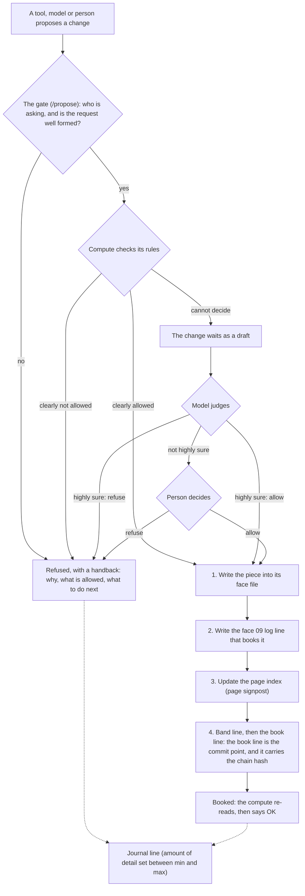
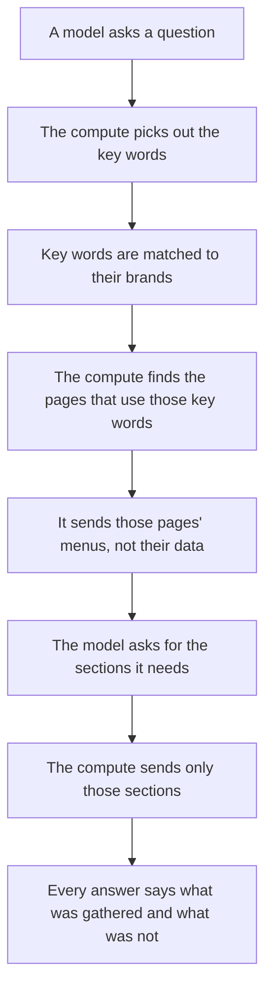

# How the core works and how the tools work: a design spec

state: draft spec, `7` (open), `9` (not trialled). Not a ruling. Nothing here is law.
made: Mon 16 Nov 2026, Designer (design partner for Prima). Director: Matthew, the only approver.
why: Matthew asked for "a design spec for how the rust core is going to work and how the tools work", and said "I want to be able to read it." (t204u, as relayed by Prima; see "Differences" below for where his words are recorded).
built from: docs/design/SEQ-FILE-PLAN.md (at 6daa3a6), docs/design/SECTIONS-AND-CARDS.md (at ab19e04), docs/spec/DIRECTOR-RULINGS.md R26-R37 (R37 at 26a17be), docs/review/CODEX-LIBRARIAN-TOOLS-REVIEW.md (at 65cac98), docs/review/CURSOR-BUILD-REVIEW.md (L1-L7), docs/review/OUR-CODE-VS-CURSOR-LESSONS.md, Tester's R33 fixes (5e63ad8, d85d4f8, a150d03), and the crates/ code at 26a17be. Every claim is cited by file:line. Anything not in a source is marked **NEW (proposal)**.
labels: **EXISTS TODAY** means the code does it now (cited by crates/ path:line). **PLANNED** means a design file or ruling says it should be built, and the code does not do it yet. **NEW (proposal)** means this spec is the first to say it.
does not: edit any other file, change the core, the compute or the kernel, close any open question, or number a ruling. Open questions are proposed answers only. It also does not design how a model is held on task or how its return is checked for drift; that is out of scope here and still needs its own design file, which Prima has not yet assigned (`7`).
changed: Mon 16 Nov 2026, 1:43 PM EST (Designer), revising ad26dab after the two t210u reviews recorded in docs/review/CORE-SPEC-REVIEWS-t210u.md (341a63f). Each point was checked against crates/ and the sources first; see "Change note (t210u)" below. Old commits are not changed; this is a new step on top (axiom 6) [Axioms.md:23].

---

## Change note (t210u, Mon 16 Nov 2026, 1:43 PM EST)

**Why.** Two reviews of ad26dab were recorded word for word in docs/review/CORE-SPEC-REVIEWS-t210u.md (341a63f): Codex (lines 3-13) and a revision brief with 14 points and a build-order question (lines 15-78). The brief's rules (lines 19-24) were followed. No point was taken as true just because it was raised.

**Runtime claims, checked at HEAD 341a63f.** Codex's checkout lacked 26a17be, so it could not check the code (CORE-SPEC-REVIEWS-t210u.md:6). The code is the same at 341a63f as at 26a17be (`git diff 26a17be 341a63f` touches only two docs). In a throwaway copy (`git archive 341a63f`), `cargo test --workspace --offline` gave 418 passed, 0 failed, 2 ignored, at about 1:40 PM EST. That includes Tester's clock tests (`write_dated_before_the_line_above_is_refused`, `boot_refuses_a_book_whose_times_run_backwards`) and Host tests (`wrong_or_missing_host_is_refused`). The cites in Part B and C were re-read at 341a63f and still point at the right lines.

**What changed, by point (held = whether the point was true of the code and sources):**

| Point | Held | Check | Change |
|---|---|---|---|
| 1. Crash recovery across files | yes | today one append, one fsync (crates/compute/src/store.rs:924-975); no directory fsync after a new file (crates/seqaddr-core/src/log.rs:417-423, crates/compute/src/store.rs:936-937); the plan rebuilds signposts from face 09 lines after the last book line [SEQ-FILE-PLAN.md:580], which books a write the caller was never told about | B6 gets a step-by-step recovery table; B4's "halt" now covers only damage, not an unfinished tail; directory fsync added; power loss marked `9` with the test that would clear it; roll back or roll forward asked as K9 |
| 2. A model can allow a write | partly | R35's words do let a model settle a case: "if the model can't solve to a high degree of certainty. then it goes to the person" [DIRECTOR-RULINGS.md:177]; but tokens name a writer, not a model (crates/compute/src/identity.rs:1-9), so "a different model" cannot be checked today | B9 and T7 get a case-type table, the judge-is-not-proposer check, and "the decision is logged as an input"; scope asked as K10 |
| 3. A waiting draft has no base | yes | a proposal has no base fingerprint field (crates/seqaddr-core/src/validate.rs:16-43); `from` checks only a tail state | B9, B15 and K6 now say a draft carries its base and goes stale; a waiting draft never blocks the queue (crates/compute/src/lib.rs:54-67); asked as K11 |
| 4. The gate is optional until the OS lock exists | yes | any local program can write `books/`; a direct append is cut silently at the next compute append (crates/compute/src/store.rs:950-951); a same-length edit is not seen at runtime; boot accepts any file that parses (crates/compute/src/store.rs:270-284); the chain "has no secret" [SEQ-FILE-PLAN.md:546] | said plainly in Part A, B1 and Part D; build order in K8 |
| 5. The read side is thin | yes | `/ask` returns 1-3 cards or a probe, not pages or menus (crates/ask/src/lib.rs:6-16); no menu code exists | new B16 follows one query end to end; drift checking put in the "does not" line |
| 6. The spec grades itself | partly | true for Axioms and Better lines (axiom 9 [Axioms.md:29]); but the Better label was part of Prima's t204u brief ("Every step gets the three checks (axioms, better than now, and person/model/compute)"), so it is kept, relabelled, and its removal asked as K15 | every "Axioms:" is now "Axioms (claim, 9):", every "Better:" is "Better (claim, 9):"; Tester is proposed for the hostile pass |
| 7. Clock step-back | partly | a backwards clock does not produce a bad line: the write is refused 409 before append (crates/compute/src/store.rs:904-913); but writes to that book stay refused until the clock passes the last line, with no raise | B2 item 6 says so; NEW: raise once to the journal and `/health` |
| 8. ASCII only | partly | the ruling exists: R4 [DIRECTOR-RULINGS.md:15]-[DIRECTOR-RULINGS.md:16]; whether "plain" must stay ASCII on face 04 is already open as C13a [SEQ-FILE-PLAN.md:994] | B2 item 7 cites R4 and C13a; no new question |
| 9. Menu stored on face 03 | partly | R35, 2's Read says "a compute-written face 03 menu" [DIRECTOR-RULINGS.md:180]; storing it would be a second piece that can disagree | B10 says how it is booked; stored or derived asked as K12 |
| 10. Journal floor flood | yes | refusals before identity (421, 415, 401) happen before any token check (crates/compute/src/lib.rs:184-192, :297-312) | B14 and K2 summarise unidentified refusals by count |
| 11. build-stage (R2) path | partly | the compute does check: the trial file must exist under docs/trial/ and its author line must not be the maker (crates/compute/src/store.rs:808-828); but the author line is typed text, the trial file's fingerprint is not recorded, and the same model under another token passes | B2 item 4 says so; asked as K13 |
| 12. Delivery id | yes | K4 gave no scope or retention | K4 amended |
| 13. Names and records | partly | DIRECTOR-RULINGS.md never names him; it says "Director" (for example [DIRECTOR-RULINGS.md:4]); no commit in this repo is his (authors: Prima, Designer, Tester, one "t"); in the Librarian repo his account is "Mathias" [CODEX-LIBRARIAN-TOOLS-REVIEW.md:23]. "Matthew" is how the review file and BUILD-LOG name him (CORE-SPEC-REVIEWS-t210u.md:1; BUILD-LOG.md:298), so it is not wrong | a note in "What Matthew said"; verbatim recording asked as K14 |
| 14. Divergence from older files | yes | seqAddr.md:158 (09 unassigned), decisions.md:404 (03 limited), format.md:20 and :60 (one file per book) | new Part D2 lists each with its ruling |
| Build order | a Director choice | | reasons and risks in Part D2; asked as K8 |
| Codex: unverified runtime | checked | above | this note |
| Codex: agrees with K1 | noted | CORE-SPEC-REVIEWS-t210u.md:9 | K1 notes it; still open |
| Codex: B6 recovery, lost reply | yes | as point 1; no delivery id today (crates/seqaddr-core/src/validate.rs:16-43) | B6 table; delivery id and receipt go in the face 09 line |
| Codex: B9 delegation scope | yes | as point 2 | B9 starts with delegated copy-check cases only |
| Codex: Part F cases | yes | Part F had no crash or retry case | Part F gets interrupted-write, lost-reply and reconstruction checks |

---

## Part A. The plain-words overview

This is the one page to read first. Each line is one idea.

**What the core is.** The core is one program. It is the only thing that writes the books. Its side label is "the compute".

**Today that is a rule, not a lock.** Any program on the same machine could still write the files directly. Locking that door is planned (B1).

**Why only one writer.** If two things write the same book, one can wipe out the other. That really happened in our own build: the old book builder erased 8 lines the compute had written (OUR-CODE-VS-CURSOR-LESSONS.md:56-75). Now the builder writes somewhere else (Tester, 5e63ad8).

**How a change gets in.** Every change is a request. A tool, a model or a person sends it to one door. The door's side label is "the gate (/propose)".

**The gate checks first.** It checks who is asking. It checks the request is well formed. It checks the rules.

**Who decides, in order.** First the compute decides by its rules. If its rules cannot decide, a model judges. If the model is not highly sure, a person decides. This order is your ruling (R35). Its side label is "the elevation chain". Which kinds of case a model may settle is still your choice (K10).

**A "no" always says why.** When the gate says no, it says why, what is allowed, and what to do next. Its side label is "a refusal with a handback" (R37, item 8).

**Where a page lives.** Each page is a folder. Each face of the page is one file in that folder. Face 04, the part a person reads, is plain text. The other faces may be compact computer code (R27).

**The page's log.** Face 09 is the page's log. Every change to the page gets one line there (R28). Nothing old is ever rewritten.

**Face 00 is like a registry.** Some of its fields lock forever: the address, the title and the page type. Others may change, such as the list of faces (R36).

**Links.** A link is a page's address plus its title. Following it gives the page as it is now (R32). People only ever see titles; addresses stay in the back end (R31, item 8).

**Signposts.** The compute keeps a small index over the files, so it can find any piece fast. Its side label is "the page index" or "signposts". It is never the real copy; it can always be rebuilt.

**A check number.** Every log line carries a check number built from the one before it. If anything is cut out or copied, the number stops matching. Its side label is "the chain hash".

**Start-up check.** When the compute starts, it checks every book first. Until that check is done, it writes nothing (SEQ-FILE-PLAN.md:541).

**After a crash.** A change that was not finished is set aside, not half-kept. You see the page as it was before. Whether that is the rule is your choice (K9).

**Menus.** A model does not get whole pages dumped on it. It gets a short menu of what is on the page, and asks for the parts it needs (R35, R35 note).

**Books as one file.** We store small files. A whole book as one file is something we export when you want it (R26).

**The journal.** The compute keeps a journal of what it did, with a setting from a minimum to a maximum amount of detail, because we do not yet know how much to capture (R37, item 9).

**The tools.** Tools sit around the core. The compute fills in every number, date, address and check number. The model writes only its judgment (R37, item 3). The tools are listed in Part C.

**What is built today.** The one writer, the gate, the rule checks, the clock check, the Host check and the book files are built. Small files, face 09, signposts, menus, the elevation chain, handbacks and the journal are planned, not built. Part D has the full list.

**What only you decide.** Part E lists the open questions, top three first. Each has a proposed answer, a reason, and the axioms it was checked against.

---

## Part A2. One write, from start to finish (the picture)

This picture shows one write. Plain words are on each box.

How to read it: solid arrows always happen. The model's "allow" arrow applies only to case types you delegate (K10). Dotted arrows go to the journal, whose place and amount are open (K1, K2). Whether a refusal also gets a face 09 line is open (C2, Q8). The write order in steps 1 to 4 is Tester's working path, not a ruling (SEQ-FILE-PLAN.md:496-502).

**Axioms (claim, 9):** 1 [Axioms.md:13] pass: "Compute enforces it. A model works within it." and a person holds final say. 6 [Axioms.md:23] pass: every booked change is a new log line; nothing is rewritten. 8 [Axioms.md:27] pass: "Before a write: authority, missing, connection (`1.7.8`)" is the gate's order. 7 [Axioms.md:25] tension: when the model and the person are both unavailable, the draft waits with no deadline (K6).

**Better (claim, 9):** Better than today, where the gate gives a plain yes or no and cannot hand a hard case to a model or a person (crates/compute/src/store.rs:888-900). Better than Cursor's build, whose record programs skipped its gate (CURSOR-BUILD-REVIEW.md:183). Better than Codex's Brand Clerk, where "the gate only works if the model calls it" (CODEX-LIBRARIAN-TOOLS-REVIEW.md:217).

**Three leads:** Person: sees only what the compute and model could not settle, and has the last word. Model: judges only the hard cases, and says plainly when it is not sure. Compute: owns the door, the rules, the write order and every number.

---

## How to read the rest

Part B is the core, one part per section. Part C is the tools, one tool per section. Part D lists what is built and what is planned. Part E is the open questions. From Part B on, the detail is written for builders.

Every section ends with three checks:

- **Axioms (claim, 9):** each axiom cited by its line in docs/spec/Axioms.md, marked pass or tension.
- **Better (claim, 9):** how it beats today's code, or Cursor's or Codex's approach.
- **Three leads:** what the person, the model and the compute each do.

**These checks are claims, not trials.** The designer wrote them about the designer's own work, and "its maker is the easiest one to convince" [Axioms.md:29]. So each "pass" is marked `9` until another view has tried to break it. NEW (proposal): Tester makes that hostile pass, as for SEQ-FILE-PLAN.md. A "Better" line that cites a measured result says so; the rest are comparisons with cited sources, not measurements. Every "tension" stays. Whether to drop the Better lines is K15.

---

## What Matthew said (quoted from DIRECTOR-RULINGS.md)

Only his recorded words are quoted here. Prima's "Read" lines are the recorded meaning.

A note on names (point 13). DIRECTOR-RULINGS.md never uses his name; it says "Director" and "Director's words" (for example [DIRECTOR-RULINGS.md:4]). No commit in this repo is authored by him. This spec uses "Matthew", as the review file and the build log do (CORE-SPEC-REVIEWS-t210u.md:1; BUILD-LOG.md:298). In the Librarian repo his git account is "Mathias" [CODEX-LIBRARIAN-TOOLS-REVIEW.md:23].

- **R26 (t171u, t175u):** "Yes we can keep small files then have the ability to export books later." and "yes change R3" [DIRECTOR-RULINGS.md:104] [DIRECTOR-RULINGS.md:105].
- **R27 (t171u, t175u):** "It can just be code. for every face other then 04." and "Update R4." [DIRECTOR-RULINGS.md:109] [DIRECTOR-RULINGS.md:110].
- **R28 (t171u):** "agreed 09 is log, we keep a short log in 00 if you think that is a superiour design." [DIRECTOR-RULINGS.md:114].
- **R29 (t171u, t172u):** "A user should be able to modify and change their documents in 04." and "go with Google's approach." [DIRECTOR-RULINGS.md:118] [DIRECTOR-RULINGS.md:119].
- **R30 (t171u):** "We use the seqaddr system. our 2.2.2.4.title we don't include the face its a sub group of the page." [DIRECTOR-RULINGS.md:123].
- **R31, 7 (t184u):** "Well yes, but we should have a type type that contains and orders this. With our reader able to open and see what data is there." [DIRECTOR-RULINGS.md:141]. **R31, 8:** "Titles do, we keep addresses hidden from users it's back end only." [DIRECTOR-RULINGS.md:143].
- **R32, 1 (t191u):** "We don't want to link to exact wordings of a page face. But be linked so the compute can find out about Jim." [DIRECTOR-RULINGS.md:151]. **R32, 2:** "Once the 00 is done it's locked the info might change on the faces but once a page exists and is linked it can only be retired, so the record is there, and not be in active searches." [DIRECTOR-RULINGS.md:153].
- **R33, 1 (t192u):** "Yes, books change through compute not by models. Models can be wrong and having them answer a question correctly 100% of the time can be an issue." [DIRECTOR-RULINGS.md:159]. **R33, 3:** "I agree" (clocks) [DIRECTOR-RULINGS.md:163]. **R33, 4:** "I agree." (Host check) [DIRECTOR-RULINGS.md:165].
- **R34, 1 (t195u):** "yes I think we freeze system pages. They are backend and designed for control not for user to access." [DIRECTOR-RULINGS.md:169]. **R34, 3:** "titles can be reused." [DIRECTOR-RULINGS.md:173].
- **R35, 1 (t197u):** "Yes this is where the elevate comes in. If the comp can't solve according to it's code, it gives it to the model, if the model can't solve to a high degree of certainty. then it goes to the person." [DIRECTOR-RULINGS.md:177]. **R35, 2:** "So instead of the model eating everything it only gets what it needs." [DIRECTOR-RULINGS.md:179].
- **R35 note (t198u):** "Yes the menu is how the compute handles giving information to a model. If a model has a general query about "Jim" for example. The compute might have "jim" as a key word in 4 pages. instead of handing the model all the data in those pages it hands it the menu. So the model can decide what it should request first." [DIRECTOR-RULINGS.md:185].
- **R36 (t200u):** "Ok so on face 00 think of it like windows registry. We have fields that nevere change and lock, like it's address, it's title, it's page type. Others could change. We can have a split on this." [DIRECTOR-RULINGS.md:189].
- **R37 (t204u):** "1. I agree 2. I agree 3. I agree 4. Yes, that is good 5. I agree 6. It's good 7. good 8. good 9. Design with a min and a max, so we can shift the amount of logging we do up or down, we don't really know how much information we should be capturing in a log yet. 10. That is good." [DIRECTOR-RULINGS.md:193]. The ten items he agreed to are listed at [DIRECTOR-RULINGS.md:195]-[DIRECTOR-RULINGS.md:204].

---

## Differences (Prima's brief against the recorded words)

1. **t204u.** The brief quotes t204u as "Now I want you to get designer to turn make a design spec for how the rust core is going to work and how the tools work. I want to be able to read it." That sentence is not in DIRECTOR-RULINGS.md. The only t204u entry there is R37's ten answers [DIRECTOR-RULINGS.md:192]-[DIRECTOR-RULINGS.md:193]. So the request is quoted here as relayed by Prima.
2. **The journal.** The brief says R37 includes "the journal with min and max logging levels". That matches item 9. But R37 also says "Where it lives (face 09 or a system log) is still open" [DIRECTOR-RULINGS.md:203], and his words add "we don't really know how much information we should be capturing in a log yet" [DIRECTOR-RULINGS.md:193]. Both are kept open here (K1, K2).
3. **Menus.** The brief says "the model gets the menu, not the data". His words are about "a general query" [DIRECTOR-RULINGS.md:185], and R35, 2 is about one long page [DIRECTOR-RULINGS.md:179]. Using menus for every read, including a direct link, is NEW here and asked as K3.
4. **Elevation.** The brief lists the elevation chain as a core part. His R35 words answer the copy-check question ("Refuse or flag copies") [DIRECTOR-RULINGS.md:177]. Using the same order for every undecided case in the gate is NEW here (Part B, B9). "Highly certain" is still open (Q7).
5. **Boot check.** The brief says "reads are marked 9 until it is done". That is the file plan's proposal [SEQ-FILE-PLAN.md:541], not a ruling. Today's compute does not answer at all until boot ends: it boots, then binds its port (crates/compute/src/main.rs:59-79). Asked as K5.
6. **Page index.** The brief says "page index" (Prima's word, R31, 9 and R32, 3). SEQ-FILE-PLAN.md calls it the "page signpost" [SEQ-FILE-PLAN.md:467]. They are the same thing; this spec uses "page index" in plain words and "page signpost" in builder text.
7. **Codex review on R36.** The review says "R36, open fields in face 00 are written only by the compute" [CODEX-LIBRARIAN-TOOLS-REVIEW.md:361]. R36's recorded words do not say who writes open fields [DIRECTOR-RULINGS.md:189]-[DIRECTOR-RULINGS.md:190]. "Compute only" is the file plan's proposal (C28, C29 [SEQ-FILE-PLAN.md:948] [SEQ-FILE-PLAN.md:954]).
8. **Tester's commit times.** 5e63ad8, d85d4f8 and a150d03 show "11:19 -0600". That is 12:19 PM EST.

Added for the t210u revision (Prima's message against docs/review/CORE-SPEC-REVIEWS-t210u.md):

9. **t210u is not in DIRECTOR-RULINGS.md.** The reviews are recorded only in the review file (CORE-SPEC-REVIEWS-t210u.md:1).
10. **Prima's list of Codex points leaves out two.** It omits Codex's B9 point, to start model judgment with explicitly delegated copy-check cases and check the evidence before booking (CORE-SPEC-REVIEWS-t210u.md:12), and the B6 detail that "the delivery ID and receipt must be recoverable from the commit" (CORE-SPEC-REVIEWS-t210u.md:11). Both are handled here (B6, B9).
11. **Point 13.** Prima asks only how the rulings and the commit author name the Director. The file also asks to "Propose how a relayed instruction is recorded verbatim before it is passed on" (CORE-SPEC-REVIEWS-t210u.md:68). That is K14.
12. **Build order.** The file asks for "your reasons for or against, with what each order risks" (CORE-SPEC-REVIEWS-t210u.md:73); Prima's message adds "Do not decide it". Both are followed: Part D3 and K8.
13. **Quoting the review file.** Codex's text uses curly apostrophes, which are not ASCII. Quotes from it here use plain apostrophes.

---
## Part B. The core (the compute)

### B1. One writer, one queue

**In plain words.** Only one program writes the books. Every change waits its turn in one line.

**EXISTS TODAY.** The compute starts one writer task. Every write (propose, a `.seq` page, ask/link, close) goes through one queue, in order (crates/compute/src/lib.rs:30-70). The store module says "Only this module writes book files." (crates/compute/src/store.rs:1-2). The spec rule is "Only the compute writes to disk." [format.md:18]. Each request gets a queue id, kept on disk in `.queue` so ids never repeat after a restart (crates/compute/src/store.rs:735-753).

**EXISTS TODAY (R33, 1).** The kernel builder no longer writes `books/`. It writes `export/` and refuses to run if its output is inside `books/` (Tester, 5e63ad8; kernel/build.mjs:20-22, :31).

**PLANNED.** Only the compute's own OS account may write the stored folder; others get read-only access, and the compute holds an OS file lock [SEQ-FILE-PLAN.md:594]-[SEQ-FILE-PLAN.md:596]. Not built (build gap [SEQ-FILE-PLAN.md:1086]).

**Until then, the gate is optional (point 4, held).** Any program with a shell on the box can write `books/` directly. That is the same fault this spec holds against Brand Clerk, "the gate only works if the model calls it" (CODEX-LIBRARIAN-TOOLS-REVIEW.md:217). What notices a direct write today (EXISTS TODAY):

- A file **shorter** than the compute wrote is refused at the next write (crates/compute/src/store.rs:947-948).
- A file **longer** than the compute wrote has the extra bytes cut at the next write, with no report (crates/compute/src/store.rs:950-951). So a direct append is erased, not detected.
- An edit that keeps the same length is not noticed while the compute runs.
- At boot, any book that parses is loaded (crates/compute/src/store.rs:270-284). Nothing tells a direct write from a compute write.

What will prevent it (PLANNED): the OS account and file permissions [SEQ-FILE-PLAN.md:596], and refuse-not-cut at runtime [SEQ-FILE-PLAN.md:592]. The chain hash will not: it "has no secret", so a process that can write the files can also rewrite the chain [SEQ-FILE-PLAN.md:546]. Only the OS permission stops that. A keyed chain would not help while the key sits on the same machine under the same account (NEW, not proposed). Where this sits in the build order: K8 proposes it first, because it is small and every later proof depends on it.

**Axioms (claim, 9):** 1 [Axioms.md:13] pass: "Compute enforces it." 6 [Axioms.md:23] pass: one writer cannot erase another's lines. 3 [Axioms.md:17] pass: storage is compute-led work.

**Better (claim, 9):** Better than our own build before 5e63ad8, where two writers existed and "the builder wins" (OUR-CODE-VS-CURSOR-LESSONS.md:74-75). Better than Cursor, which checked on a copy and wrote later with no lock (CURSOR-BUILD-REVIEW.md:137).

**Three leads:** Person: never edits stored files by hand. Model: sends requests, never files. Compute: the only writer, in strict order.

---

### B2. The gate (/propose)

**In plain words.** The gate is the one door for every change. It checks who you are, that the request makes sense, and the rules.

**EXISTS TODAY.** In order:

1. **Host check (R33, 4).** A request whose Host header is missing or not the compute's own address is refused with 421 before any route runs (crates/compute/src/lib.rs:273-312; Tester, a150d03).
2. **Media type.** Only `application/json` or `text/x-seqpage`; anything else is refused 415, so a cross-site form cannot post (crates/compute/src/lib.rs:184-188).
3. **Identity.** Every write carries a token; the body's `by` is ignored (crates/compute/src/lib.rs:85-97; crates/compute/src/store.rs:730-734; crates/compute/src/identity.rs:73).
4. **Seat approval (R2).** Seating a face needs `approved_by: director` from the Director's own token, or `build-stage (R2)` with a hostile trial; otherwise 403, axiom 1 (crates/compute/src/store.rs:851-883). **Who checks the trial (point 11):** the compute checks that the trial names a file under `docs/trial/`, that the file exists, and that its first `Lane NAME` or `author: NAME` line is not the face's maker (crates/compute/src/store.rs:808-828). The record is the entry's `approved_by` and `trial` fields (crates/seqaddr-core/src/validate.rs:33-38). Gaps: the author line is typed text, not tied to a token; the trial file's fingerprint is not recorded, so the file can change after the seat; and the same model under a second token name would pass. R2 asks for "a hostile trial (axiom 9) from a different view than its maker" [DIRECTOR-RULINGS.md:9]. Asked as K13.
5. **The core's rules.** `validate` checks the proposal against the current world (crates/compute/src/store.rs:884; crates/seqaddr-core/src/validate.rs:151). A refusal maps to 409 conflict, 404 missing, 422 invalid, or 409 elevate (crates/compute/src/store.rs:888-900).
6. **Clock (R33, 3).** A line dated earlier than the line above is refused 409 "clock" (crates/compute/src/store.rs:904-913; crates/seqaddr-core/src/log.rs:229-245; Tester, d85d4f8). **If the system clock steps back (point 7):** the compute stamps `at` itself (crates/compute/src/store.rs:737), so every write to that book is refused before append, and no bad line is written; boot is not affected. But writes stay refused until the clock passes the last line, and nobody is told except each caller. NEW (proposal): on the first clock refusal, raise it once in the journal and in `/health`, and keep refusing; never re-stamp a line with a made-up time.
7. **Plain text.** Every entry is checked for plain ASCII before append (crates/compute/src/store.rs:929-931; crates/seqaddr-core/src/log.rs:140). This rests on R4: "Remove accented letters from being used. We want a simple storage design for now. So limited characters is fine." [DIRECTOR-RULINGS.md:15]; its Read says it "may widen later" [DIRECTOR-RULINGS.md:16]. R27 changed which faces must be readable, not the character set [DIRECTOR-RULINGS.md:111]. Whether face 04 must stay ASCII is already open as C13a [SEQ-FILE-PLAN.md:994] (point 8).

**PLANNED.**

- The copy check becomes a refusal, then elevation (R35, 1; SECTIONS-AND-CARDS.md:184-203). Today a 04 card that copies its 01 body is only a finding (crates/seqaddr-core/src/validate.rs:440-441), and Tester showed such copies get seated (OUR-CODE-VS-CURSOR-LESSONS.md:18-20).
- Every refusal carries a handback (B12).
- **Delivery id (R37, 2).** "A return and its next step are saved together, and a delivery id can't change its content." [DIRECTOR-RULINGS.md:196]. NEW (proposal): the caller sends a delivery id with each proposal; the same id with the same content gets the first answer back and writes nothing new; the same id with different content is refused. Asked as K4.
- **Receipt (F6).** The gate's answer names the content fingerprint, the actor and the pack, written by the compute (CODEX-LIBRARIAN-TOOLS-REVIEW.md:224).

**Axioms (claim, 9):** 1 [Axioms.md:13] pass: "Authority is granted, never claimed"; the token, not the body, names the writer. 8 [Axioms.md:27] pass: the gate runs authority, missing, connection before a write. 9 [Axioms.md:29] pass: seating needs a hostile trial (R2). 2 [Axioms.md:15] tension: the copy refusal must not hit inherited text (OUR-CODE-VS-CURSOR-LESSONS.md:222-223).

**Better (claim, 9):** Better than Cursor's open server ("Access-Control-Allow-Origin: *", CURSOR-BUILD-REVIEW.md:138). Better than Brand Clerk, whose receipt "binds no content and no actor" and whose gate is optional (CODEX-LIBRARIAN-TOOLS-REVIEW.md:217). Better than today once copies are refused, not noted.

**Three leads:** Person: grants tokens and approvals; never types times or names. Model: sends a proposal and reads the answer. Compute: runs every check, in a fixed order, and fills `by` and `at` itself.

---

### B3. Storage: one folder per page, one file per face

**In plain words.** A page is a folder. Each face is one file inside it. Face 04 is plain text. Other faces may be compact code.

**Ruling.** R31, 7: "one folder per page and one file per face, plus a type, written in face 00, that holds and orders the face files." [DIRECTOR-RULINGS.md:142]. R27: only face 04 must be readable [DIRECTOR-RULINGS.md:111].

**EXISTS TODAY.** Not this layout. Today each book is one JSON Lines file, an append-only log, header on line 1 (crates/seqaddr-core/src/log.rs:1-4). The compute loads every book at boot and serves from memory (crates/compute/src/store.rs:233-309).

**PLANNED.** The page folder holds one file per face that exists; face 04 as plain text with its small-change log and full copies (Step 17); face 09 as the page log [SEQ-FILE-PLAN.md:253]. Face 04 edits are small changes plus a full copy now and then (R29 [DIRECTOR-RULINGS.md:120]). A hand edit to face 04 made outside the compute is never booked by itself; it stays a draft until a person takes it in or discards it [SEQ-FILE-PLAN.md:927]-[SEQ-FILE-PLAN.md:930]. Folder and file names are built from the address and are back end only [SEQ-FILE-PLAN.md:274]. A write across several pages needs a compute-only book journal, so it lands all or nothing [SEQ-FILE-PLAN.md:253] [SEQ-FILE-PLAN.md:554]. NEW (proposal, point 1): when the compute makes a new page folder or face file, it fsyncs the parent directory before writing the face 09 line. Today it does not: a new book file is fsynced, but its folder is not (crates/seqaddr-core/src/log.rs:417-423; crates/compute/src/store.rs:936-937).

**Axioms (claim, 9):** 2 [Axioms.md:15] pass: the same shape at every scale. 3 [Axioms.md:17] pass: one face per lead. 6 [Axioms.md:23] pass: pieces are added, never overwritten [SEQ-FILE-PLAN.md:586]. 9 [Axioms.md:29] tension: Tester's prototype is throwaway; the layout is untried in the real compute.

**Better (claim, 9):** Better than one big file: a write touches only its own file, and git shows exactly what changed [SEQ-FILE-PLAN.md:278]. Better than Cursor's single file that "replays the whole book" on every read (CURSOR-BUILD-REVIEW.md:105). Where we fall short: 3 to 7 times more disk for small files [SEQ-FILE-PLAN.md:278].

**Three leads:** Person: opens a page and sees its faces by title. Model: asks for one face or one section, never the folder. Compute: owns the folder, names the files, and writes each piece.

---

### B4. The page log (face 09)

**In plain words.** Every change to a page gets one line in face 09. The line says who, when, what and why. Face 00 keeps no log.

**Ruling.** R28: "agreed 09 is log" [DIRECTOR-RULINGS.md:114]. A short log in 00 is allowed only if better; the plan says no [SEQ-FILE-PLAN.md:459]-[SEQ-FILE-PLAN.md:465].

**EXISTS TODAY.** Not yet. The core still treats face 09 as reserved: only faces 00-06 and 08 are active (crates/seqaddr-core/src/face.rs:72-75), and a write to face 09 is refused (crates/seqaddr-core/src/validate.rs:229-234). Today a page's history is worked out from the book log (crates/seqaddr-core/src/log.rs:365; crates/compute/src/store.rs:542).

**PLANNED.** One line per approved write: entry number, time, who, operation, address, proposal, reason [SEQ-FILE-PLAN.md:453]. Written only by the compute; nobody proposes to face 09; the log never logs itself [SEQ-FILE-PLAN.md:453]. Each line names the face piece it books, with its length and fingerprint [SEQ-FILE-PLAN.md:552]. If face 09, the page index or the "last change" note ever disagree, the compute halts and raises it [SEQ-FILE-PLAN.md:473]. NEW (proposal, point 1): this halt applies only to records that the last book line already covers. Pieces and lines written after the last book line are an unfinished write, not a disagreement, and follow the recovery rule in B6. Without this, every crash between steps 2 and 4 would halt the compute. Copy-check steps get lines (Q8 [SECTIONS-AND-CARDS.md:246]). Whether plain refusals get lines is open (C2 [SEQ-FILE-PLAN.md:1006]).

**Person notes stay apart.** Face 06 holds model notes; face 09 says what happened (L7 [CURSOR-BUILD-REVIEW.md:188]; [SEQ-FILE-PLAN.md:457]).

**Axioms (claim, 9):** 6 [Axioms.md:23] pass: "A change that is not recorded did not happen." 2 [Axioms.md:15] pass: one log, no copy in face 00. 1 [Axioms.md:13] pass: a disagreement is raised, not chosen.

**Better (claim, 9):** Better than Cursor, which kept page history in face 06 notes (CURSOR-BUILD-REVIEW.md:132). Better than replaying a whole book to see one page's past.

**Three leads:** Person: one place to see what happened to a page, in time order. Model: reads the log before drafting, so it builds on the real past [SEQ-FILE-PLAN.md:479]. Compute: appends one line per write and halts on any mismatch.

---

### B5. The page index (signposts) and the chain hash

**In plain words.** The page index says where each piece sits, so the compute can jump straight to it. The chain hash is a check number that links each line to the one before.

**Ruling.** R32, 3: "face 00 holds the page type and its face list. Where each face sits is kept in the page index, so face 00 doesn't change on every write." [DIRECTOR-RULINGS.md:156].

**EXISTS TODAY.** No signposts and no chain hash. The compute keeps each book's length in memory and refuses a file shorter than it wrote (crates/compute/src/store.rs:944-949).

**PLANNED.**

- **Page index.** One page signpost per page, and band and book signposts above it [SEQ-FILE-PLAN.md:496]-[SEQ-FILE-PLAN.md:502]. It can always be rebuilt from the logs; it is never the real copy [SEQ-FILE-PLAN.md:18]. It also records where each section and card starts, so one section can be opened alone [SECTIONS-AND-CARDS.md:111]. It holds a "last change" note (held 7 by R31, 9 [DIRECTOR-RULINGS.md:146]; C24).
- **Chain hash.** chain = SHA-256(previous chain + new bytes) [SEQ-FILE-PLAN.md:533]. Each page's log starts from seed = SHA-256("page" + book birth id + page address), so a page copied to another number fails [SEQ-FILE-PLAN.md:551]-[SEQ-FILE-PLAN.md:556]. The book chain covers every page's latest log line [SEQ-FILE-PLAN.md:553].
- **File fingerprint.** A stored face file's fingerprint is its git blob id, so a person can check it with git [SEQ-FILE-PLAN.md:534].
- **Limits.** The chain has no secret; it catches damage, not a forger [SEQ-FILE-PLAN.md:546]. A byte-exact copy of a whole book at the same address is not caught [SEQ-FILE-PLAN.md:556].

**Axioms (claim, 9):** 8 [Axioms.md:27] pass: "a menu, a copy or a link never becomes what it points to"; the index points, the logs govern. 1 [Axioms.md:13] pass: "A draft, a copy, or a memory does not outrank" the live record. 9 [Axioms.md:29] pass: checked before trusted. 7 [Axioms.md:25] pass: a damaged signpost is missing, not guessed [SEQ-FILE-PLAN.md:602].

**Better (claim, 9):** Better than today, where "nothing inside a book says this line is intact except that it parses" [SEQ-FILE-PLAN.md:564]. Better than Codex's clerk lab only in scale; it is the same idea: a hash-chained record, and views rebuilt from it (CODEX-LIBRARIAN-TOOLS-REVIEW.md:136-137; R37, 1 [DIRECTOR-RULINGS.md:195]).

**Three leads:** Person: can check a fingerprint with git, without trusting the compute. Model: cites a version by address plus fingerprint, never by commit id [SEQ-FILE-PLAN.md:566]. Compute: keeps the index, the chain, and the memory copy of each file's length and last chain.

---

### B6. The write order and the commit point

**In plain words.** A write happens in a fixed order. It only counts once the last step is done. A crash before that leaves nothing half-booked.

**EXISTS TODAY.** All or nothing per proposal; whole lines appended at the known end; one fsync (crates/compute/src/store.rs:924-975). A partly written last line is dropped on load (crates/seqaddr-core/src/log.rs:282-300). Memory is updated only after the file write succeeds (crates/compute/src/store.rs:914-921).

**PLANNED (Tester's working path, not a ruling).** 0: hold the OS lock and check each file against memory. 1: the face piece, fsynced. 2: the face 09 line that books it, fsynced. 3: face 04 only, the current-view file, after the 09 line. 4: page signpost, band line, book line. "The book line is the commit point" [SEQ-FILE-PLAN.md:496]-[SEQ-FILE-PLAN.md:502]. After the fsync the compute re-reads length and chain; only then does it say "booked" [SEQ-FILE-PLAN.md:597].

**Fix still to build.** Today a file longer than expected has its extra bytes cut at every append (crates/compute/src/store.rs:950-951). The plan: refuse at runtime; cut only during the start-up repair [SEQ-FILE-PLAN.md:592].

**Recovery after a crash, step by step (NEW, proposal; points 1 and Codex B6; untried, `9`).** The rule: a write exists only if the last book line covers it. Everything after the last book line is an unfinished write. It is never booked at boot. It is moved aside into a recovery folder, kept, and listed in the journal, so nothing is lost and nothing old is rewritten. Readers always see the last committed page. This differs from the file plan, which rebuilds signposts from face 09 lines after the last book line [SEQ-FILE-PLAN.md:580] and so would book a write whose caller was never told "booked". Roll back (this proposal) or roll forward (the plan) is K9.

| Crash after | On disk | What boot does | What the caller was told |
|---|---|---|---|
| step 0 (lock and check) | nothing new | nothing to do | nothing (no reply); it retries with the same delivery id |
| step 1 (face piece) | a piece no face 09 line names | moves the piece aside; journal line | nothing; retry |
| step 2 (face 09 line) | piece and 09 line, no book line | checks the 09 line's length and fingerprint against the piece; moves both aside; journal line | nothing; retry |
| step 3 (face 04 view) | as step 2, plus a new current-view file | rebuilds the view from the last committed 04 change; moves the new view aside | nothing; retry |
| step 4a (page or band line) | as above, plus signpost lines after the last book line | drops those signpost lines as an unfinished tail [SEQ-FILE-PLAN.md:580]; moves the piece and 09 line aside | nothing; retry |
| step 4b (book line written, before re-read) | a complete committed write | keeps it; it is booked | maybe nothing (the reply was lost); the retry with the same delivery id gets the original answer back (K4) |

**How boot tells an unfinished write from damage.** Unfinished: only at the tail, after the last book line, in write order, and each piece matches the length and fingerprint its own 09 line names (or has no 09 line yet). Damage: any mismatch in records the last book line covers, any gap in the chain, or a tail out of write order. Damage halts and is raised [SEQ-FILE-PLAN.md:545].

**Which records prove a commit.** The book line, whose chain covers each band line, each page's latest 09 line, and through them each piece [SEQ-FILE-PLAN.md:552]-[SEQ-FILE-PLAN.md:553]. NEW: the face 09 line also carries the delivery id and the receipt fingerprint, so a lost reply can be answered from the commit itself (Codex, CORE-SPEC-REVIEWS-t210u.md:11).

**Face 04 view (Codex).** At runtime, readers are served from memory, and memory changes only after the write is booked (today: crates/compute/src/store.rs:914-921). At boot, the current-view file is trusted only if its fingerprint matches the latest committed 04 change; otherwise it is rebuilt from the log. A view newer than the log that no unfinished write explains is a hand edit and stays a draft [SEQ-FILE-PLAN.md:927].

**Power loss stays `9`.** Tester's crash tests used kill -9, which "is not a power cut" [SEQ-FILE-PLAN.md:604]. What would clear the mark (NEW): a test that hard-resets a virtual machine at random points during a loop of writes, many times, then boots and finds only committed writes or cleanly set-aside tails, and no halt from an unfinished write. It must run on a disk that honours fsync (D431 [SEQ-FILE-PLAN.md:572]).

**Axioms (claim, 9):** 6 [Axioms.md:23] pass: "add the new step after it." 1 [Axioms.md:13] pass: an outside change is refused and raised. 9 [Axioms.md:29] tension: kill -9 "is not a power cut"; power loss is untested [SEQ-FILE-PLAN.md:604].

**Better (claim, 9):** Better than Cursor, which used flush without fsync (CURSOR-BUILD-REVIEW.md:136). The worst case is a full replay, "exactly as today", so never less safe [SEQ-FILE-PLAN.md:584].

**Three leads:** Person: told plainly if a write did not book. Model: gets "booked" or "not booked", never a maybe. Compute: follows the order, and recovers by it after a crash.

---

### B7. Face 00: locked fields and open fields

**In plain words.** Face 00 is the page's registry card. Some fields lock forever. Others may change, and each change is logged.

**Ruling.** R36: locked fields "(address, title, page type, and any others named later) are set once and never change. Open fields may change, so R25's records on 00 can continue." [DIRECTOR-RULINGS.md:190]. R32, 2: "Once the 00 is done it's locked" applies to the locked fields [DIRECTOR-RULINGS.md:190].

**EXISTS TODAY.** The core reads face 00's stamp, including `title` and `type` (crates/seqaddr-core/src/cards.rs:147-160). The `.seq` reader checks face 00 fields by type (crates/seqpage/src/face00.rs:133-213). Nothing locks a field yet.

**PLANNED (our proposed split, still open as C28).** Locked: address, title, type, plus `level`, page 0000's `parent`, a pointer page's `kind`, a band page's `role`, and a book's birth id. Open, changed only by the compute as a logged step: `state`, `why-draft`, `faces` (with R25's seat records), `why-NN`, `axioms`, `lineage`, and the other per-type fields [SEQ-FILE-PLAN.md:948]. Whether a linked system page's open fields may change is C29 [SEQ-FILE-PLAN.md:952]-[SEQ-FILE-PLAN.md:956]. The gate refuses any change to a locked field [SEQ-FILE-PLAN.md:862].

**How an open field changes.** The old face 00 fingerprint goes on the 00 counter first, then the change, then a face 09 line (R25 [DIRECTOR-RULINGS.md:101]; [SECTIONS-AND-CARDS.md:144]).

**Axioms (claim, 9):** 1 [Axioms.md:13] pass for the three fields he named; tension for the rest until C28 is answered. 6 [Axioms.md:23] pass: an open change is a new step, the old value kept. 8 [Axioms.md:27] pass: links rely only on locked fields.

**Better (claim, 9):** Better than locking all of face 00, which would stop a page gaining a face or being retired. Better than Cursor, whose face 00 "is a stamp only" (CURSOR-BUILD-REVIEW.md:131).

**Three leads:** Person: sees the title and type; never the address (R31, 8). Model: proposes open-field changes only through the gate. Compute: refuses locked-field changes and writes every open-field change as a logged step.

---

### B8. Links

**In plain words.** A link is a page's address plus its title. It always opens the page as it is now. A linked page can never be deleted, only retired.

**Rulings.** R30: "our 2.2.2.4.title we don't include the face" [DIRECTOR-RULINGS.md:123]. R32, 1: "following it gives the current page. Old versions stay in the log" [DIRECTOR-RULINGS.md:152]. R32, 2: a linked page "can only be retired" [DIRECTOR-RULINGS.md:153]. R34, 3: titles may be reused [DIRECTOR-RULINGS.md:174].

**EXISTS TODAY.** Lookup walks book, shelf, desk, kernel; the first match wins (crates/seqaddr-core/src/resolve.rs:1-3, :223). A title written in an address is checked against face 00; a mismatch is elevated (crates/seqaddr-core/src/resolve.rs:292-305). Not found is elevated to the user, never guessed (crates/seqaddr-core/src/resolve.rs:140). Several active pages: "ask the user which one" (crates/seqaddr-core/src/addr.rs:657-665). Links are read at `/links/:addr` (crates/compute/src/store.rs:581).

**PLANNED.** The compute follows the address; the title is only a check [SEQ-FILE-PLAN.md:669]. No page is ever renamed; a new title means a new page, linked [SEQ-FILE-PLAN.md:676]-[SEQ-FILE-PLAN.md:677]. Every link has a back-link [seqAddr.md:251]. A title search returns every live match with context, never picks one silently [SEQ-FILE-PLAN.md:671]. A retired page leaves title search [SEQ-FILE-PLAN.md:672]. Open: what an address lookup does at a retired page (C25), and same-title searches (C26).

**A review is not a link.** R37, 4: "A review is tied to the exact version it read ... A review is a record, not a link (R32)." [DIRECTOR-RULINGS.md:198]. So a review pins a fingerprint; a link never does.

**Axioms (claim, 9):** 8 [Axioms.md:27] pass: "A connection is lawful only when it is written", both ways. 6 [Axioms.md:23] pass: old versions stay in the log. 1 [Axioms.md:13] pass: a mismatch is raised, not fixed by guessing.

**Better (claim, 9):** Better than links to faces, which break when a page changes; better than links that pin a version, which leave every link pointing at stale words [SEQ-FILE-PLAN.md:702].

**Three leads:** Person: picks a title and follows it. Model: follows links to the current page; reads the log for old wording. Compute: stores the address, checks the title, and keeps back-links.

---

### B9. The elevation chain: compute, then model, then person

**In plain words.** If the compute's rules cannot decide, it asks a model. If the model is not highly sure, it asks a person. While it waits, the change is a draft, not live.

**Ruling.** R35, 1 [DIRECTOR-RULINGS.md:177]-[DIRECTOR-RULINGS.md:178], given for the copy check.

**EXISTS TODAY.** Only the first rung and the word. The core has an `Elevate` error (crates/seqaddr-core/src/error.rs:22-23, :45-46) and the gate maps it to 409 (crates/compute/src/store.rs:894). It is used for a title mismatch and for several active pages (crates/seqaddr-core/src/resolve.rs:304-305; crates/seqaddr-core/src/addr.rs:665). Nothing routes the case to a model or a person; the caller just gets 409.

**PLANNED (for the copy check).** The compute decides every case its rules can settle; it elevates partial overlap and unresolved quotes [SECTIONS-AND-CARDS.md:184]-[SECTIONS-AND-CARDS.md:196]. The model gets both texts and the overlap; it answers allow, refuse, or "add a cite", with the rule named [SECTIONS-AND-CARDS.md:199]. The person sees both texts, the compute's measure and the model's reason [SECTIONS-AND-CARDS.md:201]. The write waits as a draft (R5, R8 [SECTIONS-AND-CARDS.md:203]). Each step is logged (Q8).

**NEW (proposal): one elevation path for the whole gate.** Every `Elevate` result, not only the copy check, follows the same three rungs. The compute writes an elevation record (the case, the rule, both sides, what it could not settle). A model may take it only if the case type allows a model; otherwise it goes straight to a person. A title mismatch is one such case: it goes to a person, because seqAddr.md says "elevated to the user" [seqAddr.md:116].

**"Highly certain."** Open as Q7 [SECTIONS-AND-CARDS.md:240]-[SECTIONS-AND-CARDS.md:244]: the model names the exact rule and source, and a second hostile pass agrees. Point for Q7 (not an answer): two passes by the same model are not "a different view"; a second pass counts only if it comes from a different model.

**Scope of model judgment (points 2 and Codex B9; NEW, proposal).** R35's words do let a model settle a case: "if the model can't solve to a high degree of certainty. then it goes to the person" [DIRECTOR-RULINGS.md:177]. R33, 1 also records "Models can be wrong" [DIRECTOR-RULINGS.md:159]. So a model may settle only case types that are delegated in writing. Start with the copy check, as Codex advises (CORE-SPEC-REVIEWS-t210u.md:12):

| Case type | Compute | Model may | Person |
|---|---|---|---|
| Copy check: partial overlap | measures | allow, refuse, or "add a cite" (delegated) | if the model is not highly certain |
| Copy check: quote whose cite does not resolve | finds it | refuse or "add a cite"; not allow | to allow |
| Title in an address does not match face 00 | finds it | nothing | decides [seqAddr.md:116] |
| Several active pages for one address | finds them | nothing | decides (crates/seqaddr-core/src/addr.rs:665) |
| Not found in book, shelf, desk or kernel | finds it | nothing | decides (crates/seqaddr-core/src/resolve.rs:140) |
| Anything not on this list | elevates | nothing | decides |

Which case types go on the list, and whether a model may ever allow, is K10.

**Checks before a model's decision is booked (NEW, proposal).**

- The judging model is not the proposing one. Today tokens name writers, not models (crates/compute/src/identity.rs:1-9), so the compute can only compare token names. NEW: each identity also names its model, and the compute refuses a judgment whose model matches the proposer's.
- The proposal, the compared text and the page base still match the fingerprints the model saw. If not, the case goes stale and is handed back (Codex, CORE-SPEC-REVIEWS-t210u.md:12).
- The decision is logged as an input: the elevation record keeps the proposal, the compared text, the rule, the model, its answer and its reason. A replay reads that record and never asks a model again, so the gate stays reproducible.

**A waiting draft has a base (point 3; NEW, proposal).** Every proposal carries the fingerprint of the page version it was made against. Today there is no such field (crates/seqaddr-core/src/validate.rs:16-43). If the page changes while a draft waits, the draft goes stale and is handed back, the same way a review goes stale (R37, 4 [DIRECTOR-RULINGS.md:198]). A waiting draft is stored state, not a job in the queue, so it never blocks the single write queue (today each queue job runs to the end, crates/compute/src/lib.rs:54-67). Asked as K11.

**Axioms (claim, 9):** 1 [Axioms.md:13] pass: "Compute enforces it. A model works within it. That is the order." 3 [Axioms.md:17] pass: each lead does what it does best. 9 [Axioms.md:29] pass with Q7's hostile pass. 5 [Axioms.md:21] pass: "At the edge of the frame, stop, state the issue, record it, and raise it." 7 [Axioms.md:25] tension: a case can wait with nobody to take it (K6).

**Better (claim, 9):** Better than today's dead-end 409. Better than sending every hard case to a person: most end at the compute [SECTIONS-AND-CARDS.md:224]. Better than Codex's clerk lab, where the "fix" was picked by attempt number, not by reading the review (CODEX-LIBRARIAN-TOOLS-REVIEW.md:134).

**Three leads:** Person: decides only what is left, with the full trail. Model: judges, names its rule, says when it is not sure. Compute: settles clear cases, holds the draft, routes the rest, logs each step.

---

### B10. Menus for model queries

**In plain words.** A model gets a short menu of what is on a page, not the whole page. Then it asks for the parts it needs.

**Rulings.** R35, 2: "instead of the model eating everything it only gets what it needs." [DIRECTOR-RULINGS.md:179]. R35 note: for a general query "it hands it the menu. So the model can decide what it should request first." [DIRECTOR-RULINGS.md:185].

**EXISTS TODAY.** No menus. Face 03 is allowed in normal books only on pages 0001-0099 (crates/seqaddr-core/src/validate.rs:352-354), the old rule R35, 2 updates [DIRECTOR-RULINGS.md:180]. The `menu` card type is "derived by the compute" in the spec [decisions.md:516]. The nearest tools today are `/brands` and `/cards` lookups (crates/compute/src/store.rs:624, :701).

**PLANNED.** One `menu` card on face 03: one line per piece with key, face, card type, label, size, and whether it points elsewhere [SECTIONS-AND-CARDS.md:127]-[SECTIONS-AND-CARDS.md:136]. Only the compute writes it, rebuilt after each write [SECTIONS-AND-CARDS.md:138]. Lazy loading: page, then menu, then sections by key [SECTIONS-AND-CARDS.md:140]. General query: the compute finds the pages that hold the key word and hands over their menus [SECTIONS-AND-CARDS.md:142]. Where the key-word-to-pages list lives is Q9 [SECTIONS-AND-CARDS.md:270].

**How a stored menu is booked (point 9; NEW, proposal).** If the menu is stored on face 03, it is rebuilt inside the same write as the change it describes: one write group, one face 09 line naming both pieces, one book line. So there is no second write, and the menu enters the chain. The other way is to keep the menu in the page index, which is already derived and rebuildable, and show it as face 03 when read. Then there is no stored copy that can disagree. R35, 2's Read says "a compute-written face 03 menu" [DIRECTOR-RULINGS.md:180]; it does not say stored. Asked as K12.

**R37, 10: say what was gathered and what was not.** "Every packet says what it gathered and what it didn't." [DIRECTOR-RULINGS.md:204]. NEW (proposal): every menu answer ends with a coverage line: pages matched, menus sent, pages skipped and why (retired, refused at boot, could not read).

**Axioms (claim, 9):** 8 [Axioms.md:27] pass: "a menu ... never becomes what it points to." 5 [Axioms.md:21] pass: the model works inside a frame of only what it needs. 2 [Axioms.md:15] pass: the menu is derived, never typed. 9 [Axioms.md:29] tension: untried on large pages.

**Better (claim, 9):** Better than giving a model whole pages, or every page that mentions a word. Better than Codex's prime cycle, where a default packet was treated as the whole review (CODEX-LIBRARIAN-TOOLS-REVIEW.md:302, :404-407).

**Three leads:** Person: sees what is on a page at a glance. Model: reads menus and chooses what to ask for first. Compute: writes menus, finds pages, serves pieces, reports coverage.

---

### B11. The start-up check (boot check)

**In plain words.** When the compute starts, it checks every book. Until the check is done, it writes nothing.

**EXISTS TODAY.** Boot finds the kernel first and refuses to start without it (crates/compute/src/store.rs:259-262). It loads each book; a bad book is listed as refused and left as it is (crates/compute/src/store.rs:270-292). "Nothing is written during boot" (crates/compute/src/store.rs:236). No identities file means "reads only, every write is refused" (crates/compute/src/store.rs:296-302). A line dated earlier than the line above makes the book refused at boot (Tester, d85d4f8). The compute only opens its port after boot ends (crates/compute/src/main.rs:59-79), so today nothing is served during the check.

**PLANNED.** One pass checks the chain, the R4 byte check on face 04 and the decoder check on code faces, then replays to rebuild and compare the signposts [SEQ-FILE-PLAN.md:540]. "Until that check ends, every read is marked `9`, and every write is refused." [SEQ-FILE-PLAN.md:541]. If every signpost is missing, halt and ask a person; do not quietly rebuild [SEQ-FILE-PLAN.md:558]. Any mismatch halts and is raised [SEQ-FILE-PLAN.md:545].

**R37, 7: preflight.** "A check before each run confirms every needed file and the expected state." [DIRECTOR-RULINGS.md:201]. NEW (proposal): boot ends with one line per book (pass, refused, halted) and a list of expected files that were not found. "Exit 0" alone never counts as a pass (CODEX-LIBRARIAN-TOOLS-REVIEW.md:194).

**R37, 6: "couldn't look" is not "isn't there".** [DIRECTOR-RULINGS.md:200]. NEW (proposal): a book that failed to load is reported "could not read", and lookups into it answer "could not read", never "missing".

**Axioms (claim, 9):** 9 [Axioms.md:29] pass: "`9` marks what has not yet faced its trial: do not trust it as it stands." 7 [Axioms.md:25] pass: "A required absence is a defect: report it, and raise it." 1 [Axioms.md:13] pass: no writes before the live record is checked.

**Better (claim, 9):** Better than Codex's replay smoke check, which "accepted exit 1 without checking the state" (CODEX-LIBRARIAN-TOOLS-REVIEW.md:273). Better than Tester's prototype boot, which quietly rebuilt forged signposts [SEQ-FILE-PLAN.md:558].

**Three leads:** Person: sees one pass or fail per book, and is asked only when something halts. Model: sees `9` on any answer read before the check ends. Compute: runs the check, refuses writes until it ends, and reports what it could not read.

---

### B12. Refusals with handbacks

**In plain words.** A "no" never leaves you stuck. It says why, what is allowed, and what to do next. If the compute does not understand, it stops and asks; it never makes up a meaning.

**Ruling.** R37, 8: "Refuse with a handback, and stop rather than invent a meaning." [DIRECTOR-RULINGS.md:202].

**EXISTS TODAY (partly).** Refusals are JSON with `status: rejected`, `error`, `axiom`, `detail` and `reasons` (crates/compute/src/store.rs:844-846, :888-900). Some details already say what to do, for example the R2 message (crates/compute/src/store.rs:859) and the media-type message (crates/compute/src/lib.rs:184-188). There is no fixed "allowed" or "next" field.

**PLANNED (shape from the Codex review [CODEX-LIBRARIAN-TOOLS-REVIEW.md:390]).** NEW (proposal) field names: `refused` (the rule and axiom), `why` (plain words), `allowed` (what this caller may do here), `next` (one step to try), `elevated` (yes or no, and to whom). Unknown words get `stop`, not a guess, as Brand Clerk did (CODEX-LIBRARIAN-TOOLS-REVIEW.md:119).

**Axioms (claim, 9):** 5 [Axioms.md:21] pass: "stop, state the issue, record it, and raise it." 7 [Axioms.md:25] pass: "Never invent it; unknown stays unknown." 4 [Axioms.md:19] pass: every refusal carries its why.

**Better (claim, 9):** Better than a dead-end error. Matches the review's reason: "the model gets told what to do next instead of a dead end" (CODEX-LIBRARIAN-TOOLS-REVIEW.md:391).

**Three leads:** Person: reads the `why` in plain words. Model: follows `next`, or stops. Compute: fills every field from the rule that fired; the model writes none of it.

---

### B13. Export: small files now, whole books later

**In plain words.** We keep small files. When you want a whole book as one file, the compute makes a copy for you. The copy is never the real one.

**Rulings.** R26 [DIRECTOR-RULINGS.md:104]-[DIRECTOR-RULINGS.md:106]. R33, 1: "The book builder stops writing into books/ and makes an export instead (R26)." [DIRECTOR-RULINGS.md:160].

**EXISTS TODAY.** One-page `.seq` views: `GET /page.seq` (crates/compute/src/store.rs:774-784) and `seqpage export` (crates/seqpage/src/write.rs:141). A `.seq` file is "a view", imported back only as a proposal (crates/seqpage/src/lib.rs:1-7). The kernel builder writes `export/` (kernel/build.mjs:31; Tester, 5e63ad8).

**PLANNED.** A whole-book `.seq` file made from the small files, read back only through the proposal queue [SEQ-FILE-PLAN.md:247]. Each exported piece can carry the git blob of the small file it came from, so a person can check it with git [SEQ-FILE-PLAN.md:528].

**Axioms (claim, 9):** 8 [Axioms.md:27] pass: "a copy ... never becomes what it points to." 1 [Axioms.md:13] pass: the small files govern. 6 [Axioms.md:23] pass: importing an export is a new proposal, never an overwrite.

**Better (claim, 9):** Better than our old builder, which overwrote books (OUR-CODE-VS-CURSOR-LESSONS.md:74-75). Better than storing the big file: small writes stay small.

**Three leads:** Person: asks for an export and opens it. Model: reads an export only as a copy; proposes changes through the gate. Compute: builds the export and marks it as a copy.

---

### B14. The journal, with a minimum and a maximum

**In plain words.** The compute keeps a diary of what it did. A dial sets how much detail goes in, from a minimum to a maximum. We can turn it up or down later.

**Ruling.** R37, 9: "Design with a min and a max, so we can shift the amount of logging we do up or down, we don't really know how much information we should be capturing in a log yet." [DIRECTOR-RULINGS.md:193]. Read: "Where it lives (face 09 or a system log) is still open." [DIRECTOR-RULINGS.md:203].

**EXISTS TODAY.** Only `.queue`: one record per write request with id, time, writer, book, status, reasons and entries (crates/compute/src/store.rs:740-749). Boot steps are kept only in memory (crates/compute/src/store.rs:239, :308); `/health` shows the refused books (crates/compute/src/store.rs:317-322). Reads are not recorded.

**PLANNED, from the review [CODEX-LIBRARIAN-TOOLS-REVIEW.md:398]:** start and end of each operation, argv, input hashes, and time per operation; "No productivity figures worked out from it."

**NEW (proposal): the levels.**

| Level | What it records |
|---|---|
| min (floor) | every write request and its outcome, every refusal, every elevation step, every boot result, every level change |
| normal | min, plus start and end time of each operation, tool name and version, input hashes |
| max | normal, plus every read and menu served, with its coverage line, and per-step timings |

- The floor can never be lowered below "min". Changing the level is itself a journal line, with who and why.
- **Refusals before identity is known (point 10).** A Host, media-type or token refusal happens before the compute knows who is asking (crates/compute/src/lib.rs:184-192, :297-312). These are summarised: one line per source, per refusal kind, per minute, with a count and the first and last time. Every refusal is still counted, so the floor holds, but a faulty or hostile client cannot fill the disk. Refusals from a known token are kept one line each.
- The journal is compute-written, append-only, chained like face 09 (B5), and stored as small files.
- It points to face 09 lines by address and entry number; it never copies them.
- Where it lives and what the floor holds are asked as K1 and K2.

**Axioms (claim, 9):** 6 [Axioms.md:23] pass: "A change that is not recorded did not happen." 4 [Axioms.md:19] pass: "Never invent a reason so the work feels finished"; no worked-out productivity numbers. 2 [Axioms.md:15] pass: points to face 09, never copies it. 7 [Axioms.md:25] tension: at "min", some detail is knowingly not captured.

**Better (claim, 9):** Better than today's `.queue` alone, which records no timings, no reads and no boot results on disk. Same idea as Codex's prime-cycle day view, rebuilt from the journal (CODEX-LIBRARIAN-TOOLS-REVIEW.md:162), with a dial added.

**Three leads:** Person: sets the dial and audits the journal. Model: reads a day view built from it; never writes it. Compute: writes every line.

---

### B15. States kept apart

**In plain words.** "Picked", "waiting" and "accepted" are three different things. The compute never mixes them up.

**Ruling.** R37, 5: "Selected, pending, and accepted are separate states." [DIRECTOR-RULINGS.md:199]. The review lists five: selected, pending, custody, review freshness, acceptance [CODEX-LIBRARIAN-TOOLS-REVIEW.md:214].

**EXISTS TODAY (partly).** Counters move through tails one step at a time, draft -> pack -> open -> return -> review -> closed (crates/seqaddr-core/src/tail.rs:80-92); faces carry `draft` and `retired` tails [seqAddr.md:127]. Review counters close only through the compute, by their named reviewer (crates/compute/src/store.rs:977-996). A pending elevated draft has no state yet.

**PLANNED, NEW (proposal).** Each page keeps these apart in its face 09 lines and page index: `selected` (the live version), `pending` (a draft waiting, and why: elevated, copy check, hand edit; with the base fingerprint it was made against, so it can go stale, B9), `review` (fresh or stale, bound to a fingerprint), `accepted` (who accepted which fingerprint). A new pending change never hides behind a selected one: the menu and the page view both show it. This is the defect Codex found as CC-07 (CODEX-LIBRARIAN-TOOLS-REVIEW.md:199, :106).

**Axioms (claim, 9):** 7 [Axioms.md:25] pass: "unknown stays unknown." 6 [Axioms.md:23] pass. 8 [Axioms.md:27] pass: a review is bound by a written fingerprint, not by matching.

**Better (claim, 9):** Better than Codex's desk core, whose 22 tests passed while CC-07 hid a pending revision (CODEX-LIBRARIAN-TOOLS-REVIEW.md:114).

**Three leads:** Person: sees what is live, what is waiting and what is stale. Model: sees pending work before it drafts. Compute: tracks each state and refuses to merge them.

---
### B16. One model query, from start to finish (point 5)

**In plain words.** This follows one question from a model, the way Part A2 follows one write. Most of it is not built yet.

| Step | Status | Where |
|---|---|---|
| 1. The query arrives (`POST /ask`; no token needed to read) | EXISTS TODAY | crates/compute/src/lib.rs:202-210 |
| 2. Words are picked out: key, link and question words; filler dropped | EXISTS TODAY | crates/ask/src/lib.rs:6-8, :83 |
| 3. Words are matched to question cards and brand cards, ranked, 1-3 pieces or a probe | EXISTS TODAY | crates/ask/src/lib.rs:9-14, :278; crates/compute/src/askq.rs:34-103 |
| 4. Pages that use the key words are found | PLANNED; where the list lives is Q9 | [SECTIONS-AND-CARDS.md:162] [SECTIONS-AND-CARDS.md:270] |
| 5. Their face 03 menus are served, not their data | PLANNED (R35 note) | [SECTIONS-AND-CARDS.md:142] |
| 6. The model asks for sections by key; only those are sent | PLANNED | [SECTIONS-AND-CARDS.md:140] |
| 7. Coverage: what was gathered, what was not, and why | NEW (R37, 10) | B10 |
| 8. Pages that could not be read are reported as "could not read", not "missing" | NEW (R37, 6) | B11 |

**Out of scope here.** Holding a model on task, and checking its return for drift, are not designed in this spec (see the "does not" line).

**Axioms (claim, 9):** 8 [Axioms.md:27] pass: menus point, pages govern. 5 [Axioms.md:21] pass: the model gets a frame of only what it needs. 7 [Axioms.md:25] pass: "could not read" is not "missing". 9 [Axioms.md:29] tension: steps 4-8 are unbuilt and untried.

**Better (claim, 9):** today a query returns cards or a probe question, and never a page's menu (crates/ask/src/lib.rs:12-14). No measured result yet.

**Three leads:** Person: answers a probe when the compute cannot tell what was meant. Model: chooses what to read next. Compute: finds, serves and reports coverage.

---

## Part C. The tools

**In plain words.** A tool is a small helper that talks to the core. Every tool follows one split: the compute fills in every number, date, address and check number; the model writes only its judgment; a person approves (R37, 3 [DIRECTOR-RULINGS.md:197]).

**Where the split comes from.** In Codex's prime cycle, the tool filled 57 of 78 fields, and the model wrote the 21 judgment fields (CODEX-LIBRARIAN-TOOLS-REVIEW.md:161). The review calls this "the right split for axiom 3" (CODEX-LIBRARIAN-TOOLS-REVIEW.md:167).

**One rule for every tool (NEW, proposal).** No tool writes a stored file. Every tool that changes anything sends a proposal through the gate (R33, 1 [DIRECTOR-RULINGS.md:160]; L2 [CURSOR-BUILD-REVIEW.md:183]). Every tool's tests must run on the box's Linux (CODEX-LIBRARIAN-TOOLS-REVIEW.md:230).

Each tool below gives: job, inputs, outputs, what the compute fills, what the model writes, how it refuses, and what exists today.

---

### T1. Propose (the gate client)

- **Job:** send one change, or a group of changes that land together.
- **Inputs:** a proposal `{ops: [...]}` as JSON, or a `.seq` page as `text/x-seqpage`; a token in the header (crates/compute/src/lib.rs:184-200).
- **Outputs:** `approved` with entry numbers, or `rejected` with reasons; a queue id (crates/compute/src/store.rs:736-739).
- **Compute fills:** `by` from the token, `at` from the system clock, entry numbers, the queue id (crates/compute/src/store.rs:730-737). PLANNED: the face 09 line, fingerprints, chain, receipt.
- **Model writes:** the content of the change, and for a seat, the approval reference it was granted.
- **Refuses:** wrong Host 421, wrong media type 415, no token 401, no granted approval 403, rule failure 409/404/422, earlier clock 409 (B2). PLANNED: handback fields (B12); delivery id with changed content (K4).
- **Status:** EXISTS TODAY; handbacks, delivery id and receipt PLANNED.

**Axioms (claim, 9):** 1 [Axioms.md:13] pass. 8 [Axioms.md:27] pass. **Better (claim, 9):** the writer's name and time can no longer be typed (OUR-CODE-VS-CURSOR-LESSONS.md:171-177), unlike Cursor's typed times (CURSOR-BUILD-REVIEW.md:135). **Three leads:** P grants the token; M writes the change; C fills every field and decides.

---

### T2. Reader (open a page, a face, a link, a history)

- **Job:** read without changing anything.
- **Inputs:** an address (back end) or, through the app, a title. Routes: `/books`, `/book/:addr`, `/page/:addr`, `/face/:addr`, `/resolve/:addr`, `/history/:addr`, `/links/:addr`, `/brands`, `/cards`, `/queue`, `/health`, `/whoami` (crates/compute/src/lib.rs:241-260).
- **Outputs:** JSON views built from memory.
- **Compute fills:** the resolution trace, the state of each face, whether a face is local or inherited (crates/compute/src/store.rs:458-489).
- **Model writes:** nothing.
- **Refuses:** wrong Host 421 (crates/compute/src/lib.rs:297-312). Not found answers `missing` with axiom 7, never a guess (crates/seqaddr-core/src/resolve.rs:140).
- **Status:** EXISTS TODAY. PLANNED: answers marked `9` before the start-up check ends (K5); "could not read" kept apart from "missing" (R37, 6); people see titles only (R31, 8).

**Axioms (claim, 9):** 7 [Axioms.md:25] pass: "unknown stays unknown." 8 [Axioms.md:27] pass. **Better (claim, 9):** reads are closed to other sites by the Host check (a150d03), which Tester found open before (OUR-CODE-VS-CURSOR-LESSONS.md:157-160). **Three leads:** P reads by title; M reads by address; C resolves and marks.

---

### T3. Menu (planned)

- **Job:** give a model the menu first, then the sections it asks for (R35, 2; R35 note).
- **Inputs:** a page address, or a key word for a general query; then a list of section keys.
- **Outputs:** the face 03 menu (or menus), then only the asked-for sections; a coverage line (R37, 10).
- **Compute fills:** the whole menu (key, face, type, label, size, points-elsewhere) [SECTIONS-AND-CARDS.md:127], the list of pages for a key word (Q9), the coverage line.
- **Model writes:** only its choice of what to ask for next.
- **Refuses:** a hand edit to a menu (only the compute writes it [SECTIONS-AND-CARDS.md:138]); a key that is not on the menu ("not on this page", with the menu sent back).
- **Status:** PLANNED. Today face 03 outside pages 0001-0099 is refused (crates/seqaddr-core/src/validate.rs:352-354).

**Axioms (claim, 9):** 8 [Axioms.md:27] pass. 5 [Axioms.md:21] pass. 2 [Axioms.md:15] pass. **Better (claim, 9):** the model stops "eating everything" [DIRECTOR-RULINGS.md:179]; better than Codex's default packet taken as the whole review (CODEX-LIBRARIAN-TOOLS-REVIEW.md:302). **Three leads:** P sees the menu as a contents list; M chooses; C builds and serves.

---

### T4. Ask (common questions, R11)

- **Job:** answer a common question by its key words, or ask the person a clarifying question (R11 [DIRECTOR-RULINGS.md:44]-[DIRECTOR-RULINGS.md:46]).
- **Inputs:** a prompt in plain ASCII (`POST /ask`); to teach a new phrasing, `POST /ask/link` with a token.
- **Outputs:** 1-3 ranked pieces with the words that matched, or a probe question (crates/ask/src/lib.rs:6-16, :278, :318).
- **Compute fills:** the word split, the score, the matched words, the probe text (crates/ask/src/lib.rs:83, :161). Pure Rust, no network, no state (crates/ask/src/lib.rs:15-16).
- **Model writes:** nothing in the solver; it may propose a new phrasing through `/ask/link`, which goes through the queue (crates/compute/src/lib.rs:211-223; crates/compute/src/askq.rs:140).
- **Refuses:** non-ASCII (crates/ask/src/lib.rs:61); a missing card answers `missing` with axiom 7 (crates/compute/src/askq.rs:84-98, :158-170).
- **Status:** EXISTS TODAY. PLANNED (NEW, proposal): when the solver's best score is below its threshold, it hands back the menus of the candidate pages (T3) instead of a guess.

**Axioms (claim, 9):** 7 [Axioms.md:25] pass. 3 [Axioms.md:17] pass: the compute solves what it can (R11). **Better (claim, 9):** a transparent score that says which words matched, not a hidden guess. **Three leads:** P answers the probe; M proposes phrasings; C solves and ranks.

---

### T5. Review (planned)

- **Job:** one model reviews another's change. The review is bound to the exact version it read, and goes stale if the page changes (R37, 4 [DIRECTOR-RULINGS.md:198]).
- **Inputs:** a page address and a booked entry number.
- **Outputs:** a review template with the binding block already filled; after the model fills it, a review record.
- **Compute fills:** the address, title, entry number, the content fingerprint read, the time, the reviewer's name from the token, and the template [CODEX-LIBRARIAN-TOOLS-REVIEW.md:161] [CODEX-LIBRARIAN-TOOLS-REVIEW.md:167]. It marks the review stale when a later write changes the page.
- **Model writes:** only the judgment: the outcome (for example "changes"), the reasons, the next action, and what is unresolved.
- **Refuses:** a review whose binding fields differ from the compute's ("filled by the compute; do not type"); a review of a fingerprint that is no longer current (stale, with the new fingerprint handed back); closing by anyone but the named reviewer (EXISTS TODAY, crates/compute/src/store.rs:991-993).
- **Status:** PARTLY. `POST /close` closes a review counter only for its reviewer, and only the compute writes the close (crates/compute/src/store.rs:977-996). Templates, binding and staleness are PLANNED.

**Axioms (claim, 9):** 9 [Axioms.md:29] pass: "Work is not right because you made it." 6 [Axioms.md:23] pass. 8 [Axioms.md:27] pass: a review is a record bound by fingerprint, not a link (R37, 4). **Better (claim, 9):** the model types no hashes; a review cannot "quietly move onto different work" (CODEX-LIBRARIAN-TOOLS-REVIEW.md:365). Better than the clerk lab, whose builder never opened the review (CODEX-LIBRARIAN-TOOLS-REVIEW.md:145). **Three leads:** P sees fresh and stale reviews; M judges; C binds and tracks freshness.

---

### T6. Copy check (planned)

- **Job:** stop copied text, and let honest reuse through (R35, 1).
- **Inputs:** a proposed section or card, the page, the book's section fingerprints.
- **Outputs:** allow, refuse with a handback ("link it or quote it"), or elevate [SECTIONS-AND-CARDS.md:184]-[SECTIONS-AND-CARDS.md:197].
- **Compute fills:** the clean-up and compare, the overlap measure, the rule that fired, the face 09 lines [SECTIONS-AND-CARDS.md:182] [SECTIONS-AND-CARDS.md:205]-[SECTIONS-AND-CARDS.md:212].
- **Model writes:** for elevated cases only, allow, refuse or "add a cite", with the rule named [SECTIONS-AND-CARDS.md:199].
- **Refuses:** a section the same as its own 01 or 02 body; the same why on two cards; an unmarked exact copy; a `source:` line naming another page's card [SECTIONS-AND-CARDS.md:192]-[SECTIONS-AND-CARDS.md:195]. Re-run on promote [SECTIONS-AND-CARDS.md:216].
- **Status:** PLANNED. Today only a finding (crates/seqaddr-core/src/validate.rs:440-441).

**Axioms (claim, 9):** 2 [Axioms.md:15] pass: "Do not copy the parent." 4 [Axioms.md:19] pass. 8 [Axioms.md:27] pass: "Agreement is not connection." **Better (claim, 9):** closes L4 (CURSOR-BUILD-REVIEW.md:185), which Tester showed failing (OUR-CODE-VS-CURSOR-LESSONS.md:18-20). **Three leads:** P decides what is left; M judges overlaps; C settles clear cases.

---

### T7. Elevation desk (planned)

- **Job:** hold every case the compute could not settle, pass it to a model, then to a person, and record each step (R35, 1; B9).
- **Inputs:** an elevation record from the gate.
- **Outputs:** the case, routed; when decided, the held draft is booked or refused.
- **Compute fills:** the case record (rule, both sides, what it could not settle), the draft state ("elevated, copy check" [SECTIONS-AND-CARDS.md:203]), who holds it now, each face 09 line.
- **Model writes:** its answer and its named rule, or "not highly certain".
- **Person writes:** allow or refuse, and why.
- **Refuses:** a model answer with no named rule; a decision from someone without authority over the page (axiom 1); a decision on a case already closed; a model decision on a case type not delegated to models (B9); a judgment from the proposing model (B9); a decision on a case whose proposal, evidence or page base has changed since it was judged (stale, handed back).
- **Status:** PLANNED (NEW, proposal as a tool). Today `Elevate` just returns 409 (crates/compute/src/store.rs:894).

**Axioms (claim, 9):** 1 [Axioms.md:13] pass. 5 [Axioms.md:21] pass. 7 [Axioms.md:25] tension: who takes a case when nobody is there (K6). **Better (claim, 9):** a hard case is no longer a dead end. **Three leads:** P decides last; M decides when highly certain; C routes and records.

---

### T8. Preflight and boot report (planned)

- **Job:** before a run, prove every needed file is there and the expected state appears (R37, 7 [DIRECTOR-RULINGS.md:201]).
- **Inputs:** the books folders, the kernel, the identities file; for a tool run, the tool's own file list.
- **Outputs:** one line per book (pass, refused, halted, could not read) and a list of expected files that were missing.
- **Compute fills:** everything.
- **Model writes:** nothing.
- **Refuses:** to start without the kernel (EXISTS TODAY, crates/compute/src/store.rs:259-262); to write without identities (EXISTS TODAY, crates/compute/src/store.rs:296-302); to accept "exit 0" as proof (PLANNED).
- **Status:** PARTLY. Boot checks exist (B11); the per-book report on disk and the tool-run preflight are PLANNED.

**Axioms (claim, 9):** 9 [Axioms.md:29] pass. 8 [Axioms.md:27] pass: "A connection that cannot be opened is missing (`7.8`)." **Better (claim, 9):** Codex's kit was byte-perfect but still failed to run, because the check never looked at the state (CODEX-LIBRARIAN-TOOLS-REVIEW.md:183, :194). **Three leads:** P sees one pass or fail; M sees `9` until it passes; C checks.

---

### T9. Journal and day view (planned)

- **Job:** record what the compute did, at a level from min to max, and show a person one day at a glance (R37, 9; B14).
- **Inputs:** none from callers; the level is set by a person with authority.
- **Outputs:** journal lines; a read-only day view rebuilt from them (CODEX-LIBRARIAN-TOOLS-REVIEW.md:162).
- **Compute fills:** every field: operation, start, end, argv, tool name and version, input hashes, outcome.
- **Model writes:** nothing.
- **Refuses:** any write to the journal from outside the compute; lowering the level below "min".
- **Status:** PLANNED. Today only `.queue` (crates/compute/src/store.rs:740-749).

**Axioms (claim, 9):** 6 [Axioms.md:23] pass. 4 [Axioms.md:19] pass: no invented productivity numbers [CODEX-LIBRARIAN-TOOLS-REVIEW.md:398]. **Better (claim, 9):** made Codex's F3 checkable (CODEX-LIBRARIAN-TOOLS-REVIEW.md:399). **Three leads:** P sets the dial and audits; M reads the day view; C writes.

---

### T10. The `.seq` page tool (view, check, import)

- **Job:** show one page as one plain-text file; check a `.seq` file; send it back as a proposal.
- **Inputs:** an address (`GET /page.seq?addr=`), or `.seq` text (`POST /check.seq`, `POST /propose` as `text/x-seqpage`); the CLI `seqpage export | import | check` (crates/seqpage/src/bin/seqpage.rs:1-3).
- **Outputs:** the `.seq` text and its file name; an import report; a proposal (crates/compute/src/store.rs:757-790).
- **Compute fills:** derived lines such as the face list and history (crates/seqpage/src/derive.rs:155-173).
- **Model writes:** edits to the page text, which come back as a proposal, never a file write (crates/seqpage/src/lib.rs:4-7).
- **Refuses:** non-ASCII (crates/compute/src/lib.rs:194); a page that does not parse or conflicts with the book, 422 (crates/compute/src/store.rs:761-762).
- **Status:** EXISTS TODAY. PLANNED: under R26 and R27 this is the one-page export; faces other than 04 may be code in storage, so the view decodes them.

**Axioms (claim, 9):** 8 [Axioms.md:27] pass: the view is a copy. 1 [Axioms.md:13] pass: import is a proposal. **Better (claim, 9):** the import never writes a book (crates/seqpage/src/bin/seqpage.rs:1-3). **Three leads:** P reads one file; M edits and proposes; C derives and checks.

---

### T11. Book export (planned)

- **Job:** make a whole book as one `.seq` file (R26).
- **Inputs:** a book address.
- **Outputs:** one file, marked as an export, each piece carrying the git blob of the small file it came from [SEQ-FILE-PLAN.md:528].
- **Compute fills:** everything.
- **Model writes:** nothing.
- **Refuses:** to write the export into the stored folder; to read an export back except through the proposal queue [SEQ-FILE-PLAN.md:247].
- **Status:** PLANNED. The kernel builder already writes to `export/` (kernel/build.mjs:31).

**Axioms (claim, 9):** 8 [Axioms.md:27] pass. 6 [Axioms.md:23] pass. **Better (claim, 9):** one file when wanted, without making it the stored copy. **Three leads:** P asks for it; M reads it as a copy; C builds it.

---

### T12. Retire and promote (planned)

- **Job:** retire a linked page (never delete it), and let a developer promote a new copy of a locked system page (R31, 4-5; R32, 2).
- **Inputs:** a page address; for promote, the new copy's address.
- **Outputs:** a face 09 line; the `retired` tail [seqAddr.md:127]; for promote, links both ways on face 08 [SEQ-FILE-PLAN.md:661].
- **Compute fills:** the lines, the back-link, the lineage naming the original by address, title and fingerprint [SEQ-FILE-PLAN.md:661]-[SEQ-FILE-PLAN.md:663].
- **Model writes:** the reason.
- **Refuses:** deleting a linked page; renaming any page [SEQ-FILE-PLAN.md:676]; promoting without the developer role (who that is: C19).
- **Status:** PARTLY. The `retired` tail exists in the grammar [seqAddr.md:127]; link-aware retire and promote are PLANNED.

**Axioms (claim, 9):** 6 [Axioms.md:23] pass: "The past is not rewritten." 8 [Axioms.md:27] pass: linked both ways. 1 [Axioms.md:13] tension until C19 says who a developer is. **Better (claim, 9):** links never break, because nothing linked is ever deleted or renamed. **Three leads:** P approves; M gives the reason; C writes the lines.

---

### T13. Address tool (`seqaddr` CLI) and kernel builder

- **`seqaddr`:** parse, validate, replay, history, resolve, and a dry-run propose that "writes nothing" (crates/seqaddr-core/src/bin/seqaddr.rs:1-11). EXISTS TODAY. Compute fills everything; model writes nothing; refuses bad addresses with the rule named.
- **Kernel builder:** builds books from kernel Markdown into `export/`, never `books/`, and refuses to run if its output is inside `books/` (kernel/build.mjs:20-22, :31; Tester, 5e63ad8). EXISTS TODAY. PLANNED: its fixed typed time (OUR-CODE-VS-CURSOR-LESSONS.md:187-189) goes away with Tester's Q3 [OUR-CODE-VS-CURSOR-LESSONS.md:226-227].

**Axioms (claim, 9):** 1 [Axioms.md:13] pass: neither writes the stored books. 6 [Axioms.md:23] tension: the builder still stamps a typed time. **Better (claim, 9):** the builder can no longer erase compute lines (5e63ad8). **Three leads:** P runs them; M reads their reports; C (the core library) does the checking.

---

## Part D. What exists today and what is planned

| Part | Exists in code today | Planned |
|---|---|---|
| One writer, one queue | yes (lib.rs:30-70); but any local program can still write `books/`, so the gate is optional today (B1) | OS account and file lock; refuse, not cut, at runtime |
| Gate: Host, media, token, R2, rules, clock, ASCII | yes (B2) | copy refusal, handbacks, delivery id, receipt |
| Book storage | one JSON Lines file per book (log.rs:1-4) | folder per page, file per face (R31, 7) |
| Face 09 log | refused as reserved (face.rs:72-75) | page log (R28) |
| Page index and chain hash | no | yes (B5) |
| Write order and commit point | append + fsync (store.rs:924-975) | five-step order, re-read before OK |
| Face 00 locked and open fields | read only (cards.rs:147-160) | lock rule; split open as C28 |
| Links | resolve walk, title check (resolve.rs) | back-links enforced, retire-aware lookup |
| Elevation | `Elevate` returns 409 (store.rs:894) | compute, model, person (B9, T7) |
| Menus | no (face 03 limited, validate.rs:352-354) | face 03 menu on any page (T3) |
| Boot check | loads, refuses bad books (store.rs:233-309) | chain check, `9` marking, per-book report |
| Refusals | JSON reasons (store.rs:844-900) | handback fields (B12) |
| Export | one-page `.seq` (write.rs:141); builder to export/ | whole-book export (T11) |
| Journal | `.queue` only (store.rs:740-749) | min-to-max journal (B14, T9) |
| Review | `/close` by reviewer (store.rs:977-996) | bound, stale-aware reviews (T5) |
| Crash recovery | one append, one fsync; partial last line dropped (log.rs:282-300) | step-by-step rule (B6); directory fsync; power-cut test (`9`) |
| Base fingerprint on proposals | no (validate.rs:16-43) | yes; stale drafts handed back (B9) |
| Read path for a query | words and cards (ask/src/lib.rs) | pages, menus, sections, coverage (B16) |

**Build gaps already named elsewhere:** face 09 refused by the core [SEQ-FILE-PLAN.md:1085]; the longer-file cut at every append, no OS lock [SEQ-FILE-PLAN.md:1086].

---

## Part D2. Where this build differs from the older Workshop files (point 14)

The rulings file says it governs "over older spec wording" [DIRECTOR-RULINGS.md:1]. These older lines are not yet updated. Updating or marking them superseded is for whoever owns those files; this spec does not edit them.

| Older file says | This build | Ruling that allows it |
|---|---|---|
| Face 09 is "reserved, unassigned" [seqAddr.md:158]; the core agrees (crates/seqaddr-core/src/face.rs:72-75) | face 09 is the page log | R28 [DIRECTOR-RULINGS.md:113]-[DIRECTOR-RULINGS.md:114] |
| Face 03 in normal books only on pages 0001-0099 [decisions.md:404]; the core agrees (crates/seqaddr-core/src/validate.rs:352-354) | a face 03 menu on any page | R35, 2 [DIRECTOR-RULINGS.md:179]-[DIRECTOR-RULINGS.md:180] |
| "A book is one file - decided" (dash made plain) [format.md:20]; "A book is an append-only log" [format.md:60] | small files stored; one folder per page, one file per face; whole books exported | R26 [DIRECTOR-RULINGS.md:104]-[DIRECTOR-RULINGS.md:106]; R31, 7 [DIRECTOR-RULINGS.md:141]-[DIRECTOR-RULINGS.md:142] |
| The book is the real stored copy, and `.seq` is a one-page view (R3 [DIRECTOR-RULINGS.md:12]) | the stored copy is the small files; `.seq` may also be a whole-book export | R26 [DIRECTOR-RULINGS.md:106] |
| Stored files are readable plain text (R4 [DIRECTOR-RULINGS.md:16]) | only face 04 must be readable; other faces may be code | R27 [DIRECTOR-RULINGS.md:111] |

## Part D3. Build order: the reviewer's proposal, assessed

The reviewer suggests running the Part F proof on today's one-file log, with face 09 produced as a derived view, and moving storage only after the recovery rule is written and a power-cut test exists (CORE-SPEC-REVIEWS-t210u.md:73).

**For it.** Today's log already gives a page's history (crates/seqaddr-core/src/log.rs:365; crates/compute/src/store.rs:542), so face 09 can be shown as a view without the core writing face 09. Today's write is one append and one fsync (crates/compute/src/store.rs:924-975), which is already tested, including crash tests (crates/trial-compute/tests/crash.rs). The proof then tests what is new (review binding, delivery id, rebuild from the log) without also testing a new storage layout. Storage risk stays on its own.

**Against it.** The interrupted-write cases in Part F would test one append, not the five-step write, so they must be run again after the move. A derived face 09 now and a stored face 09 later are two shapes, which can drift (axiom 2). And the proof would not show small files, which Matthew ruled for (R26).

**Risk of the other order (storage first).** The proof waits on the biggest unbuilt part. A failure in it would be hard to place: storage, or the review loop.

**Proposed order (a proposal, not a decision; K8):** 1. Close the direct-write door (OS account, refuse-not-cut), because every proof depends on it (B1). 2. Part F on today's log, with a derived face 09, delivery ids and bound reviews. 3. The recovery rule's tests and the power-cut test (B6). 4. The storage move.

---

## Part E. Open questions

Each uses Matthew's four-part form (t189u). These are proposed answers, not rulings. The new questions from the t210u reviews come first, top three first (K8-K10). The first set (K1-K7) follows, with its own top three.

### K8 (TOP). In what order should we build?

1. **Question.** Should the first proof (Part F) run on today's one-file book log, with face 09 shown as a view, and the move to small files come later?
2. **Proposed answer.** Yes. First close the direct-write door (OS account, refuse-not-cut). Then run Part F on today's log. Then test the recovery rule and power cuts. Then move storage (Part D3).
3. **Why.** Every proof depends on the gate not being optional (B1). Running the proof on today's tested log means a failure points at the new review loop, not at untried storage. Who gets hurt otherwise: you, if a failed proof cannot say which part broke.
4. **Axioms checked.** 9 [Axioms.md:29] pass: each new part faces its own trial. 1 [Axioms.md:13] pass: the gate becomes real first. 2 [Axioms.md:15] tension: a derived face 09 now and a stored one later are two shapes. 6 [Axioms.md:23] pass.

### K9 (TOP). After a crash, is an unfinished change set aside or finished?

1. **Question.** If the compute stops after writing a change's face piece and face 09 line, but before its book line, should start-up set the change aside, or finish it?
2. **Proposed answer.** Set it aside: move it into a recovery folder, keep it, list it in the journal, and show the page as it was before. The caller, who was never told "booked", retries with the same delivery id (B6).
3. **Why.** The book line is the commit point. Finishing a change at start-up would book something nobody was told about, and readers could see a page that was never confirmed. Who gets hurt otherwise: a model or person who retries and gets a doubled change, or who acts on a change that later turns out half-made.
4. **Axioms checked.** 6 [Axioms.md:23] pass: nothing booked is rewritten, and the set-aside bytes are kept. 1 [Axioms.md:13] pass: only a committed write is the live record. 7 [Axioms.md:25] pass: an unfinished write is treated as not there, not guessed complete. 9 [Axioms.md:29] tension: untried; differs from the file plan's rebuild [SEQ-FILE-PLAN.md:580].

### K10 (TOP). Which cases may a model settle, and may it ever say yes?

1. **Question.** R35 lets a model settle a case it is highly certain about. Should that apply only to case types you list, and may a model allow a write, or only refuse and hand back?
2. **Proposed answer.** Only listed case types. Start with the copy check: a model may allow, refuse or ask for a cite on a partial overlap; it may refuse but not allow a quote whose cite does not resolve; everything else goes to a person (B9 table). The judging model must not be the proposing model, and its decision is stored so a replay never asks again.
3. **Why.** "Models can be wrong" (R33, 1 [DIRECTOR-RULINGS.md:159]), and a model's certainty is its own report. A short list keeps the cost of a wrong yes small and visible. Who gets hurt otherwise: a page owner whose page changes on one model's word.
4. **Axioms checked.** 1 [Axioms.md:13] pass: "A model works within it"; the list is the grant. 9 [Axioms.md:29] pass: a different model judges. 5 [Axioms.md:21] pass: the model's frame is the list. 3 [Axioms.md:17] tension: more cases go to the person, who leads less of the routine work.

### K11. Does every proposal say which version it was made against?

1. **Question.** Should every proposal carry the fingerprint of the page version it was based on, so a waiting draft goes stale when the page moves?
2. **Proposed answer.** Yes. A stale draft is handed back with the new fingerprint, the same way a stale review is (R37, 4).
3. **Why.** Otherwise a draft that waited could be approved on top of text it never saw. Who gets hurt otherwise: the person whose newer edit is overwritten in meaning by an old draft.
4. **Axioms checked.** 6 [Axioms.md:23] pass. 8 [Axioms.md:27] pass: the link to the base is written, not assumed. 7 [Axioms.md:25] pass.

### K12. Is the face 03 menu stored, or worked out when read?

1. **Question.** R35 approves a compute-written face 03 menu. Should it be stored as a face 03 file, or kept in the page index and shown as face 03 when read?
2. **Proposed answer.** Keep it in the page index and show it as face 03. If it is stored, it is written in the same write as the change and booked by the same face 09 line (B10).
3. **Why.** A stored menu is a second copy that can disagree with the page. The page index is already derived and rebuildable. Who gets hurt otherwise: a model that trusts a stale menu and misses a section.
4. **Axioms checked.** 8 [Axioms.md:27] pass: "a menu ... never becomes what it points to". 2 [Axioms.md:15] pass: no stored copy. 1 [Axioms.md:13] tension: R35, 2's Read says "face 03 menu" [DIRECTOR-RULINGS.md:180]; this reads it as a face 03 view.

### K13. For a build-stage (R2) seat, who may write the trial?

1. **Question.** R2 lets a face be seated without your token if a hostile trial "from a different view than its maker" exists [DIRECTOR-RULINGS.md:9]. May that trial come from the same model under another name?
2. **Proposed answer.** No. The trial's author must be a different identity and a different model from the maker, and the seat records the trial file's fingerprint, so the trial cannot change after the seat.
3. **Why.** Today the author is a typed line in the trial file (crates/compute/src/store.rs:818-825). The same model under a second name would pass. Who gets hurt otherwise: everyone downstream of a face seated on a trial that was not really from another view.
4. **Axioms checked.** 9 [Axioms.md:29] pass: "its maker is the easiest one to convince". 1 [Axioms.md:13] pass. 6 [Axioms.md:23] pass: the trial is pinned.

### K14. How is a relayed instruction recorded before it is passed on?

1. **Question.** Your request for this spec was never recorded in your own words (Differences, 1). Should every instruction relayed for you be recorded word for word before it is passed on?
2. **Proposed answer.** Yes. Prima records your exact words, with the turn number and time, in a dated file in the repo before relaying them, as 341a63f did for the t210u reviews. A relay then cites that file and line.
3. **Why.** A summary can drift from what you said, and you cannot check a summary against your memory. Who gets hurt otherwise: you, when work is built on words you did not say.
4. **Axioms checked.** 6 [Axioms.md:23] pass: "A change that is not recorded did not happen." 1 [Axioms.md:13] pass: the record outranks a memory. 4 [Axioms.md:19] pass.

### K15. Keep or drop the "Better" lines?

1. **Question.** The reviewer says the designer's "Better" lines are self-grading and should go unless they cite a measured result. Keep them or drop them?
2. **Proposed answer.** Keep them, marked as claims (`9`), because they say what each choice is meant to improve and cite the source compared. Drop any that Tester's hostile pass cannot back.
3. **Why.** Prima's brief asked for a "better than now" check on every step. A claim that is labelled as a claim does no harm; an unlabelled one does. Who gets hurt otherwise: a reader who takes a designer's opinion as a test result.
4. **Axioms checked.** 9 [Axioms.md:29] pass once labelled. 4 [Axioms.md:19] pass: the why of each choice is kept. 2 [Axioms.md:15] tension: the Better lines partly repeat the Axioms lines.

### K1 (TOP). Where does the journal live?

(Codex agrees with the proposed answer: "Keep the operational journal outside the books and link its entries to Face 09 where relevant." CORE-SPEC-REVIEWS-t210u.md:9. Still open; only the Director decides.)

1. **Question.** R37 says the journal's place is still open: face 09 or a system log [DIRECTOR-RULINGS.md:203]. Which one?
2. **Proposed answer.** A system journal, kept by the compute, outside every book, as small chained files. Face 09 keeps only the page's own changes. A journal line points to the face 09 line it relates to; it never copies it.
3. **Why.** Many journal lines are not about one page: boot results, reads, menus served, level changes. Putting them on face 09 would change a page every time someone reads it, and face 09 would stop being "the page's log" (R28). Who gets hurt otherwise: a person reading a page's history, who would have to dig through reads and timings to find the real changes.
4. **Axioms checked.** 2 [Axioms.md:15] pass: one fact in one place; the journal points, not copies. 6 [Axioms.md:23] pass. 8 [Axioms.md:27] pass: a written pointer to face 09. 1 [Axioms.md:13] pass: only the compute writes it. 3 [Axioms.md:17] pass: compute-led bookkeeping.

### K2 (TOP). What must the journal always keep, even at its lowest setting?

1. **Question.** You asked for a minimum and a maximum [DIRECTOR-RULINGS.md:193]. What is the floor that can never be turned off?
2. **Proposed answer.** The floor ("min") always keeps: every write request and its outcome, every refusal, every elevation step, every start-up check result, and every change of the level itself (who and why). Refusals from callers whose identity is not yet known are counted per source and kind each minute, not one line each (B14). Turning the dial up adds timings, tool versions and input hashes ("normal"), then every read and menu served ("max").
3. **Why.** If the floor could drop writes or refusals, a change could happen with no record, and "A change that is not recorded did not happen." The extra detail is what we are unsure about, so that is what the dial moves. Who gets hurt otherwise: a person trying to find out later why their work was refused or changed.
4. **Axioms checked.** 6 [Axioms.md:23] pass. 4 [Axioms.md:19] pass: the why of each refusal is kept. 7 [Axioms.md:25] tension: below "max", some detail is knowingly not kept. 2 [Axioms.md:15] tension: refusals in the journal overlap C2 and Q8 (refusals in face 09); K1's answer keeps them in one place only if C2 says no.

### K3 (TOP). Does a model always get the menu first, even when it follows a link to one page?

1. **Question.** Your R35 note says the compute hands the model menus for a general query [DIRECTOR-RULINGS.md:185]. When a model follows a link straight to one page, should it also get the menu first?
2. **Proposed answer.** Yes, when the page has a menu and is bigger than a set size (a builder setting, say 8 KB). A small page is sent whole, with a line saying so. The model can always ask for the whole page by name.
3. **Why.** R35, 2 says "instead of the model eating everything it only gets what it needs" [DIRECTOR-RULINGS.md:179]. A long story page reached by a link is the same problem as a general query. A tiny page is cheaper sent whole than in two steps. Who gets hurt otherwise: the model, which wastes its attention on pages of text it did not need, and the person paying for it.
4. **Axioms checked.** 5 [Axioms.md:21] pass: a framed task. 8 [Axioms.md:27] pass: the menu points, the page governs. 3 [Axioms.md:17] pass. 9 [Axioms.md:29] tension: the size line is a guess until tried.

### K4. Does a repeated request with the same delivery id write twice?

1. **Question.** R37, 2 says "a delivery id can't change its content" [DIRECTOR-RULINGS.md:196]. When a tool sends the same request twice (for example after a crash), what happens?
2. **Proposed answer.** Same id and same content: the compute returns the first answer and writes nothing new. Same id with different content: refused, with the first content's fingerprint handed back. An id belongs to one token name, so two writers cannot collide. For a booked write, the id and the receipt live in its face 09 line, under the chain, so they are kept as long as the page (B6) and a retry can always get the first answer. For a refused request, nothing was written, so a retry after the journal record is gone is simply checked again.
3. **Why.** A crash can make a tool unsure whether its write landed, or the reply can be lost after the commit (Codex, CORE-SPEC-REVIEWS-t210u.md:11). Without this, a retry writes a second copy. Who gets hurt otherwise: anyone reading a page with a doubled change.
4. **Axioms checked.** 6 [Axioms.md:23] pass. 8 [Axioms.md:27] pass. 1 [Axioms.md:13] pass.

### K5. During the start-up check, does the compute answer reads at all?

1. **Question.** The file plan says reads are marked `9` until the check ends [SEQ-FILE-PLAN.md:541]. Today the compute answers nothing until boot ends (crates/compute/src/main.rs:59-79). Which do you want?
2. **Proposed answer.** Answer reads, each marked `9` ("not yet checked"), and refuse every write until the check ends.
3. **Why.** A large set of books may take seconds to check (Tester measured 1.3 s for 183 MB [SEQ-FILE-PLAN.md:540]). Marking with `9` lets a person read at once without trusting it. Who gets hurt otherwise: a person locked out while a long check runs.
4. **Axioms checked.** 9 [Axioms.md:29] pass: "do not trust it as it stands." 1 [Axioms.md:13] pass: no writes before the record is checked. 7 [Axioms.md:25] pass.

### K6. When nobody is available to take an elevated case, what happens?

1. **Question.** An elevated case waits as a draft (R5, R8). What if no model is set up for that case and no person answers?
2. **Proposed answer.** It waits as a draft with no time limit. The person's page view and the day view show it as "waiting for you". It is never decided by default. If the page changes while it waits, the draft goes stale and is handed back (B9, K11). It never blocks the write queue.
3. **Why.** Deciding by default would let the compute choose where your rule says it must not. Who gets hurt otherwise: the page owner, whose page changes without anyone deciding.
4. **Axioms checked.** 1 [Axioms.md:13] pass: "Do not choose." 7 [Axioms.md:25] tension: work can stay unfinished for a long time.

### K7. Does every tool run record its own version?

1. **Question.** Codex's review says a pinned tool hash, saved argv and hashed output are enough for a second reviewer to check a run [CODEX-LIBRARIAN-TOOLS-REVIEW.md:180]. Should the journal record each tool's version and fingerprint on every run?
2. **Proposed answer.** Yes, at the "normal" level and above: tool name, version, fingerprint of the tool's own file, and argv.
3. **Why.** Without it, nobody can tell later which version of a tool made a change. Who gets hurt otherwise: a reviewer who cannot repeat a result.
4. **Axioms checked.** 6 [Axioms.md:23] pass. 9 [Axioms.md:29] pass: a second reviewer can repeat the run. 2 [Axioms.md:15] pass.

### Carried over, not repeated here

These are open in the two design files. They are not answered here.

- **C25, C26** (retired pages in lookup; same-title search): [SEQ-FILE-PLAN.md:958] [SEQ-FILE-PLAN.md:964].
- **C28, C29** (face 00 field split; system page open fields): [SEQ-FILE-PLAN.md:946] [SEQ-FILE-PLAN.md:952].
- **Q7, Q8, Q9** ("highly certain"; copy-check lines on face 09; where the key-word-to-pages list lives): [SECTIONS-AND-CARDS.md:240] [SECTIONS-AND-CARDS.md:246] [SECTIONS-AND-CARDS.md:270].
- Also touched: C2 (refusals in face 09) [SEQ-FILE-PLAN.md:1006], C19 (who is a developer) [SEQ-FILE-PLAN.md:988], C24 (where the "last change" note goes) [SEQ-FILE-PLAN.md:1000].

---

## Part F. The first proof to build

**In plain words.** Before building all of this, build one small proof you can watch: one edit, one review, one restart.

From the Codex review [CODEX-LIBRARIAN-TOOLS-REVIEW.md:326]-[CODEX-LIBRARIAN-TOOLS-REVIEW.md:336]:

1. A model sends one face 04 edit to `/propose`.
2. The compute writes a face 09 line and makes a review template with the fingerprint bound in.
3. A second model fills in only the judgment, with a reason.
4. The first model reads that reason and sends a fix.
5. The review is accepted, bound to the new fingerprint.
6. Stop the compute. Start it again. Rebuild the page view from the log alone.
7. Show two refusals: a hand-edited summary does not change the view; editing the page after the review makes the review stale.

"Pass if: each step is a log line you can open. No path or hash was typed by a person or model. And step 4 really used the review text." [CODEX-LIBRARIAN-TOOLS-REVIEW.md:336].

What it needs first: a face 09 view (K8 proposes a derived view on today's log), the review tool (T5), delivery ids (K4), and the boot rebuild (B11).

**Added from the Codex review (CORE-SPEC-REVIEWS-t210u.md:11, :13):**

8. **An interrupted write after each step.** For each write in the proof (steps 1 to 5), stop the compute after each write step (B6 table) and start it again. Pass if every reader sees the last committed page, the unfinished change is set aside and listed, and nothing halts. On today's one-file log there is one append step, so these cases must be run again after the storage move.
9. **A lost reply.** Let the commit succeed and drop the reply. Retry with the same delivery id and the same content. Pass if the original result comes back and no second change is written. Retry with the same id and different content: pass if it is refused.
10. **Rebuild the story from the records alone.** At the end, someone who did not take part uses only the logs, the journal and the review records to say: what was proposed, why it changed, exactly what the reviewer saw (by fingerprint), and what survived the restart. Pass if they can do it without asking anyone and without reading a reply that was not saved. Codex: "That's the proof I'd want Matthew to be able to inspect for himself." (CORE-SPEC-REVIEWS-t210u.md:13, apostrophe made plain).

**Axioms (claim, 9):** 9 [Axioms.md:29] pass: a hostile pass from another view. 6 [Axioms.md:23] pass. 3 [Axioms.md:17] pass: compute binds, model judges, person watches.

**Better (claim, 9):** Better than the clerk lab, whose builder fix was scripted (CODEX-LIBRARIAN-TOOLS-REVIEW.md:134). It proves a real model acting on another model's review, which none of Codex's five sources showed (CODEX-LIBRARIAN-TOOLS-REVIEW.md:416).

**Three leads:** Person: watches each step as a log line. Model: edits, reviews, fixes. Compute: binds, logs, rebuilds.

---

## Sources

- `docs/spec/DIRECTOR-RULINGS.md` (read at 26a17be): lines 9, 29, 35, 44-46, 101, 104-106, 109-111, 114, 118-120, 123, 141-143, 146, 151-156, 159-160, 163, 165, 169, 173-174, 177-180, 185, 189-190, 192-204.
- `docs/spec/Axioms.md`: lines 13, 15, 17, 19, 21, 23, 25, 27, 29.
- `docs/design/SEQ-FILE-PLAN.md` (at 6daa3a6): lines 18, 247, 253, 274, 278, 453, 457, 459-465, 467, 473, 479, 496-502, 528, 533-534, 540-541, 545-546, 551-558, 564, 566, 584, 586, 592-597, 602, 604, 661-663, 669-677, 702, 862, 927-930, 946-956, 958, 964, 988, 1000, 1006, 1085-1086.
- `docs/design/SECTIONS-AND-CARDS.md` (at ab19e04): lines 111, 127-144, 182-216, 224, 240-246, 270.
- `docs/review/CODEX-LIBRARIAN-TOOLS-REVIEW.md` (at 65cac98, Prima, advisory): lines 106, 114, 119, 134, 136-137, 145, 161-167, 180, 183, 194, 199, 214, 217, 224, 230, 273, 302, 326-336, 361, 365, 390-391, 398-399, 404-407, 416.
- `docs/review/CURSOR-BUILD-REVIEW.md` (Prima): lines 105, 131-138, 183, 185, 188.
- `docs/review/OUR-CODE-VS-CURSOR-LESSONS.md` (Tester, not a ruling): lines 18-20, 56-75, 157-160, 171-177, 187-189, 222-223, 226-227.
- Tester's R33 fixes: 5e63ad8 (builder writes export/), d85d4f8 (clock order), a150d03 (Host check), all 2026-11-16 12:19 PM EST.
- `docs/spec/format.md`: line 18. `docs/spec/seqAddr.md`: lines 116, 127, 251. `docs/spec/decisions.md`: line 516.
- `docs/review/CORE-SPEC-REVIEWS-t210u.md` (341a63f): lines 1, 6, 9, 11-13, 19-24, 68, 73.
- Added for t210u: `docs/spec/DIRECTOR-RULINGS.md` lines 1, 4, 12, 15-16; `docs/spec/format.md` lines 20, 60; `docs/spec/seqAddr.md` line 158; `docs/spec/decisions.md` line 404; `docs/design/SEQ-FILE-PLAN.md` lines 572, 580, 994; `docs/BUILD-LOG.md` line 298; `crates/trial-compute/tests/crash.rs`.
- Code (read, not changed), at 26a17be and re-read at 341a63f: `crates/compute/src/lib.rs`, `store.rs`, `main.rs`, `identity.rs`, `askq.rs`; `crates/seqaddr-core/src/validate.rs`, `face.rs`, `log.rs`, `resolve.rs`, `addr.rs`, `error.rs`, `cards.rs`, `tail.rs`, `bin/seqaddr.rs`; `crates/seqpage/src/lib.rs`, `write.rs`, `derive.rs`, `face00.rs`, `bin/seqpage.rs`; `crates/ask/src/lib.rs`; `kernel/build.mjs`. Line numbers are cited in place.
