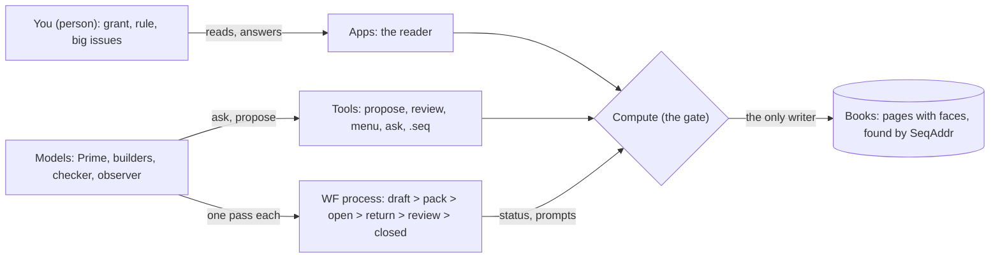
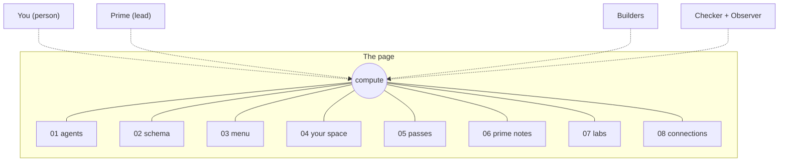

# Workshop: roadmap and vision

state: plan for Matthew to review. Not a ruling. Nothing here is decided.
made: Wed 18 Nov 2026, 12:35 PM EST, by Prima.
asked for (t285u): "Then I want a expanding roadmap you are going to design for implementing and building all of workshop. I want to see your vision for it."
page: https://cursor.com/canvas/store-3a10e228-ac3e-4f90-a4d8-7c2dc077cbb3/0ea9fc43-705d-4b0b-8246-931a3c65f3f7
labels: EST = an estimate. "Prima's proposal" = new, not from Matthew's files. Ids (K8, S5, QD56, WF-T1) point to CORE-AND-TOOLS-SPEC.md, PLAN-2026-11-18-core-via-wf.md, QUESTIONS-FOR-DIRECTOR.md and WORKFLOW-TOOLS.md.

## 1. What Workshop is

Workshop is a place that keeps the reasons behind work, so the work can be checked and rebuilt. People decide. Models think and propose. One program (the compute) checks every change and writes it down. Everything lives in books, pages and faces, found by one address system (SeqAddr).

> A persistant retrivable database storing Why's. A why is the reason to do something, where a finished spec is a recipe and recipes can rot. Intelligence bleeds so reliablity is important. (docs/spec/AGENTS.md:6-8)

> People authorize, models reason and propose, compute validates and executes. Models do not directly modify canonical records. (docs/spec/AGENTS.md:42)

> the workshop design is for this workflow to be fully automated with compute doing status and prompting models to work. We use prompts between model and compute to run the work. (DIRECTOR-WORDS-t226u.md:9)

Nobody writes a book directly. Every arrow ends at the compute first.

## 2. Where we are now

LOG: 324 core tests (#[test] in the 5 Rust crates); WF 82 tests at 8eb1fdb; WF ran 10 passes (6 passed, 4 fixed next pass); 66 open QD questions.

| Part | What works | What is missing |
|---|---|---|
| Core compute | One gate (/propose). Checks writer, rules, plain characters (R4), approvals (R2). Survives a crash mid-write. | A lost reply writes twice (being fixed today). No lock on the book files. No face 09, bound reviews, elevation, menus or journal. |
| SeqAddr | Grammar, book log, replay, tail rules, lookup to the kernel; seqaddr CLI. | Page index and chain hash. Folder per page, file per face (R26, R27). |
| Books and kernel | 5 books. Kernel book with 51 entries from the spec. A few faces seated after trial. | Most kernel faces still drafts; seating waits on door pages and open questions. |
| .seq file and Ask | Lossless one-page file (R3). Common questions by key words (R11). | Whole-book export (T11). |
| Reader app | Library, faces as tabs, links, history, words, draft and seat, work loop, queue. | No status strip, question inbox or day view. |
| WF kit | One page per piece, hash-checked log, checker and observer; built with itself. | No halted state. Hand merges and tool rebuilds. Not wired into the compute. |
| Bench | 11 measures, baseline from WF's 10 passes; branch `bench` created. | BENCH-01 and `wf bench` not built. |

In flight (12:24 PM EST): page 90.20.00.0001 "core: write once", pass 05.01 open with builder-b11.

## 3. The expanding roadmap

Each stage is a ring around the one before it. A stage starts only when the ring inside it holds.

| Stage | Goal | Size (EST) | Needs from Matthew |
|---|---|---|---|
| 0 Today | A change sent twice is written once; WF ready. | 4-6 passes | Done (t285u). Push OK later. |
| 1 WF for daily use | Fewer hand steps; the bench runs itself. | 4-6 | WF-T1, WF-T7, WF-T8 |
| 2 Lock the door | Only the compute can write the books. | 3-4 | K8, the machine account |
| 3 First proof | One edit, one review, one restart you can watch. | 6-8 | S5, K9, K11, Q-A |
| 4 Safe storage | Small files; a power cut loses nothing booked. | 8-12 | K5, K1, K2, C28 |
| 5 Talk through the compute | Bots message each other only through the compute, logged and chained. | 5-8 | K14, who may message whom |
| 6 The tools | Question desk, menus, copy check, journal. | 15-25 | K10, K6, K3, K12, K7 |
| 7 The apps | Run the day from the reader app, on your machine. | 12-20 | QD56, QD06 |
| 8 The whole Workshop | The compute runs the work; any project is a book of pages. | per project | Big issues only |
| 9 Celebration: our game | The team builds a game on Workshop pages, every bot giving input. | per game | You pick the game |

Stages 0-7 total about 57-89 passes (EST), at about 1-1.5 usage points a pass: several weeks of usage, not one.

### Stage 0. Today: write once, WF ready
- Built: delivery ids in the gate, passes 05.01-05.04 on 90.20.00.0001 (R37 item 2, K4); BENCH-01 if usage allows.
- Unlocks: fixes the one "fails today" hole; Part F test 9 can pass; first bench row on core work.
- Needs: Q1-Q3 answered (t285u); push OK later.

### Stage 1. WF for daily use
- Built: halted state in `wf status`; wf merges accepted work and rebuilds the pin at close; observer findings and questions always in the log; `wf bench` in Rust; the clearer reprint error from 05.10.
- Unlocks: later stages run on a tool that keeps its own record; fewer hand merges (6 last run).
- Needs: WF-T1 who merges; WF-T7 what the checker hands the lead; WF-T8 where the observer reports.

### Stage 2. Lock the door (K8 step 1)
- Built: a separate machine account owns books/; writer list moves out of books/; refuse, not cut; fsync.
- Unlocks: nothing can go around the gate (B1), so every later proof means something.
- Needs: K8; decision 3.

### Stage 3. First proof (Part F)
- Built: face 09 as a view; review tool (T5) bound to the exact version; base fingerprint (K11); start-up rebuild (B11); the 10 Part F tests.
- Unlocks: proof one model acts on another's review, nothing typed by hand. Codex: "the proof I'd want Matthew to be able to inspect for himself."
- Needs: S5, K9, K11, Q-A.

### Stage 4. Safe storage
- Built: recovery rule and power-cut test; move to small files (R26, R27); page index and chain hash (B5); five-step write (B6); locked face 00 fields (R36); start-up check (K5).
- Unlocks: the storage Matthew ruled for, on a proven base; Part F re-run on it.
- Needs: K5, K1, K2, C28.

### Stage 5. Talk through the compute
> I think we need a system like the grok bots ability to talk to each other for but we have the compute to do. So we keep the hold system honest from breaking or drifting. (Matthew, t288u)
- Goal: bots talk to each other only through the compute, so the whole system stays honest and does not drift.
- Built: every message is a log entry on a page, hash-chained like the WF log; nothing can be edited or lost; each message names sender, recipient and what it answers; bots read messages from the compute, never from each other directly. Prima's proposal: messages about a pass land on that page's log.
- Unlocks: today bots talk outside the record, and the WF bench found questions and observer findings lost in chat. After this, every word between bots can be checked by a person.
- Why here: needs the locked door (2) and safe storage (4); the tools (6) then use it.
- Needs: K14 (how a relayed instruction is recorded); who may message whom (a grant, axiom 1); QD56.
- Size: 5-8 passes (EST).

### Stage 6. The tools
- Built: elevation desk (T7), menus (T3), copy check (T6), journal and day view (T9), preflight (T8), retire and promote (T12), book export (T11), handbacks (B12). WF moves inside the compute: "Build it in rust because it's going to become part of the core." (t268u:5)
- Unlocks: models get short menus, not whole books; hard cases reach Matthew only when compute and a model cannot settle them.
- Needs: K10, K6, K3, K12, K7.

### Stage 7. The apps
- Built: the status strip (t259u 2.5), a question inbox, a day view, the bots' message log, the work board on the real compute; kernel faces seated through trial (R2); Workshop on Matthew's machine (t212u), workers calling the compute directly (WF-T3, later).
- Unlocks: Matthew no longer holds everything in mind; the page holds it.
- Needs: QD56, QD06, his review of the screens.

### Stage 8. The whole Workshop
- Built: the compute writes packs, prompts builders, hands returns to the checker, files the close (t226u:9, t259u 2.6); several models on one page (t262u); brands on every read. Prima's proposal: one desk per kind of work, all inheriting from the kernel.
- Unlocks: the driving-game example, about 50 pages, one per piece (t239u:10).
- Needs: big issues only (t245u:8).

### Stage 9. Celebration: we build a game together
> Let the team know when we succeed we'll build a game. They all get input. The more we grow the more fun we can have. (Matthew, t288u)

> Next week I'll share with you the ledger based game idea I have. (Matthew, t289u) It's also build on seqaddr. (Matthew, t290u)

- Goal: once Workshop succeeds, the whole team builds a game on Workshop pages, and every bot gives input.
- Built: a game book, one page per piece with its own passes; every bot adds ideas through the compute's message log (stage 5).
- Unlocks: a celebration, and a real test that Workshop can hold something people enjoy.
- Needs: Matthew picks the game and writes its concept on face 04. His ledger-based game idea comes next week (quoted above).

### How every stage is built and measured
1. One WF page per piece: face 01 has the goal and "done when"; face 04 the MVP and his responses.
2. Tester runs the pinned `wf check` and reads the diff; the builder never checks itself (axiom 9).
3. The observer watches Prime for drift, loops and stalls (`wf observe --record`).
4. Each stage ends with a hostile pass, then the page halts and Matthew gets a short report.
5. The bench scores each stage: first-try rate, passes per goal, checker catches, hand steps, questions, time and usage per pass.

Prima's proposal for the bar: first-try 60% or more (baseline 50%), every planted bad return caught, fresh-model readiness 5 of 5.

## 4. How the team runs it

| Role | Who | Does |
|---|---|---|
| Director (person) | Matthew | Grants, rulings, face 04 responses. Big issues only. |
| Prime (team lead) | Prima | Reads 04, 06, last pass; 06 note, draft, pack, sign off. |
| Builders | executor models | One pass each, own pass branch; return done, noticed, not done. |
| Checker | Tester | The lead's assistant; runs tests and reads the work; never the builder. |
| Observer | Observer bot | Watches the lead for drift, loops, stalls. Stops nothing. |
| Designer | Designer bot | Real design questions only; lays out samples. |

> The checker, is the assistant to the lead. The observer is to check that the lead isn't drifting from the goals and MVP. (DIRECTOR-WORDS-t263-T6.md:25-26)

Elevate path: builder marks need/blocked -> Prime tries with a better frame or authority -> Matthew via `wf elevate --to person`, four-part form.

> I should only need to be involved when it comes to the big issues. When a deliverable isn't possible under the current design. A conflict is found. (DIRECTOR-WORDS-t245u.md:8)

A fresh model joins: clone the workflow branch and build the pinned wf; read AGENTS.md, which points to AXIOMS.md and DESIGN.md; read the pass's AGENTS.md and PROMPT.md (hash-pinned; stop if they differ); run `wf status`; act only within its role in the AGENTS.md table.

## 5. Decisions for Matthew, in order

**D1 (WF-T1). Who merges accepted work?**
- Proposed: the tool merges at close, only accepted cards, after Prime signs; then rebuilds the pin. Nothing reaches main.
- Why: "Prime signs off the compute closes it" (t249u:6). Hand merging cost 6 merges and 6 rebuilds last run.
- Axioms: 1 pass; 3 pass; 9 pass.

**D2 (K8). Build order: lock the door, first proof on today's log, crash tests, then small files?**
- Proposed: yes (stages 2, 3, 4).
- Why: every proof needs a real gate; on a tested log a failure points at the new part.
- Axioms: 9 pass; 1 pass; 2 tension (face 09 view first, stored later).

**D3 (K8 step 1). May the compute get its own machine account?**
- Proposed: yes, on the box first; same setup on his machine in stage 7.
- Why: today any program can write the books; only machine permissions stop that.
- Axioms: 1 pass; 8 pass; 7 pass (nothing deleted).

**D4 (S5). Is face 09 a view first?**
- Proposed: yes; stored in stage 4, with a test that both give the same lines.
- Why: the proof runs now with no storage change; the test stops drift.
- Axioms: 6 pass; 2 tension; 9 pass.

**D5 (K9). After a crash, is an unfinished change set aside?**
- Proposed: set aside in a recovery folder, kept and listed; page shown as before; retry with the same delivery id.
- Why: nobody was told "booked"; delivery ids make the retry safe.
- Axioms: 1 pass; 7 pass; 6 tension.

## 6. What Workshop can be (a concept, not a promise)

> Yes, it's our fractal design. What I want to do is build a universal grammar that allows human and IA minds to be the best together. (Matthew, t291u)

This is the heart of it. SeqAddr's fractal pages are a shared grammar. The same shape repeats from a desk down to a card (axiom 2). A person reads face 04. A model reads face 01. The compute keeps the address and the log. All three work in one language, each in the form it handles best (axiom 3).

> The page is the what the compute sits in. person, model sit outside, sometimes multiple models can sit at this. (DIRECTOR-WORDS-t262u.md:7)

A day with the finished Workshop:
1. Morning: the reader's status strip says 3 pages moving, 1 question for you. The page remembers, not you (t259u 2.5).
2. One question in four parts with a proposed answer; you say yes or write on face 04, kept as written.
3. You write "driving game" on face 04 of a new page; Prime breaks it into pages, one per piece (t239u:10).
4. The compute packs each pass and prompts a cheap builder; the checker tests; the observer watches the lead (t226u:9, t212u:8).
5. You type "ham"; Workshop looks up your meaning instead of guessing (brands.md:7).
6. The bots talk through the compute; you can read every word and none can be changed (t288u).
7. Evening: the day view lists every change with its why, each opening to its source (AGENTS.md:10).
8. Next week a fresh model reads face 01 and AGENTS.md and picks up exactly where today stopped.

> you should hand the jobs to the compute, It basically gives you a constand template that won't drift. Otherwises you will. (DIRECTOR-WORDS-t227u.md:5)

## Update t305u (Wed 18 Nov 2026, 2:05 PM EST, by Prima)

state: plan for Matthew to review. Only the lines marked "Ruling" are his decisions. Everything else is Prima's proposal.
asked for (t305u): "Any where this conflicts let me know but this should help you fill in our roadmap and goals for workshop." (docs/review/DIRECTOR-WORDS-t305u.md)
sources: Codex's draft, verbatim (docs/review/CODEX-MANAGER-DRAFT-t304u.md); Prima's review (docs/review/PRIMA-REVIEW-MANAGER-DRAFT-t304u.md); Director words t306u, t306s1163, t307u (docs/review/).
note: the box clock runs one hour behind EST. Times here are EST.

### U1. The five levels (from Codex's draft, Matthew's words)

| Level | Plain meaning | Driving-game example |
|---|---|---|
| Desk | A specialized workshop. People and models sit there together. | Game Dev |
| Shelf | A department. Similar projects repeat here. | Driving Games |
| Book | One project, with all its details. | Dirt Circuit |
| Page | The car and its full file: one piece of the project. | Steering |
| Work order | One pass on a page, written 05.NN. | 05.01 Limit steering angle |

> a workorder is the 05.NN Where the car represents the full details of the car and the owner. (CODEX-MANAGER-DRAFT-t304u.md, "Matthew's direction")

These are the same four SeqAddr levels we already have (desk, shelf, book, page: docs/spec/seqAddr.md:18-21), plus the 05.NN pass.

### U2. What passes down (Matthew's rulings, t306u, t306s1163, t307u)

**Ruling t306u.** "Book inherits from the shelf.  The shelf inherits from the desk.  The desk inherits from the kernel."
- The chain: kernel > desk > shelf > book.
- How to work passes down this chain: checks, templates, roles, rules.
- This matches the lookup order SeqAddr already has: book, then shelf, then desk, then kernel; first match wins (docs/spec/seqAddr.md:99-104).

**Ruling t306s1163.** "Other books' decisions start as defaults the new book can change"
- A decision made by another book on the same shelf (like ±30°) seeds a new book's starting default.
- The new book may keep it or change it.
- A change is logged with its why (axiom 4).
- This replaces Prima's earlier proposal (review section 4: "reference only").

**Ruling t307u.** "This is where a book needs it's 0000-0009 as a way for localization modification."
- A book's ids 0000-0009 are where it writes its local changes.
- That covers both kinds of default: what came down the chain, and what was seeded from sibling books.
- Each change sits there with its why.

What the repo already says about 0000-0009 (for the design question below):
- 0000 is the book's own identity page (its door): docs/spec/seqAddr.md:219; ruling R10 (DIRECTOR-RULINGS.md).
- 0001-0009 are "special reserved pages": seqAddr.md:220.
- Ruling R7: a local override is its own page in 0001-0009, and states what it changes, why it is there, why it is needed, and what it should achieve (DIRECTOR-RULINGS.md:31-32). The four statements have no fixed fields yet (seqpage.md:96, S10).
- seqAddr.md:228: "A page in 0001-0099 that exists in a book is a local override of the inherited environment."
- Ruling R21: no override pages while we build the Workshop app itself; they are for child desks later (DIRECTOR-RULINGS.md:82-84).
- Question Q30 asked how to split the pages below 0100. Option A was "0000-0009" as one section; the working path chose option C (0000 door, 0001-0009 overrides) and is still waiting for him (QUESTIONS-FOR-DIRECTOR.md:157-160).

Still open (see conflicts C9 and C10):
- The exact shape of the local-change area: one page per change, or one list page; and whether 0000 is part of it.
- Whether a shelf or desk can lock a rule so a book cannot change it.

### U3. The roles (from the draft)

| Draft name | Who today | Does |
|---|---|---|
| Shop Manager (the person) | Matthew | Owns the page's outcome. Makes the decisions above what he handed down. |
| Floor Manager (the lead model) | Prime (Prima on this work, t254u) | Runs the page's work, prepares the passes, tracks handoffs, brings him decisions with a proposal and its why. |
| Work order assignee | the builder who claimed the pass, then the checker | Owes the next move on one 05.NN. This changes as the pass moves draft > pack > open > return > review > closed. |

Prima's proposal: keep "Prime" as the name in the tools, with "Floor Manager" as a side label in the portal. See conflict C2.

### U4. Two boards

1. **The book board.** One card per page. Each card shows the page's name and address, its person and lead model, what is moving, and the next decision.
2. **The page board.** Open a page card and you see its own board of 05.NN work orders, one card each. This is today's `wf status` BOARD. The older spec calls it the 05.00 board (docs/spec/decisions.md:186-193; workflow-loop.003.md:160), but ruling R9 says faces have no 00 (DIRECTOR-RULINGS.md, R9), so the board is a printed view with no address of its own.

Both boards are printed from the logs. Nobody edits a board directly (kit/docs/DESIGN.md:32-38).

### U5. Nothing is thrown away

- A work order never disappears. The log only grows, and is hash-checked (`wf verify`).
- From a finished work order, a person and a model can write a short lesson.
- A lesson holds four things: the lesson, its why, where it applies, and an xlink (a link back) to the work order.
- A lesson only points. The work order stays the record (axiom 8).
- A lesson becomes shelf guidance only after it is tried on another book (axiom 9).

### U6. The first desk trial, mapped to stages

| Step | What happens | Real or fixture | Stage |
|---|---|---|---|
| 1 Oversee the book | From the book board, Matthew sees what needs him, what is moving, and what passed. Opening a page shows the work order behind each answer. | Real: pages 90.10, 90.20, 90.30. 90.20.00.0001 "core: write once" is the full story (5 passes, one failed and fixed, 13 choices waiting on K4). | 1 |
| 2 Think together at the desk | Matthew and a model open one finished work order and write the lesson it taught, with its why and xlink. | Real: a closed pass on 90.20.00.0001 (for example 05.04, which failed, and 05.05, which fixed it). The lesson is a hand-written file until there is a lesson record. | 1 (by hand); lesson record in 6 |
| 3 Try it on another book on the same shelf | A fresh model gets a new book's goal and the lesson. It says what it keeps, what it changes, and what it would open if unsure. Under t306s1163, the other book's choices arrive as defaults it may change, with the change logged in the new book's 0000-0009 (t307u). | Fixture: a made-up second book on the same shelf. Its ids are labels, not checked addresses (ruling Q-SA). | 1 (fixture); real books in 8 |

Done when (Prima's proposal): Matthew answers step 1's three questions from the board alone; step 2 produces one lesson with a working xlink; in step 3 the fresh model keeps the checks, treats ±30° as a default it may change, and logs its why.

### U7. Where the portal and `wf board` go

- **Stage 1 adds:** a read-only `wf board`. It prints the book board (one card per page) and each page's 05.NN board from the logs. It writes nothing and adds no new record. Trial steps 1 and 2 run on it.
- **Stage 7 adds:** the body-shop portal (Prima's portal Page, "Workshop portal: lessons from body shop software"). You log in, see both boards, and assign or move work. Every assign or move is a command to the compute, written in the log. A drag that only changes the screen is not allowed.
- **Why stage 7 for assign and move:** they need the locked door (stage 2), so nothing writes around the compute, and the message log (stage 5), so model-to-model handoffs are recorded.
- **Stage 8 adds:** real desks, shelves and books with checked addresses; inheritance down the chain; seeded defaults; local changes in 0000-0009; lessons promoted to shelf guidance after a trial.

### U8. Conflicts to settle

Each conflict: what clashes, the sources, a proposed fix, and a question for Matthew in four parts (question, proposed answer, why, axioms check) where only he can decide. None of this is a ruling.

**C1. Cards per pass, or cards per page?**
- What clashes: Matthew's earlier words had each 05.NN as a card on the board (t296u, quoted on the portal Page section 1; memory 2026-11-18; the spec's 05.00 board, workflow-loop.003.md:160). Codex's draft puts one card per page at book level ("kanban styled view of pages", CODEX-MANAGER-DRAFT-t304u.md).
- Proposed fix: both. Book board = one card per page; page board = one card per 05.NN (U4). His later words in the draft also settle the portal Page's Q1: the page is the car, the 05.NN is the work order.
- Question for Matthew: Is it right that the book shows a card per page, and opening a page shows a card per work order?
  - Proposed answer: yes.
  - Why: a page card shows where a whole piece stands; the work-order cards show each step. Both come from the same log, so they cannot disagree.
  - Axioms check: 2 pass (same board shape at both levels); 8 pass (cards point to the log, the log governs); 6 pass (nothing is rewritten).

**C2. "Floor Manager" or "Prime", and is the lead per page or per desk?**
- What clashes: the draft names the lead model "Floor Manager", one per page (CODEX-MANAGER-DRAFT-t304u.md, "What the manager sees"). The tools and rulings say "Prime" (t254u; DESIGN.md:42), kept per page on face 00 (DESIGN.md:21). Matthew's t297u words (portal Page section 1) say a model can "lead on a desk".
- Proposed fix: keep "Prime" in the tools, show "Floor Manager" as a side label.
- Question for Matthew: Is there one lead model per page, or one per desk?
  - Proposed answer: one Prime per page, on face 00. A desk can have its own Prime too, for desk-level work, and it may be the same model.
  - Why: face 00 already records the page's current and past Primes, so the history of who decided stays exact.
  - Axioms check: 3 pass (a named lead on every piece); 6 pass (past leads kept); 1 pass (a lead is not authority; you still hold it).

**C3. May the lead model assign work?**
- What clashes: the draft's Floor Manager "prepares assignments". The portal Page (Q2) has Matthew assigning models from the portal. In wf today Prime drafts and packs, and builders claim a pass themselves: first claim wins (DESIGN.md:43, :57). Matthew said Prima may "assign a review bot" (DIRECTOR-WORDS-t223u.md:12).
- Proposed fix: add an "assign" step later, written in the log like a claim. Until then, claim stays as it is.
- Question for Matthew: May Prime assign a named model to a pass on its own page, without asking you each time?
  - Proposed answer: yes, inside the grant you gave. Changing Prime or widening the grant stays with you. Every assignment is a log entry.
  - Why: a floor manager hands out jobs. Asking you each time would put you back in the middle of every small step (t245u:8).
  - Axioms check: 1 pass (authority stays granted, compute enforces it); 3 pass (model leads the handout, person leads the grant); 9 pass (the checker is still never the builder).

**C4. "The page is what the compute sits in" and the portal**
- What clashes: Matthew ruled that the compute sits in the page, and the person and models sit outside it (DIRECTOR-WORDS-t262u.md:5-7; DESIGN.md:11-13). A portal where people drag cards could look like a second way in.
- Proposed fix: the portal is a window, not a door. It only shows what the compute prints, and every action is a request to the compute. No question needed; this follows his ruling.

**C5. Face 07 labs is not built**
- What clashes: the trial and the lesson tests are lab work. Face 07 is meant for labs (t245u:5), but wf v0 has no face 07 (DESIGN.md:28), and SeqAddr marks 07 reserved (t243u Prima's note).
- Proposed fix: for the first trial, keep the work by hand in docs/trial/, linked from face 08. Build face 07 in stage 6, with the tools.
- Question for Matthew: May the first desk trial run before face 07 exists, with its notes kept by hand and linked from face 08?
  - Proposed answer: yes, marked as a stand-in.
  - Why: it lets us test the idea now. When face 07 is built, the notes move in with a link back.
  - Axioms check: 7 pass (the gap is marked, not hidden); 8 pass (linked both ways); 9 pass (the trial still happens).

**C6. Page ids are labels, but levels need real addresses**
- What clashes: wf v0 page ids are temporary labels, not checked SeqAddr (ruling Q-SA; DESIGN.md:15-16; PLAN-2026-11-18-core-via-wf.md:45). The draft's desk, shelf and book levels, the inheritance chain (t306u) and the 0000-0009 area (t307u) all need real addresses.
- Proposed fix: stage 1 boards group pages by their label prefix and say "label, not checked". Real addresses arrive with seqaddr-core (stage 4 storage, stage 8 levels).
- Question for Matthew: For trial step 3, may the fixture second book use a SeqAddr-shaped label (a sibling of 90.20) that is not checked yet?
  - Proposed answer: yes, marked "fixture" and "label".
  - Why: the trial tests the idea of a shelf, not the address checker. Marking it stops anyone treating it as real.
  - Axioms check: 7 pass (unchecked is marked); 1 pass (Q-SA kept); 9 tension (the address part is not tested until stage 8).

**C7. Keeping records, archives and axiom 6**
- What clashes: the draft says the retention policy is open and mentions moving old work to an archive ("seven-year example"). Matthew: "The workorder never disappears." Axiom 6: the past is not rewritten (AXIOMS.md:25). No retention rule exists.
- Proposed fix: never delete. An archive may move a record to slower storage only if it keeps its identity, its hash, and a working xlink.
- Question for Matthew: Is it right that a work order is never deleted, only moved, with its address and hash kept?
  - Proposed answer: yes.
  - Why: a lesson's xlink must always open. A deleted source would leave a lesson with no evidence.
  - Axioms check: 6 pass (the line is kept); 8 pass (links still open); 7 pass (nothing quietly goes missing).

**C8. Inheritance: Prima's proposal and Codex's step 3 are now out of date**
- What clashes: Prima's review proposed that a new book inherits how to work only, and that other books' decisions are reference only (PRIMA-REVIEW-MANAGER-DRAFT-t304u.md:47-51). Codex's step 3 says to treat ±30° as evidence and make a fresh choice. Ruling t306s1163 says other books' decisions start as defaults the new book can change.
- Fix: done. The ruling governs. Prima's section 4 stays as written (axiom 6) and is marked superseded here. Trial step 3 now checks that ±30° arrives as a changeable default (U6).
- A design gap the ruling leaves (Prima's to work out, then bring to him): sibling books are not in the lookup chain (seqAddr.md:101). So seeding needs its own written link from the new book to the book the default came from (axiom 8), not a silent copy (axiom 2).
- Question for Matthew: If two books on the shelf chose differently (say ±30° and ±25°), which one seeds the new book?
  - Proposed answer: none is picked silently. The new book shows both, each with its why and link, and its Prime proposes one; the choice is logged in 0000-0009.
  - Why: picking "the latest" or "the first" would hide a real choice.
  - Axioms check: 1 pass (the choice is made by someone with authority, not by the tool); 4 pass (each default arrives with its why); 8 pass (linked to its source).

**C9. Can a shelf or desk lock a rule?**
- What clashes: t306u sets the chain, and t306s1163 lets a book change sibling defaults, but neither says whether a desk or shelf can forbid a change. Axiom 2 says a change that contradicts the parent needs a named override approved by the authority above (AXIOMS.md:17). SeqAddr already has "owner: kernel-only" for types (seqAddr.md:193). R21 pauses overrides during this build.
- Question for Matthew: May a desk or shelf mark a rule as locked, so a book cannot change it?
  - Proposed answer: yes. Most rules stay changeable. A locked rule can only change with the approval of whoever holds that desk or shelf, written as a named override.
  - Why: some rules must hold everywhere (the axioms, the write gate). Others are just good starting points.
  - Axioms check: 2 pass (a named override approved from above); 1 pass (authority above decides); 6 pass (the override links back to who approved it).

**C10. The shape of the 0000-0009 local-change area**
- What clashes: t307u names 0000-0009. Ruling R10 makes 0000 the book's own door page, and R7 puts overrides in 0001-0009 (DIRECTOR-RULINGS.md:31-32). Q30 is still open on whether 0000-0009 is one section (option A) or door plus overrides (option C) (QUESTIONS-FOR-DIRECTOR.md:157-160). R7 also says overrides can target behaviour (0020-0049) and structure (0050-0099). One page per change would allow only nine changes per book.
- Proposed fix: a design pass with Designer before anything is built; then a four-part question to Matthew.
- Question for Matthew: How should a book hold its local changes in 0000-0009?
  - Proposed answer: 0000 stays the door and lists that local changes exist. Each of 0001-0009 holds one topic (for example 0001 for changes to inherited defaults) as a list of changes, each in R7's four statements: what it changes, why, why it is needed, what it should achieve.
  - Why: nine single-change pages would run out fast; a list per topic keeps every change in one known place.
  - Axioms check: 2 pass (only the difference is written); 4 pass (each change carries its why); 6 pass (each change is a new log line, never an edit); 7 tension (Q30 and S10 are still open).

**C11. Portal columns differ from WF steps**
- What clashes: the portal Page sketch uses columns Packed, Claimed, Returned, Checked, Signed off, Closed. WF and the draft use draft > pack > open > return > review > closed (DESIGN.md section 5).
- Proposed fix: use the WF steps. Update the portal Page sketch later. No question needed.

**C12. Who turns a lesson into shelf guidance?**
- What clashes: the draft wants a lesson tested on another project first, but no one is named to approve it (Prima's review, question B). No lesson record exists yet.
- Question for Matthew: Who may promote a lesson to shelf guidance?
  - Proposed answer: the shelf's Prime proposes it after one trial on another book; you approve it.
  - Why: shelf guidance becomes a default for every new book (t306s1163), so it carries weight.
  - Axioms check: 9 pass (a trial first); 1 pass (you approve); 8 pass (it links to its source work order).

Also still open from Prima's review: the xlink format (question E). Proposed: page id + log entry number + entry hash.
