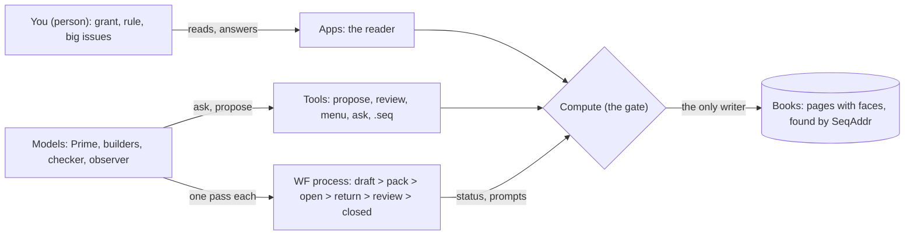
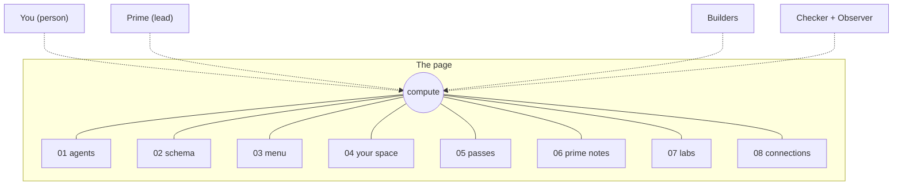

# Workshop: roadmap and vision

state: plan for Matthew to review. Not a ruling. Nothing here is decided.
made: Wed 18 Nov 2026, 12:35 PM EST, by Prima.
asked for (t285u): "Then I want a expanding roadmap you are going to design for implementing and building all of workshop. I want to see your vision for it."
page: https://cursor.com/canvas/store-3a10e228-ac3e-4f90-a4d8-7c2dc077cbb3/0ea9fc43-705d-4b0b-8246-931a3c65f3f7
labels: EST = an estimate. "Prima's proposal" = new, not from Matthew's files. Ids (K8, S5, QD56, WF-T1) point to CORE-AND-TOOLS-SPEC.md, PLAN-2026-11-18-core-via-wf.md, QUESTIONS-FOR-DIRECTOR.md and WORKFLOW-TOOLS.md.

## 1. What Workshop is

Workshop is a place that keeps the reasons behind work, so the work can be checked and rebuilt. People decide. Models think and propose. One program (the compute) checks every change and writes it down. Everything lives in books, pages and faces, found by one address system (SeqAddr).

> A persistant retrivable database storing Why's. A why is the reason to do something, where a finished spec is a recipe and recipes can rot. Intelligence bleeds so reliablity is important. (docs/spec/AGENTS.md:6-8)

> People authorize, models reason and propose, compute validates and executes. Models do not directly modify canonical records. (docs/spec/AGENTS.md:42)

> the workshop design is for this workflow to be fully automated with compute doing status and prompting models to work. We use prompts between model and compute to run the work. (DIRECTOR-WORDS-t226u.md:9)

Nobody writes a book directly. Every arrow ends at the compute first.

## 2. Where we are now

LOG: 324 core tests (#[test] in the 5 Rust crates); WF 82 tests at 8eb1fdb; WF ran 10 passes (6 passed, 4 fixed next pass); 66 open QD questions.

| Part | What works | What is missing |
|---|---|---|
| Core compute | One gate (/propose). Checks writer, rules, plain characters (R4), approvals (R2). Survives a crash mid-write. | A lost reply writes twice (being fixed today). No lock on the book files. No face 09, bound reviews, elevation, menus or journal. |
| SeqAddr | Grammar, book log, replay, tail rules, lookup to the kernel; seqaddr CLI. | Page index and chain hash. Folder per page, file per face (R26, R27). |
| Books and kernel | 5 books. Kernel book with 51 entries from the spec. A few faces seated after trial. | Most kernel faces still drafts; seating waits on door pages and open questions. |
| .seq file and Ask | Lossless one-page file (R3). Common questions by key words (R11). | Whole-book export (T11). |
| Reader app | Library, faces as tabs, links, history, words, draft and seat, work loop, queue. | No status strip, question inbox or day view. |
| WF kit | One page per piece, hash-checked log, checker and observer; built with itself. | No halted state. Hand merges and tool rebuilds. Not wired into the compute. |
| Bench | 11 measures, baseline from WF's 10 passes; branch `bench` created. | BENCH-01 and `wf bench` not built. |

In flight (12:24 PM EST): page 90.20.00.0001 "core: write once", pass 05.01 open with builder-b11.

## 3. The expanding roadmap

Each stage is a ring around the one before it. A stage starts only when the ring inside it holds.

| Stage | Goal | Size (EST) | Needs from Matthew |
|---|---|---|---|
| 0 Today | A change sent twice is written once; WF ready. | 4-6 passes | Done (t285u). Push OK later. |
| 1 WF for daily use | Fewer hand steps; the bench runs itself. | 4-6 | WF-T1, WF-T7, WF-T8 |
| 2 Lock the door | Only the compute can write the books. | 3-4 | K8, the machine account |
| 3 First proof | One edit, one review, one restart you can watch. | 6-8 | S5, K9, K11, Q-A |
| 4 Safe storage | Small files; a power cut loses nothing booked. | 8-12 | K5, K1, K2, C28 |
| 5 Talk through the compute | Bots message each other only through the compute, logged and chained. | 5-8 | K14, who may message whom |
| 6 The tools | Question desk, menus, copy check, journal. | 15-25 | K10, K6, K3, K12, K7 |
| 7 The apps | Run the day from the reader app, on your machine. | 12-20 | QD56, QD06 |
| 8 The whole Workshop | The compute runs the work; any project is a book of pages. | per project | Big issues only |
| 9 Celebration: our game | The team builds a game on Workshop pages, every bot giving input. | per game | You pick the game |

Stages 0-7 total about 57-89 passes (EST), at about 1-1.5 usage points a pass: several weeks of usage, not one.

### Stage 0. Today: write once, WF ready
- Built: delivery ids in the gate, passes 05.01-05.04 on 90.20.00.0001 (R37 item 2, K4); BENCH-01 if usage allows.
- Unlocks: fixes the one "fails today" hole; Part F test 9 can pass; first bench row on core work.
- Needs: Q1-Q3 answered (t285u); push OK later.

### Stage 1. WF for daily use
- Built: halted state in `wf status`; wf merges accepted work and rebuilds the pin at close; observer findings and questions always in the log; `wf bench` in Rust; the clearer reprint error from 05.10.
- Unlocks: later stages run on a tool that keeps its own record; fewer hand merges (6 last run).
- Needs: WF-T1 who merges; WF-T7 what the checker hands the lead; WF-T8 where the observer reports.

### Stage 2. Lock the door (K8 step 1)
- Built: a separate machine account owns books/; writer list moves out of books/; refuse, not cut; fsync.
- Unlocks: nothing can go around the gate (B1), so every later proof means something.
- Needs: K8; decision 3.

### Stage 3. First proof (Part F)
- Built: face 09 as a view; review tool (T5) bound to the exact version; base fingerprint (K11); start-up rebuild (B11); the 10 Part F tests.
- Unlocks: proof one model acts on another's review, nothing typed by hand. Codex: "the proof I'd want Matthew to be able to inspect for himself."
- Needs: S5, K9, K11, Q-A.

### Stage 4. Safe storage
- Built: recovery rule and power-cut test; move to small files (R26, R27); page index and chain hash (B5); five-step write (B6); locked face 00 fields (R36); start-up check (K5).
- Unlocks: the storage Matthew ruled for, on a proven base; Part F re-run on it.
- Needs: K5, K1, K2, C28.

### Stage 5. Talk through the compute
> I think we need a system like the grok bots ability to talk to each other for but we have the compute to do. So we keep the hold system honest from breaking or drifting. (Matthew, t288u)
- Goal: bots talk to each other only through the compute, so the whole system stays honest and does not drift.
- Built: every message is a log entry on a page, hash-chained like the WF log; nothing can be edited or lost; each message names sender, recipient and what it answers; bots read messages from the compute, never from each other directly. Prima's proposal: messages about a pass land on that page's log.
- Unlocks: today bots talk outside the record, and the WF bench found questions and observer findings lost in chat. After this, every word between bots can be checked by a person.
- Why here: needs the locked door (2) and safe storage (4); the tools (6) then use it.
- Needs: K14 (how a relayed instruction is recorded); who may message whom (a grant, axiom 1); QD56.
- Size: 5-8 passes (EST).

### Stage 6. The tools
- Built: elevation desk (T7), menus (T3), copy check (T6), journal and day view (T9), preflight (T8), retire and promote (T12), book export (T11), handbacks (B12). WF moves inside the compute: "Build it in rust because it's going to become part of the core." (t268u:5)
- Unlocks: models get short menus, not whole books; hard cases reach Matthew only when compute and a model cannot settle them.
- Needs: K10, K6, K3, K12, K7.

### Stage 7. The apps
- Built: the status strip (t259u 2.5), a question inbox, a day view, the bots' message log, the work board on the real compute; kernel faces seated through trial (R2); Workshop on Matthew's machine (t212u), workers calling the compute directly (WF-T3, later).
- Unlocks: Matthew no longer holds everything in mind; the page holds it.
- Needs: QD56, QD06, his review of the screens.

### Stage 8. The whole Workshop
- Built: the compute writes packs, prompts builders, hands returns to the checker, files the close (t226u:9, t259u 2.6); several models on one page (t262u); brands on every read. Prima's proposal: one desk per kind of work, all inheriting from the kernel.
- Unlocks: the driving-game example, about 50 pages, one per piece (t239u:10).
- Needs: big issues only (t245u:8).

### Stage 9. Celebration: we build a game together
- Goal: once Workshop succeeds, the whole team builds a game on Workshop pages, and every bot gives input (Matthew, t286u-t288u).
- Built: a game book, one page per piece with its own passes; every bot adds ideas through the compute's message log (stage 5).
- Unlocks: a celebration, and a real test that Workshop can hold something people enjoy.
- Needs: Matthew picks the game and writes its concept on face 04. He plans to share a ledger-based game idea next week, built on SeqAddr (t289u-t290u).

### How every stage is built and measured
1. One WF page per piece: face 01 has the goal and "done when"; face 04 the MVP and his responses.
2. Tester runs the pinned `wf check` and reads the diff; the builder never checks itself (axiom 9).
3. The observer watches Prime for drift, loops and stalls (`wf observe --record`).
4. Each stage ends with a hostile pass, then the page halts and Matthew gets a short report.
5. The bench scores each stage: first-try rate, passes per goal, checker catches, hand steps, questions, time and usage per pass.

Prima's proposal for the bar: first-try 60% or more (baseline 50%), every planted bad return caught, fresh-model readiness 5 of 5.

## 4. How the team runs it

| Role | Who | Does |
|---|---|---|
| Director (person) | Matthew | Grants, rulings, face 04 responses. Big issues only. |
| Prime (team lead) | Prima | Reads 04, 06, last pass; 06 note, draft, pack, sign off. |
| Builders | executor models | One pass each, own pass branch; return done, noticed, not done. |
| Checker | Tester | The lead's assistant; runs tests and reads the work; never the builder. |
| Observer | Observer bot | Watches the lead for drift, loops, stalls. Stops nothing. |
| Designer | Designer bot | Real design questions only; lays out samples. |

> The checker, is the assistant to the lead. The observer is to check that the lead isn't drifting from the goals and MVP. (DIRECTOR-WORDS-t263-T6.md:25-26)

Elevate path: builder marks need/blocked -> Prime tries with a better frame or authority -> Matthew via `wf elevate --to person`, four-part form.

> I should only need to be involved when it comes to the big issues. When a deliverable isn't possible under the current design. A conflict is found. (DIRECTOR-WORDS-t245u.md:8)

A fresh model joins: clone the workflow branch and build the pinned wf; read AGENTS.md, which points to AXIOMS.md and DESIGN.md; read the pass's AGENTS.md and PROMPT.md (hash-pinned; stop if they differ); run `wf status`; act only within its role in the AGENTS.md table.

## 5. Decisions for Matthew, in order

**D1 (WF-T1). Who merges accepted work?**
- Proposed: the tool merges at close, only accepted cards, after Prime signs; then rebuilds the pin. Nothing reaches main.
- Why: "Prime signs off the compute closes it" (t249u:6). Hand merging cost 6 merges and 6 rebuilds last run.
- Axioms: 1 pass; 3 pass; 9 pass.

**D2 (K8). Build order: lock the door, first proof on today's log, crash tests, then small files?**
- Proposed: yes (stages 2, 3, 4).
- Why: every proof needs a real gate; on a tested log a failure points at the new part.
- Axioms: 9 pass; 1 pass; 2 tension (face 09 view first, stored later).

**D3 (K8 step 1). May the compute get its own machine account?**
- Proposed: yes, on the box first; same setup on his machine in stage 7.
- Why: today any program can write the books; only machine permissions stop that.
- Axioms: 1 pass; 8 pass; 7 pass (nothing deleted).

**D4 (S5). Is face 09 a view first?**
- Proposed: yes; stored in stage 4, with a test that both give the same lines.
- Why: the proof runs now with no storage change; the test stops drift.
- Axioms: 6 pass; 2 tension; 9 pass.

**D5 (K9). After a crash, is an unfinished change set aside?**
- Proposed: set aside in a recovery folder, kept and listed; page shown as before; retry with the same delivery id.
- Why: nobody was told "booked"; delivery ids make the retry safe.
- Axioms: 1 pass; 7 pass; 6 tension.

## 6. What Workshop can be (a concept, not a promise)

> Yes, it's our fractal design. What I want to do is build a universal grammar that allows human and IA minds to be the best together. (Matthew, t291u)

This is the heart of it. SeqAddr's fractal pages are a shared grammar. The same shape repeats from a desk down to a card (axiom 2). A person reads face 04. A model reads face 01. The compute keeps the address and the log. All three work in one language, each in the form it handles best (axiom 3).

> The page is the what the compute sits in. person, model sit outside, sometimes multiple models can sit at this. (DIRECTOR-WORDS-t262u.md:7)

A day with the finished Workshop:
1. Morning: the reader's status strip says 3 pages moving, 1 question for you. The page remembers, not you (t259u 2.5).
2. One question in four parts with a proposed answer; you say yes or write on face 04, kept as written.
3. You write "driving game" on face 04 of a new page; Prime breaks it into pages, one per piece (t239u:10).
4. The compute packs each pass and prompts a cheap builder; the checker tests; the observer watches the lead (t226u:9, t212u:8).
5. You type "ham"; Workshop looks up your meaning instead of guessing (brands.md:7).
6. The bots talk through the compute; you can read every word and none can be changed (t288u).
7. Evening: the day view lists every change with its why, each opening to its source (AGENTS.md:10).
8. Next week a fresh model reads face 01 and AGENTS.md and picks up exactly where today stopped.

> you should hand the jobs to the compute, It basically gives you a constand template that won't drift. Otherwises you will. (DIRECTOR-WORDS-t227u.md:5)
