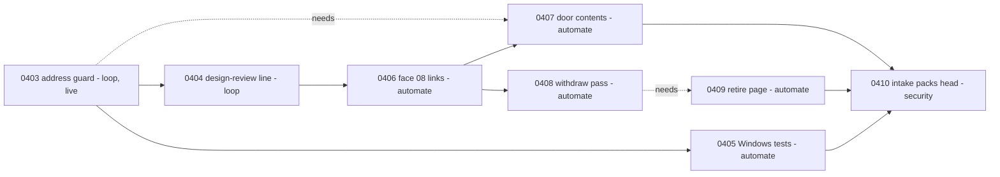
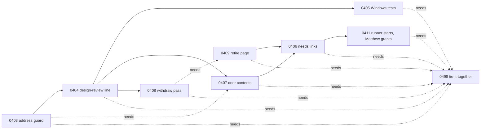
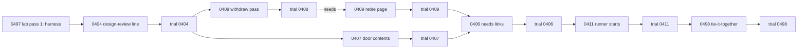

# Stage plan: WF for daily use (band 90.50.10.04xx)

Goal line (Matthew, t423u, DIRECTOR-WORDS-t423u.md:7, verbatim; spaces between sentences shortened):
"Workshop: A place models, persons, and compute work. With kanban style boards to integrate
our kernel, pages, desk, faces, seqaddr designs. So whys can be captured and reused to
strengthen over time."
Stage line: roadmap stage 1 (ROADMAP-2026-11-18.md:55) of stages 0-9 (:54-63). One stage
per band: this stage is band 0400-0499 (t423u.md:11), door 0400 (t420.md:4). Shape: loops inside loops,
measured in passes (t423u.md:13). Added in v2; see section 10.

state: draft v1 for Prima to review with Matthew. Not live. The door's next face 01
version waits for his review; no wf page was touched.
made: 2026-11-19, 1:38 PM EST, by Designer.
address: the plan belongs on the band door 90.50.10.0400 (t422.md:4).
template: docs/research/PM-DESIGN-2026-11-19.md section 10 (:157-184), with t422 answers.
axioms: 1.5.8

## 1. Stage goal, in plain words

- Goal: Matthew can hand Prima work every day, and WF carries it with few hand steps.
- Why: t401u.md:7 "lets get WF into a functional state. It doesn't have to be perfect,
  it can be glitchy, we just need I can give you work." (spaces shortened). This is
  roadmap stage 1, "WF for daily use" (ROADMAP-2026-11-18.md:55, :72).
- Done when: every page below is closed `passed`; the stage review step has run; and
  Matthew has said go, hold or redo (section 7).

Order rule: t402u.md:3 "connecting the minimum pieces required to have a loop be
completed ... then we aim for automating it, then we refine for polish and security
last." So the buckets run: loop, automate, polish, security.

## 2. What Matthew answered (t422), checked against his words

| Point | His words (DIRECTOR-WORDS-t422.md) | Relay check |
|---|---|---|
| Plan lives on the band door | :4 "Yes, the stage plan lives on the band door page" | Same |
| Needs are links on both pages | :6 "Yes, page needs are written as links on both pages" | Same. "Face 08" is not in his answer or the question (:5); it came from Researcher's proposal (PM-DESIGN:194) and wf's face table (kit docs/DESIGN.md:29) |
| Independence test | :7 question: "neither needs the other and they change no shared files"; :8 "Yes, that's the independence test; check shared reads later" | Close. The test words are the question's, which he approved. Relay said "no shared files"; his test is "change no shared files", so shared reads are allowed for now |
| Open pages | :10 "No limit on open pages" | Same. It overrides Researcher's default of 3 (PM-DESIGN:207) |
| Stage end | :12 "Yes, the stage ends with the roadmap's review step plus my go, hold or redo" | Same. The roadmap step is ROADMAP-2026-11-18.md:130 |

Also: t422.md:14 (Prima's plain words) says Researcher's defaults were approved. Q2's
default also said an unwritten need shows "unknown" and is not run in parallel
(PM-DESIGN:195). That part was not in the question he answered (t422.md:5).

## 3. Where the band stands

- 0400: door. Face 01 v2 lists the band by hand (wf-run-gh pages/90.50.10.0400/01.md:5-10).
- 0401, 0402: dropped, kept as history, never reused (DIRECTOR-RULINGS.md:129-130).
- 0403: live, the address guard, packed (pages/90.50.10.0403/05.md:4). It touches
  src/addr.rs, src/cmd.rs, src/lib.rs, tests/wf.rs (05.01/PACK.md:19).
- New pages: 0404 and up, in order, never above 0498 (seqAddr.md:323, :242; A1-A9).

## 4. The pages

Files are what each page is expected to touch, read from the wf source at
origin/returns 60dd7e25. Prime confirms them at pack time (`may touch`). Sizes are in
passes (a pass is 30-50 minutes; PM-DESIGN:79), written best/likely/worst.

### 0404  wf lint: returns state a design review (t416u)   [loop]
- Goal: a return for a pass packed on the new template must carry a line naming the
  design files the builder compared. wf refuses the return without it.
- Why: t416u.md:7 "Must be confirmed before the return is complete. We can't force it but
  we can force it to confirm it did this via our WF" (spaces shortened).
- Done when: a test shows a return with no `design review:` line is refused, naming
  t416u; a return with the line is accepted; a pass packed on the old template (0403)
  is not affected (t381u.md:8: no rule change mid pass).
- Needs: none. Waits for: 0403 to close (shared src/cmd.rs).
- Touches: templates (a new version beside templates/v3/), src/render.rs (it picks the
  template, render.rs:19-27), src/cmd.rs (`ret`, cmd.rs:462), its own test file.
- Size 1/2/3.

### 0405  tests build and run on Windows   [automate]
- Goal: `cargo test` builds on Windows. Unix-only tests are gated, and checks that use
  `true`, `grep` or `test` run there or skip with a reason.
- Why: builders work on Windows (t400u.md:7); today the builder must skip the e2e tests
  (0403 PACK.md:23). Known gap: tests/wf.rs:4 imports `std::os::unix`; wf
  docs/spec/WF-GITHUB-LOOP.md:43 lists the `true`/`grep` checks.
- Done when: `cargo test` passes on the box, and `cargo build --tests` succeeds for the
  Windows target (or a Windows builder's proof line shows it), with each skip named.
- Needs: none. Waits for: 0403 to close (shared tests/wf.rs).
- Touches: tests/wf.rs only.
- Size 2/3/5.

### 0406  needs links on face 08, both ways   [automate]
- Goal: one wf command writes "needs" on both pages' logs; `wf verify` flags a link that
  has no back-link.
- Why: t422.md:6 (links on both pages); seqAddr.md:251 "A one-way link is invalid";
  Axioms.md:27. Until it lands, Prime writes the links by hand on face 08, which wf
  already allows (cmd.rs:220). That is the manual first step (t402u.md:3).
- Done when: tests show the link appears on both pages, a one-way link is reported, and
  a link to a missing page is refused.
- Needs: none. Waits for: 0404 (shared src/cmd.rs, src/render.rs).
- Touches: src/cmd.rs, src/lib.rs, src/page.rs, src/render.rs, its own test file.
- Size 2/3/4.

### 0407  the door prints its own type and contents   [automate]
- Goal: a page ending in 00 shows `type: band` on face 00 and a contents list of the
  band's pages, built by wf from the pages folder, not written by hand.
- Why: the door's registry is hand-written today (0400/01.md:5); face00.md:141 (band
  head is `type: band`), :206 (contents is compute-only); drafting.md:40 (derived
  content is not hand-written).
- Done when: tests show a band door lists each page in its band with its state; a
  dropped page shows as dropped; a non-door page shows no list.
- Needs: 0403 (it reads `page_kind` from the new src/addr.rs). Waits for: 0406 (shared
  src/render.rs).
- Touches: src/render.rs, its own test file.
- Size 1/2/3.

### 0408  withdraw a packed pass nobody has claimed   [automate]
- Goal: Prime can withdraw a pass at `pack` with no claim. It is kept in the log as
  withdrawn, and a claim on it is refused.
- Why: 0401 and 0402 hold packed passes that can still be claimed if published
  (ADDRESS-DRIFT-t413u.md:28). Today the only guard is "never publish".
- Done when: tests show withdraw works at `pack`, is refused at `open` or later, and a
  later claim is refused; the log keeps the pass (Axioms.md:23).
- Needs: none. Waits for: 0406 (shared src/cmd.rs, src/lib.rs, src/page.rs).
- Touches: src/cmd.rs, src/lib.rs, src/page.rs, its own test file.
- Size 1/2/3.

### 0409  retire a page   [automate]
- Goal: Prime can mark a page retired with a reason. It stays on record, leaves the
  door's list of live work, and refuses new drafts.
- Why: DIRECTOR-RULINGS.md:153-154 (a linked page can only be retired). Today halt plus
  a note stands in (ADDRESS-DRIFT-t413u.md:18-19, :28).
- Done when: tests show retire works when no pass is open, is refused otherwise, and the
  page still verifies.
- Needs: 0408 (a page with a packed pass can only retire after the pass is withdrawn;
  halt is refused while a pass is open, cmd.rs:84). Waits for: 0408.
- Touches: src/cmd.rs, src/lib.rs, src/page.rs, its own test file.
- Size 1/2/3.

### 0410  intake checks the packs head   [security, last]
- Goal: `wf intake` takes a returned log only if it continues from the log published
  on the packs branch for that page.
- Why: wf docs/spec/WF-GITHUB-LOOP.md:41 "closes most of Tester's full-rewrite hole.
  t402u moved it later." t402u.md:3: security last.
- Done when: tests show a returned log that rewrites a published entry is refused, and a
  clean continuation is taken.
- Needs: none. Waits for: all pages above (security last, t402u.md:3; shared src/cmd.rs).
- Touches: src/cmd.rs (`intake`, cmd.rs:579), src/git.rs, its own test file.
- Size 2/3/5.

Polish bucket: no page planned. Polish items come from the returns' overflow lines.

Not a page: who wf records as the page starter. It is question Q1 (section 8).

Merged or split from Prima's list: "retire and withdraw" is split into 0408 and 0409
(two jobs; 0409 needs 0408). "wf lint" is kept to one check, the t416u line; a general
lint command is later work.

## 5. Needs links, both ways (write these on face 08 by hand until 0406 lands)

| Page | Needs (written on this page) | Needed by (written on the other page) |
|---|---|---|
| 0403 | none | 0407 |
| 0407 | 0403 (src/addr.rs `page_kind`) | none |
| 0408 | none | 0409 |
| 0409 | 0408 (withdraw before retire) | none |
| 0404, 0405, 0406, 0410 | none | none |
| every page | the door 0400 (band) | 0400 lists it |

## 6. Order and what can run at once

Test (t422.md:7-8): two pages run at once only if neither needs the other and they
change no shared files. Shared reads are allowed for now. No limit on open pages
(t422.md:10). wf checks file overlap only between passes on the same page
(cmd.rs:317-332), so across pages Prime checks it by hand at pack time.

Most pages edit src/cmd.rs or src/lib.rs, so most must wait their turn. Real
parallel work exists only if each new page writes its tests in its own file (Q2).

Solid arrow: waits (shared file or order). Dotted: a written need.

| Wave | Pages | Can run with | Why |
|---|---|---|---|
| 0 | 0403 | nothing new | it holds src/cmd.rs, src/lib.rs, tests/wf.rs |
| 1 | 0404, 0405 | each other | no need between them; files differ (0405 is tests/wf.rs only; 0404 uses its own test file) |
| 2 | 0406 | 0405 | 0405 changes only tests/wf.rs |
| 3 | 0407, 0408 | each other, and 0405 | 0407 is src/render.rs; 0408 is cmd.rs, lib.rs, page.rs |
| 4 | 0409 | 0407, 0405 | needs 0408 |
| 5 | 0410 | nothing | security last |

If Q2 is answered no (tests stay in tests/wf.rs), every page shares tests/wf.rs and the
whole stage runs one page at a time: 0403, 0404, 0405, 0406, 0407, 0408, 0409, 0410.

Size: 10/18/26 passes (best/likely/worst), plus 0403. The roadmap guessed 4-6 for this
stage (ROADMAP-2026-11-18.md:55), before t400u-t402u and t413u-t416u added work.

## 7. How the stage ends

1. Every page closed `passed`, each return checked by someone other than its builder
   (Axioms.md:29; ROADMAP-2026-11-18.md:128).
2. The roadmap's review step (ROADMAP-2026-11-18.md:130): "Each stage ends with a hostile
   pass, then the page halts and Matthew gets a short report." The page that halts is
   the door 0400.
3. Matthew says go, hold or redo (t422.md:12).

## 8. Open questions for Matthew

Q1. Who should wf record as the person who starts a page?
- Proposed: (default) the log names who really ran it, and names Matthew as the one who
  granted it, by a recorded words file. Other option: a build-stage allowance, Prima acts
  as him, marked build-stage.
- Why: asked at t420.md:11; his answer (:12) gave the planning flow, not this. wf
  refuses unless the starter is the person (wf src/cmd.rs:171), so every page shows
  actor `matthew`. Who gets hurt: an observer who cannot tell who acted.
- Axioms: 1 (Axioms.md:13) pass for default, tension for the other; 6 (:23) pass; 8 (:27) pass.

Q2. Should each new page put its tests in its own test file?
- Proposed: (default) yes. One page, one job, one test file, so pages that change
  different code can run at once.
- Why: his test is "change no shared files" (t422.md:7-8). Today every page would touch
  tests/wf.rs, so nothing could run at once. Same shape as "one folder per page and one
  file per face" (DIRECTOR-RULINGS.md:142). Who gets hurt: Matthew, waiting on a queue.
- Axioms: 2 (Axioms.md:15) pass, same shape at each scale; tension, small test helpers may
  be copied between files; 5 (:21) pass, a clear frame per page.

Q3. Which work counts as "novel" for the t416u design review?
- Proposed: (default) all work in Workshop, for now. Every return carries the line.
- Why: t416u.md:7 says "Novel work requires additional reviews"; t415u.md:5 says "Work
  done here is often very novel." No file says how to tell novel from routine. Who gets
  hurt: a builder who skips the review on work that only looked routine.
- Axioms: 7 (Axioms.md:25) pass, no invented test for "novel"; 9 (:29) pass; 1 (:13) pass.

Q4. Is security (0410) last in this stage, or after the whole build?
- Proposed: (default) last in this stage. Each stage keeps the same order: loop,
  automate, polish, security. Other option: move it to roadmap stage 2, "Lock the door".
- Why: t402u.md:3 "We can't secure until it's finished. That is one of the last steps to
  be completed." "It" could mean this stage or the whole build. Who gets hurt: if late,
  the rewrite hole stays open (WF-GITHUB-LOOP.md:41).
- Axioms: 2 (Axioms.md:15) pass for default; 5 (:21) tension, the frame of "finished" is unclear.

Q5. What happens to the roadmap's older stage 1 list?
- Context: ROADMAP-2026-11-18.md:73 lists `wf bench` in Rust, merges at close, halted
  state in status, observer findings in the log, and the reprint error. Three are in
  wf now (halt shows on the board, board.rs:229; `observe --record`, lib.rs HELP;
  merge at `return --push`). `wf bench` is not in the kit.
- Proposed: (default) keep the roadmap as written, and add a note that this plan is the
  newer step for stage 1, with `wf bench` moved to a later stage. Other option: add a
  `wf bench` page here.
- Why: Axioms.md:23, add a step and do not erase; t402u.md:3 puts measuring after the
  loop works. Who gets hurt: Matthew, if the roadmap and the plan say different things.
- Axioms: 6 (Axioms.md:23) pass; 2 (:15) pass; 4 (:19) pass.

## 9. Release check of this plan (RELEASE-CHECK.md @ c0e5b22)

| Item | Source file:line | Seen in this plan | Result |
|---|---|---|---|
| A1-A4 addresses | t413u.md:7, :9; seqAddr.md:320-322 | 90.50.10.0404-0410 | PASS |
| A5, A6 band 0400, door 0400 | seqAddr.md:323; t420.md:4 | section 3-4 | PASS |
| A9 not PP99, 9999 | seqAddr.md:325 | highest page 0410; cap 0498 | PASS |
| H1 page numbers | seqAddr.md:323; DIRECTOR-RULINGS.md:129-130 (0401, 0402 not reused) | next free numbers from 0404, in order | PASS |
| H1 bucket order | t402u.md:3 | loop, automate, polish, security | PASS |
| H1 one page, one job | t249u.md:9 ("one-page work"); t223u.md:8; WORK-BOOK-SPEC.md:79 (draft) | section 4 split | TENSION (no ruling says "one job per page" in those words) |
| H1 sizes in passes | PM-DESIGN:79; t400u plain words :12 (30-50 min a pass) | section 4 | PASS |
| H1 own test file per page | none yet | section 6 | TENSION (asked as Q2) |
| Plan on the door | t422.md:4 | address line | PASS (not yet written there; waits for review) |
| Needs both ways | t422.md:6; seqAddr.md:251 | section 5 | PASS |
| Independence test | t422.md:7-8 | section 6 | PASS |
| No open-page limit | t422.md:10 | section 6 | PASS |
| Stage end | t422.md:12; ROADMAP-2026-11-18.md:130 | section 7 | PASS |
| Packs on the page's own 05 | t420.md:6; seqAddr.md:324 | one 05.NN per pass per page | PASS |
| t416u gate as its own page | t416u.md:7; t381u.md:8 | 0404, not inside 0403 | PASS |
| Files touched | wf source @ 60dd7e25 | section 4 | TENSION (expected, not proven until pack) |
| Quotes from recorded files | t422, t416u, t415u, t401u, t402u, t420 | sections 1-8 | PASS |
| Axioms 1 Authority (Axioms.md:13) | plan is a proposal; Matthew decides | state line | PASS |
| Axioms 7 Missing (:25) | unknowns asked, not filled | section 8 | PASS |
| Axioms 9 Trial (:29) | Designer's own plan, no hostile pass yet | - | TENSION |
| Stage size vs roadmap | ROADMAP-2026-11-18.md:55 (4-6) | 10/18/26 | TENSION (scope grew; Q5) |

Overall verdict: no FAIL. Ready for Prima to review with Matthew. Five tensions stay:
one-job rule only in a draft, own test files (Q2), files expected not proven, no
hostile pass yet, and the stage is bigger than the roadmap guessed.

## 10. v2 note (2026-11-19, 1:41 PM EST, Designer): loops in loops, and the integration page

This note adds t423u. Sections 1-9 stay as written (Axioms.md:23); the only other change
in v2 is the goal and stage lines inserted under the title. Where they differ, this
section is the later step.

Matthew's words (DIRECTOR-WORDS-t423u.md, aeff30d), quoted exactly except double spaces:
- :3 "We have multiple loops in this as passes."
- :5 "We have our step goal, there is the highest level, in basic words what we want it to do."
- :7 the goal line, quoted at the top of this file.
- :9 "Then you have the roadmap into 9 stages I think."
- :11 "your first stage should be a book section we currently use 0400-0499 as the first
  stage band. Each piece of work to complete the first stage is designed and reviewed
  against our design documentation."
- :13 "Then the pages start to loop, until each one meets ti's MVP goals. Once each pass
  conpletes we move back it works just like a clock loops in loops in loops, we measure in passes."
- :15 "Finally a page for tying it all together into a functional piece of software I can
  use and test."

Relay check:
- Goal line: same words as :7 (only the double spaces differ).
- "Stage 1 of 1-9": the roadmap counts stages 0-9, ten rows (ROADMAP-2026-11-18.md:54-63);
  stage 0 is "Today", marked done (:54). His words say "9 stages I think" (:9). So this
  is roadmap stage 1, and his "first stage" (:11). Not "1 of 1-9".
- "One stage per band": his words name only the first stage's band (:11). "One band per
  stage" for later stages is Prima's plain words (:17), not his. Flag: later bands are not
  yet answered.
- "Door 0400": not in t423u; it comes from t420.md:4 (band head is the door).
- Integration page: :15 says "a page"; "in the band" and "INTEGRATION" are the relay's words.
  The address is not in his words.

### 10.1 The loops

| Loop | What turns | Measured by | Source |
|---|---|---|---|
| Goal | the Workshop goal line | - | t423u.md:5, :7 |
| Roadmap | stages 0-9 | stage review plus go, hold or redo | ROADMAP-2026-11-18.md:54-63, :130; t422.md:12 |
| Stage (band) | pages 0403-0410 plus integration | pages closed passed | t423u.md:11 |
| Page | passes 05.01, 05.02, ... | passes until the MVP goal is met | t423u.md:13; t420.md:6 |

Before a page's first pack, its design is reviewed against the design docs (t423u.md:11);
that is the RELEASE-CHECK.md check, done per page. Each return then states its own design
review (0404, t416u.md:7).

### 10.2 MVP goal (done-when) for every page

The MVP goal is the page's done-when; the page loops until it is met (t423u.md:13).

| Page | MVP goal (done-when) |
|---|---|
| 0403 address guard | `cargo test --lib addr` and `cargo test --test wf init_page_address` pass on the box; every old test passes with the test page at 10.10.10.0401 (0403/01.md:5) |
| 0404 design-review line | a return with no `design review:` line is refused naming t416u; with it, accepted; 0403's old-template pass unaffected |
| 0405 Windows tests | `cargo test` passes on the box; tests build for Windows, every skip named with a reason |
| 0406 face 08 links | a link shows on both pages; a one-way link is reported; a link to a missing page is refused |
| 0407 door contents | a door lists each page in its band with its state; dropped pages show dropped; a non-door page has no list |
| 0408 withdraw pass | withdraw works at `pack` with no claim, is refused at `open` or later; a later claim is refused; the log keeps the pass |
| 0409 retire page | retire works with no open pass, is refused otherwise; the page still verifies |
| 0410 intake packs head | a returned log that rewrites a published entry is refused; a clean continuation is taken |
| 0498 integration | see 10.3 |

### 10.3 0498  integration: one working WF Matthew can use and test   [tie together]
- Goal: tie the stage's pages into one working wf that Matthew can install and use on
  his Windows machine, for one real job from start to close.
- Why: t423u.md:15 "a page for tying it all together into a functional piece of software I
  can use and test." t401u.md:7 "we just need I can give you work."
- MVP goal (done-when): (1) an end-to-end test on the box runs one page through
  init-page, face 08 links, draft, pack, publish-pack, claim, return with a design review
  line, intake, check, signoff and close, plus withdraw and retire; (2) a short walk-through
  doc for Matthew, plain words, one step per line; (3) Matthew runs the walk-through on his
  machine and says it works, or names what failed (his go, hold or redo, t422.md:12).
- Needs: every page in the stage, written both ways (t422.md:6): 0403, 0404, 0405, 0406,
  0407, 0408, 0409, 0410 each list "needed by 0498", and 0498 lists all eight.
- Can run with: nothing; it needs them all.
- Touches (expected): README.md, a walk-through doc under docs/, its own test file.
- Size 1/2/4.
- Order: last of all, after 0410. t423u.md:15 says "Finally"; t402u.md:3 says security
  last among building steps. Integration builds nothing new; it ties and tests, so both
  hold. Noted as a reading, not his words.

Address: 0498 (default). Reasons:
- Not 0499: `PP99` is the band's continuation (seqAddr.md:242), and no work goes at
  `PP99` (seqAddr.md:325, section 10 rule 6). Job pages sit on NN01-NN98 (seqAddr.md:323).
- 0498 is the last job slot, so the tie-together page is last in the band however many
  pages are added before it; it never needs to move.
- Same shape in every stage band: the integration page of each band at `N?98` gives one
  slot number across bands. Pages with the same last two digits and the same title form
  a set across bands (seqAddr.md:243; DIRECTOR-RULINGS.md:71-72). That is axiom 2, the same
  shape at every scale (Axioms.md:15).
- The other pick: the next free page after the job pages (0411). It follows numbering in
  order (H1), but if the stage grows, new pages land after the integration page.
The files do not settle this, so it is question Q6.

### 10.4 Question for Matthew

Q6. Where does a stage band's integration page go?
- Proposed: (default) 0498, the last job slot, the same slot in every stage band. This is
  also my proposed answer. Other option: the next free page after the job pages (0411).
- Why: t423u.md:15 asks for a final page; seqAddr.md:242 rules out 0499; seqAddr.md:243 and
  DIRECTOR-RULINGS.md:71-72 make `N?98` a set across bands. Who gets hurt: a reader who
  looks for the integration page in a different place in every band.
- Axioms: 2 (Axioms.md:15) pass; 8 (:27) pass, links to every page both ways; 6 (:23) pass,
  0498 never moves; 7 (:25) tension, no file names an integration slot yet.

### 10.5 Updated order

Add to the diagram in section 6: every page --> 0498 (needs). Wave 6: 0498, alone.
Size with 0498: 11/20/30 passes (best/likely/worst), plus 0403.

### 10.6 Release check additions (RELEASE-CHECK.md @ c0e5b22)

| Item | Source file:line | Seen in this plan | Result |
|---|---|---|---|
| Goal line quoted exactly | t423u.md:7 | top of file | PASS (double spaces shortened, said so) |
| Stage line | ROADMAP-2026-11-18.md:54-63; t423u.md:9, :11 | top of file | PASS (relay "1 of 1-9" corrected to stages 0-9) |
| One band per stage | t423u.md:11 (first stage only) | top of file | TENSION (later bands are Prima's words, :17) |
| Each page reviewed against design docs | t423u.md:11 | 10.1 | PASS |
| Pages loop until their MVP goal | t423u.md:13 | 10.2, every page | PASS |
| Integration page | t423u.md:15 | 10.3, 0498 | PASS |
| A9 integration not at PP99 | seqAddr.md:242, :325 | 0498 | PASS |
| H1 integration address | seqAddr.md:243; DIRECTOR-RULINGS.md:71-72; Axioms.md:15 | 0498 (default) | TENSION (no file names the slot; Q6) |
| Integration links to every page, both ways | t422.md:6 | 10.3 Needs | PASS |
| Integration after security | t423u.md:15; t402u.md:3 | 10.3 Order | TENSION (a reading of two rulings) |

Overall verdict, v2: no FAIL. Ready for Prima to review with Matthew. Tensions added: later
bands per stage, the integration slot (Q6), and integration after security.

## 11. v3 (2026-11-19, 1:50 PM EST, Designer): Matthew's answers, t424

This section supersedes sections 1-10 wherever they differ. The old lines stay as
history (Axioms.md:23). state: draft v3 for Prima. Not live; no wf page touched.

### 11.1 What Matthew answered (DIRECTOR-WORDS-t424.md, f2b11ea), quoted exactly

| Q | His words | Result | Relay check |
|---|---|---|---|
| 1 starter | :6 "The real runner starts the page, I'm the granter" | default taken | Same |
| 2 tests | :8 "Yes, each page keeps its tests in its own file" | default taken | Same |
| 3 novel | :10 "All Workshop work counts as novel for now" | default taken | Same ("for now" kept) |
| 4 security | :12 "Security waits until the whole build is done" | overrides the default | Same words. "NO address in this band" and "park it as a later-stage item" are the relay's, not his; his words do not name 0410 (Prima's plain words do, :18) |
| 5 roadmap | :14 "Replace the old stage 1 list with this plan" | overrides the default | Same words. "Move bench to a named later stage" is the relay's; his words do not mention bench |
| 6 slot | :16 "The tie-it-together page goes at 0498" | default taken | Same. His phrase is "tie-it-together page"; "integration" is the relay's word (and mine in v2) |

### 11.2 Relay drifts fixed in this file (the old lines stay; read them this way)

- "face 08" (sections 4, 5, 6, 10.2): Matthew said needs are "links on both pages"
  (t422.md:6). Putting them on face 08 is Researcher's proposal (PM-DESIGN:194), which fits
  wf's face table (kit docs/DESIGN.md:29). Read every "face 08" here as that proposal.
- The independence test is "neither needs the other and they change no shared files"
  (t422.md:7, the question he approved at :8). Shared reads are allowed for now.
- The roadmap counts stages 0-9 (ROADMAP-2026-11-18.md:54-63). This is stage 1.
- "Integration" (section 10) is the relay's word. Matthew's own: "a page for tying it all
  together into a functional piece of software I can use and test" (t423u.md:15) and
  "The tie-it-together page goes at 0498" (t424.md:16). Below: "0498 tie-it-together".
- Arithmetic fix: v1's likely total was 18; the v1 pages add to 17 (section 6). v2's
  totals therefore were 11/19/30, not 11/20/30.

### 11.3 The page list, v3

| Page | Title | Bucket | Size (b/l/w) | MVP goal (done-when) |
|---|---|---|---|---|
| 0403 | address guard (live, packed) | loop | packed | as section 10.2 |
| 0404 | returns state a design review (t416u) | loop | 1/2/3 | a return on a v4 pack with no filled `design review:` line is refused naming t416u and recorded; with it, accepted; passes packed at template 1-3 (0403) print and check as before |
| 0405 | tests build and run on Windows | automate | 2/3/5 | `cargo test` passes on the box; `cargo build --tests` builds for Windows, every skip named with its reason; its own smoke test runs one loop with no unix-only call |
| 0406 | needs links on both pages | automate | 2/3/4 | as section 10.2 |
| 0407 | the door prints its own type and contents | automate | 1/2/3 | as section 10.2 |
| 0408 | withdraw a packed pass nobody claimed | automate | 1/2/3 | as section 10.2 |
| 0409 | retire a page | automate | 1/2/3 | as section 10.2 |
| 0410 | (not used; see 11.4) | - | - | - |
| 0411 | the real runner starts a page, Matthew grants it (t424 Q1) | automate | 1/2/3 | init-page with `--as` not the person needs `--grant-ref` naming a recorded words file; the init entry records runner, person and ref; without the ref it is refused; `--as` equal to `--person` works as today |
| 0498 | tie-it-together: one working wf Matthew can use and test | tie together | 1/2/4 | as section 10.3, without 0410 |

Totals: 10/18/28 passes (best/likely/worst), plus 0403. (v2: 11/19/30, corrected; minus
0410 at 2/3/5, plus 0411 at 1/2/3.)

### 11.4 0410 leaves the band; security is parked

- t424.md:12 "Security waits until the whole build is done." t402u.md:3 "We can't
  secure until it's finished."
- 0410 (intake checks the packs head) is removed from stage 1. It was never made: no
  wf page exists at 90.50.10.0410 (wf-run-gh pages/ holds 0400-0403 only).
- 0410 stays unused in this band. Why: t424.md:18 (Prima's plain words) and sections 4-10
  name "page 0410" as the packs-head check; a different job at 0410 would make those lines
  point at the wrong work (Axioms.md:23, :27). Numbers are cheap (0404-0498 hold 95 slots).
  No rule forbids reuse of a number that was never made a page; this is a choice.
- Parked at: after roadmap stage 8, "The whole Workshop" (ROADMAP-2026-11-18.md:62, :111),
  the last stage that builds; stage 9 is the celebration (:63). It gets an address in the
  band that work uses, not here. The roadmap note (ROADMAP v-note, part 2) records it.
- Open: whether t424.md:12 also moves the roadmap's other security work. See Q7.

### 11.5 Q1 as its own page (0411), not a job inside another page

- One page is one job (t249u.md:9 "I liked the one-page work design"; t223u.md:8 "in the
  pack is the jobs list"; WORK-BOOK-SPEC.md:79 "One work page is one job", a draft).
- No other page in this plan has the job of who starts a page. 0403 touches init-page, but
  it is packed and frozen: "It never changes mid pass" (t381u.md:8); t382u (:17) "Design
  never is updated during work." 0408 and 0409 touch pass and page state, not the init
  entry. Putting Q1 inside one of them gives that page two done-whens.
- What it changes: `init_page` refuses unless `--as` matches `--person` (wf src/cmd.rs:171
  @ 60dd7e25). Claim already records the real claimant (`--as`; claim, cmd.rs:413), so claim is
  not touched.
- Touches: src/cmd.rs (init_page), src/lib.rs (usage text), tests/page_0411.rs.
- Needs: none. It waits on src/cmd.rs (0403 and the others).

### 11.6 Needs links, both ways (by hand until 0406 lands)

| Page | Needs (written on this page) | Needed by (written on the other page) |
|---|---|---|
| 0403 | none | 0407, 0498 |
| 0404 | none | 0498 |
| 0405 | none | 0498 |
| 0406 | none | 0498 |
| 0407 | 0403 (src/addr.rs `page_kind`) | 0498 |
| 0408 | none | 0409, 0498 |
| 0409 | 0408 (withdraw before retire) | 0498 |
| 0411 | none | 0498 |
| 0498 | 0403, 0404, 0405, 0406, 0407, 0408, 0409, 0411 | none |
| every page | the door 0400 (band) | 0400 lists it |

0498 no longer needs 0410.

### 11.7 Files each page may change (own test file added, t424 Q2)

Read from the wf source at origin/returns 60dd7e25; line numbers move when 0403 lands, so
Prime re-reads them at pack time.

| Page | May change |
|---|---|
| 0404 | templates/v4/return.txt (new), src/render.rs, src/cmd.rs, tests/wf.rs (two hand-written return strings, :94 and :858, get the new line), tests/page_0404.rs |
| 0405 | tests/wf.rs, tests/page_0405.rs |
| 0406 | src/cmd.rs, src/lib.rs, src/page.rs, src/render.rs, tests/page_0406.rs |
| 0407 | src/render.rs, tests/page_0407.rs |
| 0408 | src/cmd.rs, src/lib.rs, src/page.rs, tests/page_0408.rs |
| 0409 | src/cmd.rs, src/lib.rs, src/page.rs, tests/page_0409.rs |
| 0411 | src/cmd.rs, src/lib.rs, tests/page_0411.rs |
| 0498 | README.md, docs/WALKTHROUGH.md (new), tests/page_0498.rs |

Why 0404 still changes tests/wf.rs: the old tests write return text by hand (tests/wf.rs:94,
:858) without the new line. New packs use template 4, so those tests would fail. Adding
one line to each string is not a new test; the new tests go in tests/page_0404.rs.

Each new test file must build on Windows: no `std::os::unix`, no `true`, `grep` or `test`
as checks (tests/wf.rs:4 is the known gap 0405 fixes). Small helpers are copied per file,
not shared; a shared helper file would be a shared changed file.

Shared changed files: src/cmd.rs (0404, 0406, 0408, 0409, 0411), src/lib.rs (0406, 0408,
0409, 0411), src/render.rs (0404, 0406, 0407), src/page.rs (0406, 0408, 0409),
tests/wf.rs (0404, 0405). src/cmd.rs is the queue: five pages, one at a time.

### 11.8 What can run at once (t422.md:7-8), after 0403 closes

| Wave | Pages | Why |
|---|---|---|
| 0 | 0403 | packed; holds src/addr.rs, src/cmd.rs, src/lib.rs, tests/wf.rs |
| 1 | 0404 alone | loop first (t402u.md:3). Every other page shares a changed file with it: 0405 tests/wf.rs, 0407 src/render.rs, the rest src/cmd.rs |
| 2 | 0405, 0407, 0408 | no needs between them; files differ (tests/wf.rs; src/render.rs; cmd.rs, lib.rs, page.rs) |
| 3 | 0409 (0405 may still run) | needs 0408; shares cmd.rs with 0406 and 0411 |
| 4 | 0406 | cmd.rs, render.rs |
| 5 | 0411 | cmd.rs |
| 6 | 0498 | needs every page |

Longest chain (likely): 0404 2, 0408 2, 0409 2, 0406 3, 0411 2, 0498 2 = 13 passes.
0405 and 0407 run beside it. If cmd.rs were split by page later, more could run at once;
that is later work, not this stage.

Solid arrow: waits for a shared changed file. Dotted: a written need.

### 11.9 How the stage ends (unchanged from section 7)

Every page closed `passed`, checked by another view; the roadmap's hostile pass and short
report (ROADMAP-2026-11-18.md:130); Matthew's go, hold or redo (t422.md:12).

### 11.10 New questions for Matthew

Q7. Does "Security waits until the whole build is done" also move the roadmap's other
security work?
- Proposed: (default) the instruction-guard items the roadmap put in stage 1
  (ROADMAP-2026-11-18.md:411, Prima's proposal: `wf audit`, the planted-trap test, pinning) park with 0410
  after the whole build, because t424.md:14 replaced the old stage 1 list. Stage 2 "Lock
  the door" (:56, :77-80) stays where it is, as the gate being the only writer, which the
  later proofs need (:79). Other option: stage 2 and the guard's stage 2-6 items (:412-415)
  also wait until after stage 8.
- Why: t424.md:11 asked "When does security work happen?" in general; the plan's question
  was about 0410. Who gets hurt: Matthew, if a stage he thinks is parked keeps running.
- Axioms: 5 Frame (Axioms.md:21) tension, the frame of "security" is not drawn; 7 (:25)
  pass, the gap is asked; 6 (:23) pass, nothing removed.

Q8. Who may record your grant in wf?
- Proposed: (default) the real runner types it, the log names the runner as actor and
  cites the recorded words file as the ref, the same shape as 0411. Other option: keep
  `wf grant` as person-only (src/cmd.rs:199) and the runner keeps acting as you there.
- Why: t424.md:6 "I'm the granter"; today wf refuses a grant unless `--as` is the person
  (cmd.rs:199), so every grant in the log shows you as actor even when Prima typed it. Who
  gets hurt: an observer who cannot tell who acted.
- Axioms: 1 (Axioms.md:13) pass, authority stays yours and the ref proves it; 8 (:27) pass;
  9 (:29) tension, the ref is checked to exist, not that you said it.
  If yes, it is one more page after 0411 (0412), or a second job for 0411; one page, one
  job says its own page.

### 11.11 Release check of v3 (RELEASE-CHECK.md @ c0e5b22)

| Item | Source file:line | Seen in v3 | Result |
|---|---|---|---|
| A1-A4, A7 addresses | t413u.md:7, :9; seqAddr.md:14, :320-322 | 90.50.10.0404-0411, 0498 | PASS |
| A5, A6 band and door | seqAddr.md:323; t420.md:4 | band 0400, door 0400 | PASS |
| A8 no override in 0001-0099 | DIRECTOR-RULINGS.md:84 | none | PASS |
| A9 not 99, PP99, 9999 | seqAddr.md:242, :325 | highest 0498 | PASS |
| H1 page numbers | seqAddr.md:323; DIRECTOR-RULINGS.md:129-130 | 0411 next after 0410; 0410 kept unused, why in 11.4 | PASS |
| H1 test file names | t424.md:8 | tests/page_NNNN.rs per page | PASS (name is my choice; any name per page fits his words) |
| H1 one page, one job | t249u.md:9; t223u.md:8; WORK-BOOK-SPEC.md:79 (draft) | 0411 own page | TENSION (rule only in a draft, as before) |
| H1 0404 bumps the template | render.rs:29 (TEMPLATE_VER), :44-49; t381u.md:8 | 11.3, 11.7 | PASS (old versions keep their text) |
| t424 Q1 | t424.md:6 | 0411 | PASS |
| t424 Q2 | t424.md:8 | 11.7 | PASS; TENSION: 0404 still edits tests/wf.rs (old strings, no new tests) |
| t424 Q3 | t424.md:10 | 0404 makes every new pack need the line | PASS |
| t424 Q4 | t424.md:12; t402u.md:3 | 11.4, 0410 out, parked after stage 8 | PASS; TENSION: scope of "security" (Q7) |
| t424 Q5 | t424.md:14 | roadmap v-note, part 2 | PASS |
| t424 Q6 | t424.md:16 | 0498 | PASS |
| t423u goal and stage lines | t423u.md:7, :9, :11 | top of file, unchanged | PASS |
| t423u pages loop to MVP goals | t423u.md:13 | 11.3 every page | PASS |
| t423u tie-it-together page | t423u.md:15 | 0498 needs all eight | PASS |
| Needs both ways | t422.md:6 | 11.6 | PASS |
| Independence test | t422.md:7-8 | 11.8 | PASS |
| t416u gate | t416u.md:7 | 0404 first | PASS |
| Files touched | wf source @ 60dd7e25 | 11.7 | TENSION (expected; line numbers move after 0403) |
| Quotes from recorded files | t424, t423u, t422, t416u, t402u, t381u, t249u, t223u | 11.1-11.10 | PASS |
| Axiom 6 Lineage (Axioms.md:23) | additions only | section 11 appended | PASS |
| Axiom 9 Trial (:29) | no hostile pass of the plan yet | - | TENSION |

Verdict, v3: no FAIL. Tensions: one-job rule only in a draft; 0404 still edits
tests/wf.rs; scope of "security" (Q7); files expected, not proven; no hostile pass yet.

## 12. v4 (2026-11-19, 1:56 PM EST, Designer): every page links to its test lab (t425u)

This section supersedes section 11 (and earlier ones) wherever they differ. Old lines
stay as history (Axioms.md:23). state: draft v4 for Prima. Not live; no wf page touched.

### 12.1 Matthew's words, quoted exactly

- t425u (docs/review/DIRECTOR-WORDS-t425u.md:3, bd34199): "Correction, each page should be
  linked to the test lab for it.  We don't need to copy paste lab code a bunch of times.
  We'll bloat if we do that."
- It corrects t424.md:8 "Yes, each page keeps its tests in its own file" (Prima's plain
  words, t425u.md:5).
- Behind it, t226u.md:7: "I did like how we had a dev page, a work page and a lab page all
  linked together."
- Relay check: same words as :3 (double spaces between sentences shortened). "This
  replaces the t424 Q2 answer" is Prima's reading (:5), not his words; his word is
  "Correction". Nothing else differs.

### 12.2 What the files say about labs

- Face 07 is labs: "07 is a flex location, for dev work it's going to become labs."
  (t245u.md:5); kit docs/DESIGN.md:28 "07 labs | trials (not built in wf v0)"; seqAddr.md:156
  face 07 "reserved, not active". wf cannot write face 07 yet (wf src/cmd.rs:226 @ 60dd7e25).
- A lab is where another view tries to break the work: workflow-loop.003.md:48 (N7 "labs:
  cold-model trials of the page's work"), DEV-WORK-LAB-PAGES.md:45, :74; Axioms.md:29.
- The draft workflow puts lab pages in their own band, 07NN, one per piece, matched by the
  last two digits (workflow-loop.003.md:48, :59; WORK-BOOK-CONCEPT.md:71, :74). That draft
  is not live, and it conflicts with the live rules for this stage: work starts in band
  0400 (t413u.md:9), a stage is one band, 0400-0499 (t423u.md:11), and a pack lives on the
  job page's own face 05 (t420.md:6). A lab page at 90.50.10.07NN would sit outside the
  stage's band.
- The files do not say whether a band has one lab or one per page. So it is Q9 below,
  with a working default this plan uses.

### 12.3 The lab: one test lab page for the band, at 0497 (default)

- What it is: 90.50.10.0497, "the band's test lab: one harness, every trial". It holds the
  one test harness (the helpers every trial uses) and the trials that try to break each
  work page. Work pages hold no test code of their own and copy no harness (t425u.md:3).
- Why one lab for the band: t425u.md:3 "We don't need to copy paste lab code a bunch of
  times." One harness, written once, inherited by every trial, is axiom 2: "Inherit what
  is agreed; write only the difference. Do not copy the parent" (Axioms.md:15). Same shape
  as the band door: one shared page per band that every page links to (t420.md:4).
- Why 0497: A1-A9 hold (90.50.10.0497: book 10, band 0400, not NN00, not NN99, not 9999).
  Not 0499 (seqAddr.md:242). Not 0498, the tie-it-together page (t424.md:16). Not 0405 or
  0410 (planned, never made; kept unused, why in 12.5 and 11.4). The slot below 0498 keeps
  the same place in every stage band, so labs form a set across bands by number and title
  (seqAddr.md:243; DIRECTOR-RULINGS.md:71-72), as 0498 does. Other pick: the next free
  page (0412).
- How a trial runs: the work page's builder changes code; it returns. Then a lab pass, by
  another view, writes that page's trial and runs it (DEV-WORK-LAB-PAGES.md:53; WL:48;
  Axioms.md:29 "its maker is the easiest one to convince"). The work page closes only after
  its trial passes and the checker accepts.
- Code shape in the wf repo: the harness is tests/common/mod.rs (moved out of tests/wf.rs,
  not copied). Each trial is a lab file tests/lab_NNNN.rs that starts with `mod common;`
  and holds only that page's cases. Those files belong to the lab page, never to a work
  page. One file per tried page lets two lab passes run at once (wf refuses overlap only
  between passes that touch the same files, src/cmd.rs:317-332).
- The lab's first pass takes 0405's job (tests build and run on Windows), because the
  harness is where the unix-only code is (tests/wf.rs:4). See 12.5.

### 12.4 The link until 0406 exists

wf v0 can write faces 01, 02 and 08 (src/cmd.rs:220), not 07 (:226). So, by hand, by Prime:
- On each work page, face 01 gets one line: "Lab: 90.50.10.0497 (band test lab); trial
  file tests/lab_NNNN.rs." Face 08 gets: "lab: 90.50.10.0497".
- On the lab 0497, face 01 lists every page it trials, with its trial file; face 08 gets
  "trials: 90.50.10.0404, ..." The link is written on both pages (t422.md:6).
- Each work pack names the lab in `overview` and in `stop if` ("a test helper is missing:
  stop; the lab adds it").
- When wf can write face 07, the link moves there (t245u.md:5), as a new face version.
- Putting links on face 08 is Researcher's proposal (PM-DESIGN:194), not Matthew's words.

### 12.5 Page list, v4

| Page | Title | May change (no test files) | Size (b/l/w) | MVP goal (done-when) |
|---|---|---|---|---|
| 0403 | address guard (live, packed) | as packed | packed | as packed |
| 0404 | returns state a design review (t416u) | templates/v4/return.txt, src/render.rs, src/cmd.rs | 1/2/3 | cargo test --lib passes; lab trial tests/lab_0404.rs passes on the box (no line: refused naming t416u; line: accepted); passes packed on templates 1-3 unchanged |
| 0405 | (not used; its job moved to the lab's first pass) | - | - | - |
| 0406 | needs links on both pages | src/cmd.rs, src/lib.rs, src/page.rs, src/render.rs | 2/3/4 | lab trial tests/lab_0406.rs passes (as 10.2) |
| 0407 | the door prints its own type and contents | src/render.rs | 1/2/3 | lab trial tests/lab_0407.rs passes (as 10.2) |
| 0408 | withdraw a packed pass nobody claimed | src/cmd.rs, src/lib.rs, src/page.rs | 1/2/3 | lab trial tests/lab_0408.rs passes (as 10.2) |
| 0409 | retire a page | src/cmd.rs, src/lib.rs, src/page.rs | 1/2/3 | lab trial tests/lab_0409.rs passes (as 10.2) |
| 0410 | (not used; 11.4) | - | - | - |
| 0411 | the real runner starts a page, Matthew grants it | src/cmd.rs, src/lib.rs | 1/2/3 | lab trial tests/lab_0411.rs passes (as 11.3) |
| 0497 | the band's test lab: one harness, every trial | pass 1: tests/common/mod.rs (new), tests/wf.rs. Each trial pass: tests/lab_NNNN.rs (new) | pass 1 2/3/5; each trial 1/1/2 (7 trials) | pass 1: the harness lives once in tests/common/mod.rs; tests/wf.rs uses it and builds for Windows, every skip named; the two hand-written return strings (tests/wf.rs:94, :858) carry a design review line. Each trial: it fails on the start commit where the work is missing, passes on the work's return |
| 0498 | tie-it-together | README.md, docs/WALKTHROUGH.md (new) | 1/2/4 | lab trial tests/lab_0498.rs runs one page start to close; Matthew runs the walk-through and says go, hold or redo (as 10.3) |

Unit tests inside a src file a page already changes (`#[cfg(test)] mod tests`) stay with
that code; they are not lab code and copy no harness.

Why 0405 is not used: its whole job was test code (tests/wf.rs, Windows). Under t425u test
code lives in the lab, so the job is the lab's first pass. A different job at 0405 would
make sections 4-11 point at the wrong work (Axioms.md:23, :27), the same reason as 0410.

Totals: work pages 8/15/23; lab 9/10/19 (pass 1 2/3/5, seven trials 7/7/14); stage
17/25/42 passes (best/likely/worst), plus 0403. Up from 10/18/28: every page now gets a
trial by another view.

### 12.6 Needs, both ways, v4

| Page | Needs | Needed by |
|---|---|---|
| 0403 | none | 0407, 0498 |
| 0404, 0406, 0407, 0408, 0409, 0411 | 0497 (pass 1, the harness; and its trial pass to close) | 0498; 0497 lists each as "trials" |
| 0407 | also 0403 | |
| 0409 | also 0408 | |
| 0408 | | also 0409 |
| 0497 | none for pass 1; each trial pass needs that page's return | every work page; 0498 |
| 0498 | 0403, 0404, 0406, 0407, 0408, 0409, 0411, 0497 | none |

### 12.7 What can run at once (t422.md:7-8), after 0403 closes

Plainly: the shared lab makes pages wait. Every work page needs the lab's harness first,
so the lab's pass 1 runs alone. And a page is not done until its trial passes, so while
it waits for its trial it still holds the files it changed.

Shared changed files: src/cmd.rs (0404, 0406, 0408, 0409, 0411), src/lib.rs (0406, 0408,
0409, 0411), src/render.rs (0404, 0406, 0407), src/page.rs (0406, 0408, 0409),
tests/wf.rs (0497 pass 1, after 0403). Lab trial files are one per page, so trials do not
block each other.

Waves, strict reading (a page holds its files until it closes):

| Wave | Runs | Why |
|---|---|---|
| 1 | 0497 pass 1 (harness) | every page needs it; tests/wf.rs is free once 0403 closes |
| 2 | 0404 | loop first (t402u.md:3); render.rs keeps 0407 out, cmd.rs the rest |
| 3 | trial 0404 | 0404 holds cmd.rs and render.rs until it closes |
| 4 | 0407, 0408 | render.rs vs cmd.rs, lib.rs, page.rs |
| 5 | trials 0407, 0408 | two lab files, at once |
| 6 | 0409 | needs 0408 closed; cmd.rs |
| 7 | trial 0409 | |
| 8 | 0406 | cmd.rs, render.rs |
| 9 | trial 0406 | |
| 10 | 0411 | cmd.rs |
| 11 | trial 0411 | |
| 12 | 0498 | needs every page |
| 13 | trial 0498 | |

Waves, looser reading (a page waiting only for its trial does not hold its files): 1 lab
pass 1; 2 0404; 3 0407, 0408, trial 0404; 4 0406, trials 0407, 0408; 5 0409, trial 0406;
6 0411, trial 0409; 7 trial 0411; 8 0498; 9 trial 0498. That reading is Q10.

### 12.8 Questions for Matthew (new)

Q9. Is the test lab one page for the whole band, or one page per work page?
- Proposed: (default) one lab page for the band, 90.50.10.0497, holding one harness and
  every trial; each work page links to it on both pages. Other options: one lab page per
  work page in band 07NN (workflow-loop.003.md:48, :59, a draft; outside the stage band,
  t413u.md:9, t423u.md:11); or one lab page per work page inside 04xx (twice the pages,
  and each would still link one shared harness).
- Why: t425u.md:3 "We don't need to copy paste lab code a bunch of times." "The test lab
  for it" can be read as one lab per page or as the lab that serves it. Who gets hurt:
  Matthew, with bloat if labs copy code; a reader, if labs sit outside the band.
- Axioms: 2 (Axioms.md:15) pass, inherit once; 8 (:27) pass, links both ways; 9 (:29) pass,
  another view writes the trials; 7 (:25) tension, no file names a band lab yet.

Q10. Does a page that is waiting only for its lab trial still block pages that change the
same files?
- Proposed: (default) yes. The page is not done until its trial passes (Axioms.md:29), so
  the files stay held: 13 waves. Other option: no; once its code is returned and merged,
  the next page may start from the new base: 9 waves.
- Why: t422.md:7 "neither needs the other and they change no shared files" does not say
  when a page stops changing them. Who gets hurt: Matthew, waiting longer under yes; a
  builder, building on code whose trial later fails, under no.
- Axioms: 9 (:29) pass for yes, tension for no; 5 (:21) pass, a clear stop point; 6 (:23)
  pass either way.

Q7 and Q8 from 11.10 stay open.

### 12.9 Release check of v4 (RELEASE-CHECK.md @ c0e5b22)

| Item | Source file:line | Seen in v4 | Result |
|---|---|---|---|
| A1-A9 for 0497 | t413u.md:7, :9; seqAddr.md:14, :241-242, :325 | 90.50.10.0497 | PASS |
| H1 lab address | seqAddr.md:243; DIRECTOR-RULINGS.md:71-72; t424.md:16 | 0497 (default), 0412 other | TENSION (no file names a lab slot; Q9) |
| H1 one lab vs many | t425u.md:3; Axioms.md:15 | one band lab (default) | TENSION (Q9) |
| H1 unused 0405 | Axioms.md:23, :27 | 12.5 why | PASS |
| t425u: page links to its lab | t425u.md:3 | 12.4, both pages | PASS |
| t425u: no copied lab code | t425u.md:3 | one harness, tests/common/mod.rs; trials import it | PASS |
| No own test file on work pages | t425u.md:3 (corrects t424.md:8) | 12.5 may change | PASS |
| Lab trial files are one per page | t425u.md:3 | owned by 0497, no harness inside | PASS (a file per trial is not a copy; Q9 covers the shape) |
| Lab band 07NN vs band 0400 | workflow-loop.003.md:48 (draft); t413u.md:9; t423u.md:11 | lab inside 04xx | PASS (draft does not govern; conflict stated) |
| Face 07 for the link | t245u.md:5; seqAddr.md:156; wf cmd.rs:226 | faces 01 and 08 until wf writes 07 | PASS |
| Trial by another view | Axioms.md:29; DEV-WORK-LAB-PAGES.md:53 | lab passes after each return | PASS |
| Every page gets a trial | workflow-loop.003.md:200 (draft); DEV-WORK-LAB-PAGES.md:53 (lab only for risky or rule-changing work) | every page | TENSION (the draft would trial less; t425u links every page) |
| Needs both ways | t422.md:6 | 12.6 | PASS |
| Independence test | t422.md:7-8 | 12.7, strict and looser | PASS; TENSION on the reading (Q10) |
| t424 Q1, Q3-Q6 | t424.md:6, :10, :12, :14, :16 | unchanged from 11 | PASS |
| t423u lines, MVP goals, 0498 | t423u.md:7-15 | 12.5 | PASS |
| t416u gate | t416u.md:7 | 0404 | PASS |
| Files touched | wf source @ 60dd7e25 | 12.5 | TENSION (expected, not proven) |
| Quotes from recorded files | t425u, t226u, t245u, t424, t422 | 12.1-12.8 | PASS |
| Axiom 6 (Axioms.md:23) | additions only | section 12 appended | PASS |
| Axiom 9 (:29) | no hostile pass of the plan | - | TENSION |

Verdict, v4: no FAIL. Tensions: lab slot and shape (Q9), when a waiting page frees its
files (Q10), every page trialled where the draft workflow trials fewer, security scope
(Q7), files expected not proven, no hostile pass yet.

## 13. v5 (2026-11-19, 2:10 PM EST, Designer): labs in their own band (t432)

This section supersedes sections 1-12 wherever they differ. Old lines stay as history
(Axioms.md:23). state: draft v5 for Prima. Not live; no wf page touched.

### 13.1 Matthew's words (docs/review/DIRECTOR-WORDS-t432.md, 0638c56), quoted exactly

| Plan Q | His words | Result |
|---|---|---|
| Q7 security and stage 2 | :5 "Yes, stage 2 waits until the build is done too" | overrides the default |
| Q8 grant | :7 "The real runner records my grant and cites my words file" | default taken: page 0412 |
| Q9 lab | :9 "(no option picked; answered by t432u below)" | replaced by t432u |
| Q10 files | :11 "Yes, a page holds its files until its lab test passes" | default taken: strict waves |
| 0403 builder | :13 "Cursor-1 keeps 0403, I'll paste it" | 0403 stays with Cursor-1; Matthew pastes its prompt |

t432u (:16): "V4 plans questions.  The labs should be a separate page in it's own band.
we might have 10 stage bands but only need 30 labs for all of it.  We want those labs to
be reusable.  So a seperate band for storing them makes sense to me."

Relay check:
- Q7: same words. Prima's plain words (:18) say "the whole build"; his words say "the build".
- 0403: the relay dropped "I'll paste it".
- t432u: the relay dropped the opening "V4 plans questions."; the rest is the same.
- The record numbers the questions 1-5 (:4-13); the plan numbers them Q7-Q10, and the
  0403 question was Prima's, not in plan v4.

### 13.2 Where the lab band goes

What the files say:
- A page number reads `NDNN`; the second digit `D` is the band (seqAddr.md:233, :237).
  Every band is 100 pages, PP00-PP99 (:240); PP00 is the band head (:241), now also its
  door (seqAddr.md section 10, rule 4; t420.md:4); PP99 is its continuation (:242).
  Job pages sit on PP01-PP98 (section 10, rule 4): 98 slots, room for about 30 labs.
- 0100-0999 are the standard bands the kernel models; 1000-9998 is user space, where a
  band takes its role by name in its band head (seqAddr.md:224-225; workflow-loop.003.md:38).
- The draft workflow map names band D=7 the labs band: "`0700-0799` (N7) | colab | labs:
  cold-model trials of the page's work" (workflow-loop.003.md:48); WORK-BOOK-CONCEPT.md:71
  "Lab page, 07NN. Cold trials of the work." Face 07 is labs on every page: "07 is a flex
  location, for dev work it's going to become labs." (t245u.md:5); kit docs/DESIGN.md:28.
- t226u.md:7 "a dev page, a work page and a lab page all linked together."
- Sets by number: "Pages with the same N and NN in different bands form a set"
  (seqAddr.md:243); "matched by the CC and the title" (DIRECTOR-RULINGS.md:71-72). But
  "two pieces that match are not connected by matching" (Axioms.md:27); a link is written.

Does a lab band collide with the stage bands? Only Matthew's first stage band is recorded
(t423u.md:11, 0400-0499). If later stages take the next hundreds in a row (0500, 0600 ...),
ten stages fill 0400-1399 (nine stages 0400-1299), and stage 4 lands on 0700. So the lab
band and the stage bands must be chosen together. That is two questions, Q11 and Q12.

Q11. Where is the lab band?
- Proposed: (default) band 0700 on the same book: door 90.50.10.0700, labs
  90.50.10.0701-0798, continuation 0799. My proposed answer is the default.
  Other options: a user band on the same book, such as 1700; or another book on the shelf,
  such as 90.50.11, band 0400 (work starts at band 0400 there too, t413u.md:9).
- Why: 7 is labs at the page scale (face 07, t245u.md:5) and in the files' band map (N7,
  workflow-loop.003.md:48; WORK-BOOK-CONCEPT.md:71). The same number at every scale is
  axiom 2 (Axioms.md:15). t432u says "its own band", a band, not a book; on the same book,
  stage pages and labs link inside one book and one log root. 0700 passes A1-A9: book 10,
  page 0100 or higher, labs on PP01-PP98, door at PP00, nothing at PP99, 99 or 9999. Who
  gets hurt: a reader who looks for labs in a different place from the face 07 they know;
  if stage 4 took 0700, two kinds of work in one band.
- Axioms: 2 (:15) pass; 8 (:27) pass, labs join pages by written links, not by number; 6
  (:23) pass, 0497 is recorded unused; 7 (:25) tension, the band map is a draft (not live).

Q12. How are later stage bands numbered, so none lands on the lab band?
- Proposed: (default) one D=4 band in each thousand: stage 1 0400, stage 2 1400, stage 3
  2400, up to 9400 for a tenth stage. Every stage band is the same kind (D=4) and none
  meets 0700. My proposed answer is the default.
  Other option: the next hundreds in a row, skipping 0700 (0400, 0500, 0600, 0800 ...,
  1400 for a tenth stage).
- Why: t432u "we might have 10 stage bands"; seqAddr.md:233 reads D as the band's kind, so
  the same D for every stage band keeps one shape (Axioms.md:15). 1000-9998 bands take
  their role by name in the band head (seqAddr.md:225; workflow-loop.003.md:38). 9400 is
  not 99 and not 9999. Who gets hurt: a reader who expects stage 2 at 0500.
- Axioms: 2 (:15) pass; 5 (:21) pass, a fixed place per stage; 7 (:25) tension, user
  space bands need a band head that names the role (no tool writes one yet).

### 13.3 How labs work in the band

- Each lab is one page in 0700-0798, titled by what it tries (a subject), not by a stage
  or a work page. The door 0700 lists every lab with its state and the pages it serves.
- Labs map to work pages by two-way links, never by number: 0701 and 0401 are not a set.
  Their titles differ, so seqAddr.md:243 does not pair them (titles should match), and
  DIRECTOR-RULINGS.md:71-72 matches by title too.
- Until 0406 lands, by hand (wf v0 writes faces 01, 02 and 08, src/cmd.rs:220; not 07, :226):
  - work page face 01: "Lab: 90.50.10.07NN (<lab title>); trial file tests/lab_PPPP.rs";
    face 08: "lab: 90.50.10.07NN".
  - lab face 01: "Serves: 90.50.10.PPPP (tests/lab_PPPP.rs), ..."; face 08: "serves:
    90.50.10.PPPP, ...".
- After 0406: the link goes on face 08 of both pages, written by wf. Face 08 is where
  links live (seqAddr.md:249; DEV-WORK-LAB-PAGES.md:65 "Face 08: links to the work page
  and the lab page, both ways"). Face 07 on the work page holds trials as a view later
  (kit docs/DESIGN.md:28 "07 labs | trials"); it is not the link.
- Reuse: a later stage's page (say 1404) links an existing lab by adding the two links
  above; its trial is a new trial file inside that lab, using the lab's harness. No new
  lab page, no copied code (t425u.md:3; Axioms.md:15 "do not reinvent what already exists").
- A new lab page is justified only when no lab on the door's list tries that subject, or
  the trial needs a different harness (for example, the core compute rather than the wf
  binary). Prime reads the door's list first and names in the pack why no lab fits.
- Each lab holds one harness for its subject and one trial file per page it serves.
  Trials are written by another view after the work's return (Axioms.md:29).

### 13.4 Stage 1's labs

One lab is enough for stage 1: every stage 1 page changes the wf binary, so they share one
harness.
- 90.50.10.0700: lab band door. Drafts no passes; face 01 lists the labs.
- 90.50.10.0701: "wf loop lab": the harness for wf end-to-end tests (tests/common/mod.rs)
  and a trial file per page it serves (tests/lab_PPPP.rs). Pass 1 moves the harness out of
  tests/wf.rs and makes the tests build on Windows (the old 0405 job, then the 0497 pass 1
  draft). Hold: it changes tests/wf.rs, which 0403 changes, so it cannot be released
  until 0403 closes (t432.md:13: Cursor-1 builds 0403).
- 0497 is retired as a slot: never made, recorded unused, not deleted. Sections 12 and the
  v2 drafts that name 0497 stay as history.

### 13.5 Page list, v5

| Page | Title | May change | Size (b/l/w) | MVP goal (done-when) |
|---|---|---|---|---|
| 0403 | address guard (live, packed; Cursor-1) | as packed | packed | as packed |
| 0404 | returns state a design review (t416u) | templates/v4/return.txt, src/render.rs, src/cmd.rs | 1/2/3 | as 12.5, trial in lab 0701 |
| 0405 | not used (12.5) | - | - | - |
| 0406 | needs links on both pages | src/cmd.rs, src/lib.rs, src/page.rs, src/render.rs | 2/3/4 | as 10.2, trial in lab 0701 |
| 0407 | the door prints its own type and contents | src/render.rs | 1/2/3 | as 10.2, trial in lab 0701 |
| 0408 | withdraw a packed pass nobody claimed | src/cmd.rs, src/lib.rs, src/page.rs | 1/2/3 | as 10.2, trial in lab 0701 |
| 0409 | retire a page | src/cmd.rs, src/lib.rs, src/page.rs | 1/2/3 | as 10.2, trial in lab 0701 |
| 0410 | not used (11.4) | - | - | - |
| 0411 | the real runner starts a page, Matthew grants it | src/cmd.rs, src/lib.rs | 1/2/3 | as 11.3, trial in lab 0701 |
| 0412 | the real runner records Matthew's grant (t432 Q8) | src/cmd.rs, src/lib.rs | 1/2/3 | `wf grant` by a runner who is not the person needs `--ref` naming a recorded words file; the grant entry records the runner as actor, Matthew as granter and the ref; with no ref it is refused; the person's own grant works as today (cmd.rs:198-204 @ 60dd7e25); trial in lab 0701 |
| 0497 | not used (13.4) | - | - | - |
| 0498 | tie-it-together | README.md, docs/WALKTHROUGH.md (new) | 1/2/4 | as 12.5, trial in lab 0701 |
| 0700 | lab band door | (drafts no passes) | 0 | lists every lab |
| 0701 | wf loop lab | pass 1: tests/common/mod.rs (new), tests/wf.rs; each trial: tests/lab_PPPP.rs (new) | pass 1 2/3/5; 8 trials 8/8/16 | pass 1 as 12.5 (0497 pass 1); each trial fails on the work's start commit and passes on its return |

0412 is its own page, not a second job in 0411: one page, one job (t249u.md:9;
WORK-BOOK-SPEC.md:79, a draft). 0411 changes init-page; 0412 changes `wf grant`.

Totals: work pages 9/17/26; lab 0701 10/11/21; stage 19/28/47 passes (best/likely/
worst), plus 0403.

### 13.6 Needs, both ways, v5

| Page | Needs | Needed by |
|---|---|---|
| 0403 | none | 0407, 0498, and 0701 pass 1 (shared tests/wf.rs, a hold) |
| 0404, 0406, 0408, 0411, 0412 | 0701 (pass 1, and its trial to close) | 0498; 0701 lists each under "serves" |
| 0407 | 0403, 0701 | 0498 |
| 0408 | | also 0409 |
| 0409 | 0408, 0701 | 0498 |
| 0701 | 0403 closed (pass 1); each trial needs that page's return | every work page above; 0498 |
| 0700 | none | lists 0701 |
| 0498 | 0403, 0404, 0406-0409, 0411, 0412, 0701 | none |

### 13.7 Waves (strict, t432.md:11), after 0403 closes

src/cmd.rs is the queue: 0404, 0406, 0408, 0409, 0411 and 0412 each change it and each
holds it until its trial passes. 0407 (src/render.rs) runs beside it once 0404 is closed.

| Wave | Runs |
|---|---|
| 1 | 0701 pass 1 (harness; held until 0403 closes) |
| 2 | 0404 |
| 3 | trial 0404 |
| 4 | 0407, 0408 |
| 5 | trials 0407, 0408 |
| 6 | 0409 |
| 7 | trial 0409 |
| 8 | 0406 |
| 9 | trial 0406 |
| 10 | 0411 |
| 11 | trial 0411 |
| 12 | 0412 |
| 13 | trial 0412 |
| 14 | 0498 |
| 15 | trial 0498 |

So 0412 adds two waves: 15, not 13. No order fixes that while 0412 changes src/cmd.rs.

### 13.8 Roadmap effects (roadmap note v3)

Stage 2 "Lock the door" waits until the build is done, with security (t432.md:5;
t424.md:12). Stages that lean on it (stage 3 :79, :84; stage 5 :97) are Q13.

Q13. With stage 2 parked, how do the stages that need a locked door run?
- Proposed: (default) they go ahead on today's gate, and every proof they make is marked
  "door open: not proof" until stage 2 lands (PACK-TEMPLATE.md:34, :122). Other option:
  move stages 3 and 5 after stage 2 as well.
- Why: ROADMAP :79 says the locked door makes "every later proof means something"; :97
  says stage 5 "needs the locked door (2)". t432.md:5 parks stage 2. Who gets hurt:
  Matthew, if a proof he watches can be gone around.
- Axioms: 9 (Axioms.md:29) pass, the label keeps proof honest; 7 (:25) pass, the gap stays
  visible; 6 (:23) pass.

The instruction guard's stage 2-6 items (ROADMAP :412-415) are security work, so they
wait under t424.md:12 itself; no new question.

### 13.9 Release check of v5 (RELEASE-CHECK.md @ c0e5b22)

| Item | Source file:line | Seen in v5 | Result |
|---|---|---|---|
| A1-A9 for 0700, 0701, 0412 | t413u.md:7, :9; seqAddr.md:14, :240-242, :325 | 0700 door (PP00, no work), 0701 and 0412 on PP01-PP98 | PASS |
| A5 work in band 0400 | t413u.md:9 ("for this"); t432.md:16 (labs in their own band) | labs in 0700 | PASS (t432u asks for a separate band) |
| A6 door at PP00, no work there | t420.md:4; seqAddr.md section 10 rule 4 | 0700 drafts no passes | PASS |
| H1 lab band number | workflow-loop.003.md:48 (draft); WORK-BOOK-CONCEPT.md:71; t245u.md:5 | 0700 (default) | TENSION (the band map is a draft; Q11) |
| H1 stage band numbers | seqAddr.md:233, :225; t432.md:16 | D=4 per thousand (default) | TENSION (only stage 1 is recorded; Q12) |
| H1 one lab for stage 1 | t432.md:16 (reusable, about 30 labs) | 0701 serves all stage 1 pages | PASS |
| H1 lab titled by subject | t432.md:16 ("reusable"); Axioms.md:15 | 13.3 | PASS |
| Labs link, not pair by number | Axioms.md:27; seqAddr.md:243 (titles should match) | 13.3 | PASS |
| Face for the link | seqAddr.md:249; DEV-WORK-LAB-PAGES.md:65; cmd.rs:220, :226 | 01 and 08 by hand, then 08 | PASS |
| 0497 retired, unused | Axioms.md:23 | 13.4 | PASS |
| Hold on 0701 pass 1 | t422.md:7; tests/wf.rs shared with 0403 | 13.4, 13.7 wave 1 | PASS |
| t432 Q7 | t432.md:5 | 13.8, roadmap note v3 | PASS; Q13 for stages that need stage 2 |
| t432 Q8 | t432.md:7 | 0412 | PASS |
| t432 Q10 | t432.md:11 | 13.7 strict | PASS (15 waves; the relay's 13 predates 0412) |
| t432 0403 | t432.md:13 | 13.5 | PASS |
| t425u no copied lab code | t425u.md:3 | one harness per lab | PASS |
| t424 Q1-Q6, t423u, t422, t416u | as 11.11, 12.9 | unchanged | PASS |
| Needs both ways | t422.md:6 | 13.6 | PASS |
| One page, one job | t249u.md:9; WORK-BOOK-SPEC.md:79 (draft) | 0412 apart from 0411 | TENSION (rule only in a draft) |
| Files touched | wf @ 60dd7e25 | 13.5 | TENSION (expected, not proven) |
| Quotes from recorded files | t432, t425u, t424, t245u, t226u | 13.1-13.8 | PASS |
| Axiom 6 (Axioms.md:23) | additions only | section 13 appended | PASS |
| Axiom 9 (:29) | no hostile pass of the plan | - | TENSION |

Verdict, v5: no FAIL. Tensions: lab band from a draft map (Q11), later stage band
numbers (Q12), stages that need stage 2 (Q13), one-job rule only in a draft, files
expected not proven, no hostile pass yet.

v-note (2026-11-19, 2:16 PM EST, Designer): 0403 is closed passed (packs 3313938c, page log entry 12; returns c09fa60c, code d9110934; 48 unit and 138 e2e tests pass at c09fa60c, run by Designer). The 0701 pass 1 hold is lifted; 0404 stays on hold until 0701.05.01 closes.

## 14. v6 (2026-11-19, 2:27 PM EST, Designer): page 0413, the work order view (t436u, t438u)

Additions only; sections 1-13 stand as written (Axioms.md:23).

Matthew's words: t436u (docs/review/DIRECTOR-WORDS-t436u.md:9) "IT's one evolving
document that starts with my words, your lead formatting into a framed piece of work to
the worker building it." t438u (DIRECTOR-WORDS-t437-t438u.md:7) "A work order can be
broken into sections with fields, some once created can't be changed, others filled in by
different parties in the chain of work." Design: docs/design/PASS-RECORD-t436u.md.

### 14.1 Page

| Page | Title | May change | Size (b/l/w) | MVP goal (done-when) |
|---|---|---|---|---|
| 0413 | work order view: 05.NN reads as one record | src/render.rs | 1/2/3 | wf prints pages/<page>/05.NN/WORK-ORDER.md from the log, sections in order (words, frame, claim, return, check, signoff, close, notes), packed files unchanged, old pages still work; trial in lab 0701 (tests/lab_0413.rs, 1/1/2) |

Why 0413: 0405, 0410 and 0497 stay unused (11.4, 12.5, 13.4; DIRECTOR-RULINGS.md:129-130);
0413 is the next slot after 0412 and was never planned in this book.

### 14.2 Needs, both ways

| Page | Needs | Needed by |
|---|---|---|
| 0413 | 0701 (pass 1, and its trial to close) | 0498; 0701 lists it under "serves" after 0701.05.01 closes |
| 0498 | adds 0413 | none |

### 14.3 Waves (strict, t432.md:11)

0413 changes only src/render.rs, so it is not in the src/cmd.rs queue. render.rs is held
by 0404 (waves 2-3), 0407 (waves 4-5) and 0406 (waves 8-9). It is free in waves 6-7:

| Wave | Runs |
|---|---|
| 6 | 0409, 0413 |
| 7 | trials 0409, 0413 |

Other waves unchanged; still 15. Placing it before 0404 (Prima's other option) would add
two waves, because 0404 also changes src/render.rs.

Totals: work pages 10/19/29; lab 0701 11/12/23; stage 21/31/52 passes, plus 0403.

### 14.4 Question (new)

Q14, how a work order starts with Matthew's words: PASS-RECORD-t436u.md section 8.
Default: Prime quotes his words with file, line and commit in the draft's words: field.

v-note (2026-11-19, 2:27 PM EST, Designer): plan v6 adds page 0413 (work order view) at wave 6
beside 0409; no wave added; t436u and t438u; 0701.05.01 packed and published (packs
b57cfdd2), so the lab now has a real packed pass.

## 15. v7 (2026-11-19, 2:36 PM EST, Designer): page 0414, wf prints the builder (t439u, t441)

Additions only; sections 1-14 stand as written (Axioms.md:23).

Matthew's words: t441 (docs/review/DIRECTOR-WORDS-t441.md:7, at 3f90b41), "Yes, add page
0414 to stage 1". It answers "Should WF print the builder's name itself (new page
0414)?" (:3). t439u (DIRECTOR-WORDS-t439u.md:5): "For your next builder prompt, I need
you to include which builder we are using." Design: PASS-RECORD-t436u.md v2.

### 15.1 Page 0414   [automate]

- Address: 90.50.10.0414. Title: "the work order names its builder; claim raises a
  different one".
- Goal: Prime names the builder in the draft (builder: one of Cursor-1, Cursor-C, Codex,
  Claude, Grok-1, Grok-2; t439u.md:9-14). wf prints it first in PROMPT.md and
  BUILDER-PROMPT.md and inside pack_text, so it locks at pack under pack_hash. A claim by
  another name is taken and wf records an elevate to Prime naming both (decisions.md:570;
  workflow-loop.003.md:172).
- MVP done-when: a pack with builder: prints "Builder: <name>" first in PROMPT.md and
  BUILDER-PROMPT.md and in PACK.md; a name not on the list is refused at pack; a claim by
  the named builder adds no elevate; a claim by another name is taken and adds one
  elevate naming both; a pack with no builder: still packs and prints "builder: not
  named"; tests/lab_0414.rs passes in lab 0701.
- May touch: src/cmd.rs, src/render.rs, templates/v4/prompt.txt, templates/v4/builder.txt
  (after 0404 makes v4; edits v4, no new version).
- Size: 1/2/3; trial in lab 0701, tests/lab_0414.rs: 1/1/2.
- Bucket: automate (t402u.md:3 order: loop, automate, polish, security). It makes wf
  print what Prima fills by hand today.

### 15.2 Needs, both ways

| Page | Needs | Needed by |
|---|---|---|
| 0414 | 0404 (templates v4), 0701 (pass 1, and its trial to close) | 0498; 0701 lists it under "serves" |
| 0404 | (as 13.6) | adds 0414 |
| 0498 | 0403, 0404, 0406-0409, 0411, 0412, 0413, 0414, 0701 | none |

0701's "serves" list (its faces 01 and 08) gets 0413 and 0414 only after 0701.05.01
closes: changing face 01 earlier would stop that pass closing as passed
(src/cmd.rs:848-849 at c09fa60c). 0413's face 01 changes stay on hold too.

### 15.3 Page list, v7 (changes from 13.5 and 14.1)

| Page | Title | May change | Size (b/l/w) |
|---|---|---|---|
| 0404 | returns state a design review | as 13.5 | 1/2/3 |
| 0406 | needs links on both pages | as 13.5 | 2/3/4 |
| 0407 | the door prints its own type and contents | as 13.5 | 1/2/3 |
| 0408 | withdraw a packed pass nobody claimed | as 13.5 | 1/2/3 |
| 0409 | retire a page | as 13.5 | 1/2/3 |
| 0411 | the real runner starts a page, Matthew grants it | as 13.5 | 1/2/3 |
| 0412 | the real runner records Matthew's grant | as 13.5 | 1/2/3 |
| 0413 | work order view: 05.NN reads as one record | src/render.rs | 1/2/3 |
| 0414 | the work order names its builder; claim raises a different one | src/cmd.rs, src/render.rs, templates/v4 prompt and builder | 1/2/3 |
| 0498 | tie-it-together | as 13.5 | 1/2/4 |
| 0701 | wf loop lab | pass 1 as 13.5; trials tests/lab_PPPP.rs | pass 1 2/3/5; 10 trials 10/10/20 |
| 0405, 0410, 0497 | not used | - | - |

Totals (from 14.3: work 10/19/29, lab 11/12/23, stage 21/31/52):
- work pages: 10+1 / 19+2 / 29+3 = 11/21/32
- lab 0701: 11+1 / 12+1 / 23+2 = 12/13/25
- stage: 11+12 / 21+13 / 32+25 = 23/34/57 passes, plus 0403.
Check from the table: work 1+2+1+1+1+1+1+1+1+1 = 11, 2+3+2+2+2+2+2+2+2+2 = 21,
3+4+3+3+3+3+3+3+3+4 = 32; lab 2+10 = 12, 3+10 = 13, 5+20 = 25. Matches.

### 15.4 Waves (strict, t432.md:11), recounted

| Wave | Runs | Why here |
|---|---|---|
| 1 | 0701 pass 1 | harness first |
| 2 | 0404 | loop first (t402u.md:3) |
| 3 | trial 0404 | |
| 4 | 0407, 0408 | render.rs; cmd.rs |
| 5 | trials 0407, 0408 | |
| 6 | 0409, 0413 | cmd.rs; render.rs (14.3) |
| 7 | trials 0409, 0413 | |
| 8 | 0406 | cmd.rs and render.rs |
| 9 | trial 0406 | |
| 10 | 0411 | cmd.rs |
| 11 | trial 0411 | |
| 12 | 0412 | cmd.rs |
| 13 | trial 0412 | |
| 14 | 0414 | cmd.rs and render.rs; needs 0404 |
| 15 | trial 0414 | |
| 16 | 0498 | tie together, last |
| 17 | trial 0498 | |

Exactly 17. 0414 cannot share a wave with any other cmd.rs page, and every render.rs
slot before wave 14 is taken.

### 15.5 Release check, brief (RELEASE-CHECK.md @ c0e5b22)

| Item | Source file:line | Seen | Result |
|---|---|---|---|
| t441 quoted exactly | DIRECTOR-WORDS-t441.md:7 | 15 heading text | PASS |
| A1-A4, A7 | t413u.md:7, :9; seqAddr.md:14 | 90.50.10.0414: desk 90, shelf 50, book 10, page 0414 | PASS |
| A5, A6 | t413u.md:9; seqAddr.md:241 | in band 0400, not the door | PASS |
| A8, A9 | seqAddr.md:228, :242 | not 0001-0099, not PP99 or 9999 | PASS |
| H1 slot | DIRECTOR-RULINGS.md:129-130 | 0414 next after 0413; 0405, 0410, 0497 kept unused | PASS |
| H1 bucket | t402u.md:3 | automate, traced | PASS |
| H1 claim rule | decisions.md:570 | raise, not refuse, traced | PASS |
| Totals and waves | 14.3; this section | arithmetic shown; 17 counted | PASS |
Verdict: no FAIL. Tensions: t441's question names only printing the name; the claim
raise comes from PASS-RECORD v2 (decisions.md:570), not from his answer. Self-stated
builder names; no hostile pass yet.

v-note (2026-11-19, 2:36 PM EST, Designer): plan v7 adds 0414 (t441) in waves 14-15; 0498
moves to 16-17; 17 waves; stage 23/34/57 plus 0403. 0701 serves 0413 and 0414 only
after 0701.05.01 closes; 0413 face 01 changes stay on hold.
