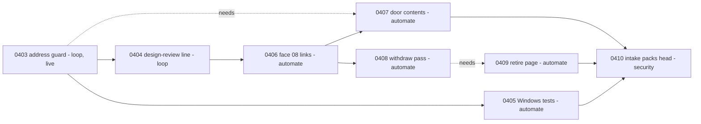
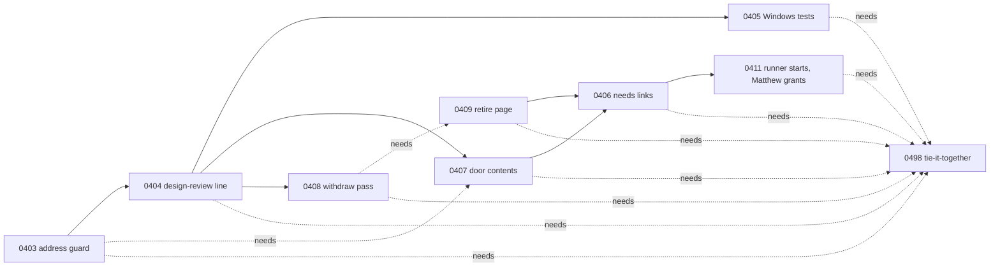

# Stage plan: WF for daily use (band 90.50.10.04xx)

Goal line (Matthew, t423u, DIRECTOR-WORDS-t423u.md:7, verbatim; spaces between sentences shortened):
"Workshop: A place models, persons, and compute work. With kanban style boards to integrate
our kernel, pages, desk, faces, seqaddr designs. So whys can be captured and reused to
strengthen over time."
Stage line: roadmap stage 1 (ROADMAP-2026-11-18.md:55) of stages 0-9 (:54-63). One stage
per band: this stage is band 0400-0499 (t423u.md:11), door 0400 (t420.md:4). Shape: loops inside loops,
measured in passes (t423u.md:13). Added in v2; see section 10.

state: draft v1 for Prima to review with Matthew. Not live. The door's next face 01
version waits for his review; no wf page was touched.
made: 2026-11-19, 1:38 PM EST, by Designer.
address: the plan belongs on the band door 90.50.10.0400 (t422.md:4).
template: docs/research/PM-DESIGN-2026-11-19.md section 10 (:157-184), with t422 answers.
axioms: 1.5.8

## 1. Stage goal, in plain words

- Goal: Matthew can hand Prima work every day, and WF carries it with few hand steps.
- Why: t401u.md:7 "lets get WF into a functional state. It doesn't have to be perfect,
  it can be glitchy, we just need I can give you work." (spaces shortened). This is
  roadmap stage 1, "WF for daily use" (ROADMAP-2026-11-18.md:55, :72).
- Done when: every page below is closed `passed`; the stage review step has run; and
  Matthew has said go, hold or redo (section 7).

Order rule: t402u.md:3 "connecting the minimum pieces required to have a loop be
completed ... then we aim for automating it, then we refine for polish and security
last." So the buckets run: loop, automate, polish, security.

## 2. What Matthew answered (t422), checked against his words

| Point | His words (DIRECTOR-WORDS-t422.md) | Relay check |
|---|---|---|
| Plan lives on the band door | :4 "Yes, the stage plan lives on the band door page" | Same |
| Needs are links on both pages | :6 "Yes, page needs are written as links on both pages" | Same. "Face 08" is not in his answer or the question (:5); it came from Researcher's proposal (PM-DESIGN:194) and wf's face table (kit docs/DESIGN.md:29) |
| Independence test | :7 question: "neither needs the other and they change no shared files"; :8 "Yes, that's the independence test; check shared reads later" | Close. The test words are the question's, which he approved. Relay said "no shared files"; his test is "change no shared files", so shared reads are allowed for now |
| Open pages | :10 "No limit on open pages" | Same. It overrides Researcher's default of 3 (PM-DESIGN:207) |
| Stage end | :12 "Yes, the stage ends with the roadmap's review step plus my go, hold or redo" | Same. The roadmap step is ROADMAP-2026-11-18.md:130 |

Also: t422.md:14 (Prima's plain words) says Researcher's defaults were approved. Q2's
default also said an unwritten need shows "unknown" and is not run in parallel
(PM-DESIGN:195). That part was not in the question he answered (t422.md:5).

## 3. Where the band stands

- 0400: door. Face 01 v2 lists the band by hand (wf-run-gh pages/90.50.10.0400/01.md:5-10).
- 0401, 0402: dropped, kept as history, never reused (DIRECTOR-RULINGS.md:129-130).
- 0403: live, the address guard, packed (pages/90.50.10.0403/05.md:4). It touches
  src/addr.rs, src/cmd.rs, src/lib.rs, tests/wf.rs (05.01/PACK.md:19).
- New pages: 0404 and up, in order, never above 0498 (seqAddr.md:323, :242; A1-A9).

## 4. The pages

Files are what each page is expected to touch, read from the wf source at
origin/returns 60dd7e25. Prime confirms them at pack time (`may touch`). Sizes are in
passes (a pass is 30-50 minutes; PM-DESIGN:79), written best/likely/worst.

### 0404  wf lint: returns state a design review (t416u)   [loop]
- Goal: a return for a pass packed on the new template must carry a line naming the
  design files the builder compared. wf refuses the return without it.
- Why: t416u.md:7 "Must be confirmed before the return is complete. We can't force it but
  we can force it to confirm it did this via our WF" (spaces shortened).
- Done when: a test shows a return with no `design review:` line is refused, naming
  t416u; a return with the line is accepted; a pass packed on the old template (0403)
  is not affected (t381u.md:8: no rule change mid pass).
- Needs: none. Waits for: 0403 to close (shared src/cmd.rs).
- Touches: templates (a new version beside templates/v3/), src/render.rs (it picks the
  template, render.rs:19-27), src/cmd.rs (`ret`, cmd.rs:462), its own test file.
- Size 1/2/3.

### 0405  tests build and run on Windows   [automate]
- Goal: `cargo test` builds on Windows. Unix-only tests are gated, and checks that use
  `true`, `grep` or `test` run there or skip with a reason.
- Why: builders work on Windows (t400u.md:7); today the builder must skip the e2e tests
  (0403 PACK.md:23). Known gap: tests/wf.rs:4 imports `std::os::unix`; wf
  docs/spec/WF-GITHUB-LOOP.md:43 lists the `true`/`grep` checks.
- Done when: `cargo test` passes on the box, and `cargo build --tests` succeeds for the
  Windows target (or a Windows builder's proof line shows it), with each skip named.
- Needs: none. Waits for: 0403 to close (shared tests/wf.rs).
- Touches: tests/wf.rs only.
- Size 2/3/5.

### 0406  needs links on face 08, both ways   [automate]
- Goal: one wf command writes "needs" on both pages' logs; `wf verify` flags a link that
  has no back-link.
- Why: t422.md:6 (links on both pages); seqAddr.md:251 "A one-way link is invalid";
  Axioms.md:27. Until it lands, Prime writes the links by hand on face 08, which wf
  already allows (cmd.rs:220). That is the manual first step (t402u.md:3).
- Done when: tests show the link appears on both pages, a one-way link is reported, and
  a link to a missing page is refused.
- Needs: none. Waits for: 0404 (shared src/cmd.rs, src/render.rs).
- Touches: src/cmd.rs, src/lib.rs, src/page.rs, src/render.rs, its own test file.
- Size 2/3/4.

### 0407  the door prints its own type and contents   [automate]
- Goal: a page ending in 00 shows `type: band` on face 00 and a contents list of the
  band's pages, built by wf from the pages folder, not written by hand.
- Why: the door's registry is hand-written today (0400/01.md:5); face00.md:141 (band
  head is `type: band`), :206 (contents is compute-only); drafting.md:40 (derived
  content is not hand-written).
- Done when: tests show a band door lists each page in its band with its state; a
  dropped page shows as dropped; a non-door page shows no list.
- Needs: 0403 (it reads `page_kind` from the new src/addr.rs). Waits for: 0406 (shared
  src/render.rs).
- Touches: src/render.rs, its own test file.
- Size 1/2/3.

### 0408  withdraw a packed pass nobody has claimed   [automate]
- Goal: Prime can withdraw a pass at `pack` with no claim. It is kept in the log as
  withdrawn, and a claim on it is refused.
- Why: 0401 and 0402 hold packed passes that can still be claimed if published
  (ADDRESS-DRIFT-t413u.md:28). Today the only guard is "never publish".
- Done when: tests show withdraw works at `pack`, is refused at `open` or later, and a
  later claim is refused; the log keeps the pass (Axioms.md:23).
- Needs: none. Waits for: 0406 (shared src/cmd.rs, src/lib.rs, src/page.rs).
- Touches: src/cmd.rs, src/lib.rs, src/page.rs, its own test file.
- Size 1/2/3.

### 0409  retire a page   [automate]
- Goal: Prime can mark a page retired with a reason. It stays on record, leaves the
  door's list of live work, and refuses new drafts.
- Why: DIRECTOR-RULINGS.md:153-154 (a linked page can only be retired). Today halt plus
  a note stands in (ADDRESS-DRIFT-t413u.md:18-19, :28).
- Done when: tests show retire works when no pass is open, is refused otherwise, and the
  page still verifies.
- Needs: 0408 (a page with a packed pass can only retire after the pass is withdrawn;
  halt is refused while a pass is open, cmd.rs:84). Waits for: 0408.
- Touches: src/cmd.rs, src/lib.rs, src/page.rs, its own test file.
- Size 1/2/3.

### 0410  intake checks the packs head   [security, last]
- Goal: `wf intake` takes a returned log only if it continues from the log published
  on the packs branch for that page.
- Why: wf docs/spec/WF-GITHUB-LOOP.md:41 "closes most of Tester's full-rewrite hole.
  t402u moved it later." t402u.md:3: security last.
- Done when: tests show a returned log that rewrites a published entry is refused, and a
  clean continuation is taken.
- Needs: none. Waits for: all pages above (security last, t402u.md:3; shared src/cmd.rs).
- Touches: src/cmd.rs (`intake`, cmd.rs:579), src/git.rs, its own test file.
- Size 2/3/5.

Polish bucket: no page planned. Polish items come from the returns' overflow lines.

Not a page: who wf records as the page starter. It is question Q1 (section 8).

Merged or split from Prima's list: "retire and withdraw" is split into 0408 and 0409
(two jobs; 0409 needs 0408). "wf lint" is kept to one check, the t416u line; a general
lint command is later work.

## 5. Needs links, both ways (write these on face 08 by hand until 0406 lands)

| Page | Needs (written on this page) | Needed by (written on the other page) |
|---|---|---|
| 0403 | none | 0407 |
| 0407 | 0403 (src/addr.rs `page_kind`) | none |
| 0408 | none | 0409 |
| 0409 | 0408 (withdraw before retire) | none |
| 0404, 0405, 0406, 0410 | none | none |
| every page | the door 0400 (band) | 0400 lists it |

## 6. Order and what can run at once

Test (t422.md:7-8): two pages run at once only if neither needs the other and they
change no shared files. Shared reads are allowed for now. No limit on open pages
(t422.md:10). wf checks file overlap only between passes on the same page
(cmd.rs:317-332), so across pages Prime checks it by hand at pack time.

Most pages edit src/cmd.rs or src/lib.rs, so most must wait their turn. Real
parallel work exists only if each new page writes its tests in its own file (Q2).

Solid arrow: waits (shared file or order). Dotted: a written need.

| Wave | Pages | Can run with | Why |
|---|---|---|---|
| 0 | 0403 | nothing new | it holds src/cmd.rs, src/lib.rs, tests/wf.rs |
| 1 | 0404, 0405 | each other | no need between them; files differ (0405 is tests/wf.rs only; 0404 uses its own test file) |
| 2 | 0406 | 0405 | 0405 changes only tests/wf.rs |
| 3 | 0407, 0408 | each other, and 0405 | 0407 is src/render.rs; 0408 is cmd.rs, lib.rs, page.rs |
| 4 | 0409 | 0407, 0405 | needs 0408 |
| 5 | 0410 | nothing | security last |

If Q2 is answered no (tests stay in tests/wf.rs), every page shares tests/wf.rs and the
whole stage runs one page at a time: 0403, 0404, 0405, 0406, 0407, 0408, 0409, 0410.

Size: 10/18/26 passes (best/likely/worst), plus 0403. The roadmap guessed 4-6 for this
stage (ROADMAP-2026-11-18.md:55), before t400u-t402u and t413u-t416u added work.

## 7. How the stage ends

1. Every page closed `passed`, each return checked by someone other than its builder
   (Axioms.md:29; ROADMAP-2026-11-18.md:128).
2. The roadmap's review step (ROADMAP-2026-11-18.md:130): "Each stage ends with a hostile
   pass, then the page halts and Matthew gets a short report." The page that halts is
   the door 0400.
3. Matthew says go, hold or redo (t422.md:12).

## 8. Open questions for Matthew

Q1. Who should wf record as the person who starts a page?
- Proposed: (default) the log names who really ran it, and names Matthew as the one who
  granted it, by a recorded words file. Other option: a build-stage allowance, Prima acts
  as him, marked build-stage.
- Why: asked at t420.md:11; his answer (:12) gave the planning flow, not this. wf
  refuses unless the starter is the person (wf src/cmd.rs:171), so every page shows
  actor `matthew`. Who gets hurt: an observer who cannot tell who acted.
- Axioms: 1 (Axioms.md:13) pass for default, tension for the other; 6 (:23) pass; 8 (:27) pass.

Q2. Should each new page put its tests in its own test file?
- Proposed: (default) yes. One page, one job, one test file, so pages that change
  different code can run at once.
- Why: his test is "change no shared files" (t422.md:7-8). Today every page would touch
  tests/wf.rs, so nothing could run at once. Same shape as "one folder per page and one
  file per face" (DIRECTOR-RULINGS.md:142). Who gets hurt: Matthew, waiting on a queue.
- Axioms: 2 (Axioms.md:15) pass, same shape at each scale; tension, small test helpers may
  be copied between files; 5 (:21) pass, a clear frame per page.

Q3. Which work counts as "novel" for the t416u design review?
- Proposed: (default) all work in Workshop, for now. Every return carries the line.
- Why: t416u.md:7 says "Novel work requires additional reviews"; t415u.md:5 says "Work
  done here is often very novel." No file says how to tell novel from routine. Who gets
  hurt: a builder who skips the review on work that only looked routine.
- Axioms: 7 (Axioms.md:25) pass, no invented test for "novel"; 9 (:29) pass; 1 (:13) pass.

Q4. Is security (0410) last in this stage, or after the whole build?
- Proposed: (default) last in this stage. Each stage keeps the same order: loop,
  automate, polish, security. Other option: move it to roadmap stage 2, "Lock the door".
- Why: t402u.md:3 "We can't secure until it's finished. That is one of the last steps to
  be completed." "It" could mean this stage or the whole build. Who gets hurt: if late,
  the rewrite hole stays open (WF-GITHUB-LOOP.md:41).
- Axioms: 2 (Axioms.md:15) pass for default; 5 (:21) tension, the frame of "finished" is unclear.

Q5. What happens to the roadmap's older stage 1 list?
- Context: ROADMAP-2026-11-18.md:73 lists `wf bench` in Rust, merges at close, halted
  state in status, observer findings in the log, and the reprint error. Three are in
  wf now (halt shows on the board, board.rs:229; `observe --record`, lib.rs HELP;
  merge at `return --push`). `wf bench` is not in the kit.
- Proposed: (default) keep the roadmap as written, and add a note that this plan is the
  newer step for stage 1, with `wf bench` moved to a later stage. Other option: add a
  `wf bench` page here.
- Why: Axioms.md:23, add a step and do not erase; t402u.md:3 puts measuring after the
  loop works. Who gets hurt: Matthew, if the roadmap and the plan say different things.
- Axioms: 6 (Axioms.md:23) pass; 2 (:15) pass; 4 (:19) pass.

## 9. Release check of this plan (RELEASE-CHECK.md @ c0e5b22)

| Item | Source file:line | Seen in this plan | Result |
|---|---|---|---|
| A1-A4 addresses | t413u.md:7, :9; seqAddr.md:320-322 | 90.50.10.0404-0410 | PASS |
| A5, A6 band 0400, door 0400 | seqAddr.md:323; t420.md:4 | section 3-4 | PASS |
| A9 not PP99, 9999 | seqAddr.md:325 | highest page 0410; cap 0498 | PASS |
| H1 page numbers | seqAddr.md:323; DIRECTOR-RULINGS.md:129-130 (0401, 0402 not reused) | next free numbers from 0404, in order | PASS |
| H1 bucket order | t402u.md:3 | loop, automate, polish, security | PASS |
| H1 one page, one job | t249u.md:9 ("one-page work"); t223u.md:8; WORK-BOOK-SPEC.md:79 (draft) | section 4 split | TENSION (no ruling says "one job per page" in those words) |
| H1 sizes in passes | PM-DESIGN:79; t400u plain words :12 (30-50 min a pass) | section 4 | PASS |
| H1 own test file per page | none yet | section 6 | TENSION (asked as Q2) |
| Plan on the door | t422.md:4 | address line | PASS (not yet written there; waits for review) |
| Needs both ways | t422.md:6; seqAddr.md:251 | section 5 | PASS |
| Independence test | t422.md:7-8 | section 6 | PASS |
| No open-page limit | t422.md:10 | section 6 | PASS |
| Stage end | t422.md:12; ROADMAP-2026-11-18.md:130 | section 7 | PASS |
| Packs on the page's own 05 | t420.md:6; seqAddr.md:324 | one 05.NN per pass per page | PASS |
| t416u gate as its own page | t416u.md:7; t381u.md:8 | 0404, not inside 0403 | PASS |
| Files touched | wf source @ 60dd7e25 | section 4 | TENSION (expected, not proven until pack) |
| Quotes from recorded files | t422, t416u, t415u, t401u, t402u, t420 | sections 1-8 | PASS |
| Axioms 1 Authority (Axioms.md:13) | plan is a proposal; Matthew decides | state line | PASS |
| Axioms 7 Missing (:25) | unknowns asked, not filled | section 8 | PASS |
| Axioms 9 Trial (:29) | Designer's own plan, no hostile pass yet | - | TENSION |
| Stage size vs roadmap | ROADMAP-2026-11-18.md:55 (4-6) | 10/18/26 | TENSION (scope grew; Q5) |

Overall verdict: no FAIL. Ready for Prima to review with Matthew. Five tensions stay:
one-job rule only in a draft, own test files (Q2), files expected not proven, no
hostile pass yet, and the stage is bigger than the roadmap guessed.

## 10. v2 note (2026-11-19, 1:41 PM EST, Designer): loops in loops, and the integration page

This note adds t423u. Sections 1-9 stay as written (Axioms.md:23); the only other change
in v2 is the goal and stage lines inserted under the title. Where they differ, this
section is the later step.

Matthew's words (DIRECTOR-WORDS-t423u.md, aeff30d), quoted exactly except double spaces:
- :3 "We have multiple loops in this as passes."
- :5 "We have our step goal, there is the highest level, in basic words what we want it to do."
- :7 the goal line, quoted at the top of this file.
- :9 "Then you have the roadmap into 9 stages I think."
- :11 "your first stage should be a book section we currently use 0400-0499 as the first
  stage band. Each piece of work to complete the first stage is designed and reviewed
  against our design documentation."
- :13 "Then the pages start to loop, until each one meets ti's MVP goals. Once each pass
  conpletes we move back it works just like a clock loops in loops in loops, we measure in passes."
- :15 "Finally a page for tying it all together into a functional piece of software I can
  use and test."

Relay check:
- Goal line: same words as :7 (only the double spaces differ).
- "Stage 1 of 1-9": the roadmap counts stages 0-9, ten rows (ROADMAP-2026-11-18.md:54-63);
  stage 0 is "Today", marked done (:54). His words say "9 stages I think" (:9). So this
  is roadmap stage 1, and his "first stage" (:11). Not "1 of 1-9".
- "One stage per band": his words name only the first stage's band (:11). "One band per
  stage" for later stages is Prima's plain words (:17), not his. Flag: later bands are not
  yet answered.
- "Door 0400": not in t423u; it comes from t420.md:4 (band head is the door).
- Integration page: :15 says "a page"; "in the band" and "INTEGRATION" are the relay's words.
  The address is not in his words.

### 10.1 The loops

| Loop | What turns | Measured by | Source |
|---|---|---|---|
| Goal | the Workshop goal line | - | t423u.md:5, :7 |
| Roadmap | stages 0-9 | stage review plus go, hold or redo | ROADMAP-2026-11-18.md:54-63, :130; t422.md:12 |
| Stage (band) | pages 0403-0410 plus integration | pages closed passed | t423u.md:11 |
| Page | passes 05.01, 05.02, ... | passes until the MVP goal is met | t423u.md:13; t420.md:6 |

Before a page's first pack, its design is reviewed against the design docs (t423u.md:11);
that is the RELEASE-CHECK.md check, done per page. Each return then states its own design
review (0404, t416u.md:7).

### 10.2 MVP goal (done-when) for every page

The MVP goal is the page's done-when; the page loops until it is met (t423u.md:13).

| Page | MVP goal (done-when) |
|---|---|
| 0403 address guard | `cargo test --lib addr` and `cargo test --test wf init_page_address` pass on the box; every old test passes with the test page at 10.10.10.0401 (0403/01.md:5) |
| 0404 design-review line | a return with no `design review:` line is refused naming t416u; with it, accepted; 0403's old-template pass unaffected |
| 0405 Windows tests | `cargo test` passes on the box; tests build for Windows, every skip named with a reason |
| 0406 face 08 links | a link shows on both pages; a one-way link is reported; a link to a missing page is refused |
| 0407 door contents | a door lists each page in its band with its state; dropped pages show dropped; a non-door page has no list |
| 0408 withdraw pass | withdraw works at `pack` with no claim, is refused at `open` or later; a later claim is refused; the log keeps the pass |
| 0409 retire page | retire works with no open pass, is refused otherwise; the page still verifies |
| 0410 intake packs head | a returned log that rewrites a published entry is refused; a clean continuation is taken |
| 0498 integration | see 10.3 |

### 10.3 0498  integration: one working WF Matthew can use and test   [tie together]
- Goal: tie the stage's pages into one working wf that Matthew can install and use on
  his Windows machine, for one real job from start to close.
- Why: t423u.md:15 "a page for tying it all together into a functional piece of software I
  can use and test." t401u.md:7 "we just need I can give you work."
- MVP goal (done-when): (1) an end-to-end test on the box runs one page through
  init-page, face 08 links, draft, pack, publish-pack, claim, return with a design review
  line, intake, check, signoff and close, plus withdraw and retire; (2) a short walk-through
  doc for Matthew, plain words, one step per line; (3) Matthew runs the walk-through on his
  machine and says it works, or names what failed (his go, hold or redo, t422.md:12).
- Needs: every page in the stage, written both ways (t422.md:6): 0403, 0404, 0405, 0406,
  0407, 0408, 0409, 0410 each list "needed by 0498", and 0498 lists all eight.
- Can run with: nothing; it needs them all.
- Touches (expected): README.md, a walk-through doc under docs/, its own test file.
- Size 1/2/4.
- Order: last of all, after 0410. t423u.md:15 says "Finally"; t402u.md:3 says security
  last among building steps. Integration builds nothing new; it ties and tests, so both
  hold. Noted as a reading, not his words.

Address: 0498 (default). Reasons:
- Not 0499: `PP99` is the band's continuation (seqAddr.md:242), and no work goes at
  `PP99` (seqAddr.md:325, section 10 rule 6). Job pages sit on NN01-NN98 (seqAddr.md:323).
- 0498 is the last job slot, so the tie-together page is last in the band however many
  pages are added before it; it never needs to move.
- Same shape in every stage band: the integration page of each band at `N?98` gives one
  slot number across bands. Pages with the same last two digits and the same title form
  a set across bands (seqAddr.md:243; DIRECTOR-RULINGS.md:71-72). That is axiom 2, the same
  shape at every scale (Axioms.md:15).
- The other pick: the next free page after the job pages (0411). It follows numbering in
  order (H1), but if the stage grows, new pages land after the integration page.
The files do not settle this, so it is question Q6.

### 10.4 Question for Matthew

Q6. Where does a stage band's integration page go?
- Proposed: (default) 0498, the last job slot, the same slot in every stage band. This is
  also my proposed answer. Other option: the next free page after the job pages (0411).
- Why: t423u.md:15 asks for a final page; seqAddr.md:242 rules out 0499; seqAddr.md:243 and
  DIRECTOR-RULINGS.md:71-72 make `N?98` a set across bands. Who gets hurt: a reader who
  looks for the integration page in a different place in every band.
- Axioms: 2 (Axioms.md:15) pass; 8 (:27) pass, links to every page both ways; 6 (:23) pass,
  0498 never moves; 7 (:25) tension, no file names an integration slot yet.

### 10.5 Updated order

Add to the diagram in section 6: every page --> 0498 (needs). Wave 6: 0498, alone.
Size with 0498: 11/20/30 passes (best/likely/worst), plus 0403.

### 10.6 Release check additions (RELEASE-CHECK.md @ c0e5b22)

| Item | Source file:line | Seen in this plan | Result |
|---|---|---|---|
| Goal line quoted exactly | t423u.md:7 | top of file | PASS (double spaces shortened, said so) |
| Stage line | ROADMAP-2026-11-18.md:54-63; t423u.md:9, :11 | top of file | PASS (relay "1 of 1-9" corrected to stages 0-9) |
| One band per stage | t423u.md:11 (first stage only) | top of file | TENSION (later bands are Prima's words, :17) |
| Each page reviewed against design docs | t423u.md:11 | 10.1 | PASS |
| Pages loop until their MVP goal | t423u.md:13 | 10.2, every page | PASS |
| Integration page | t423u.md:15 | 10.3, 0498 | PASS |
| A9 integration not at PP99 | seqAddr.md:242, :325 | 0498 | PASS |
| H1 integration address | seqAddr.md:243; DIRECTOR-RULINGS.md:71-72; Axioms.md:15 | 0498 (default) | TENSION (no file names the slot; Q6) |
| Integration links to every page, both ways | t422.md:6 | 10.3 Needs | PASS |
| Integration after security | t423u.md:15; t402u.md:3 | 10.3 Order | TENSION (a reading of two rulings) |

Overall verdict, v2: no FAIL. Ready for Prima to review with Matthew. Tensions added: later
bands per stage, the integration slot (Q6), and integration after security.

## 11. v3 (2026-11-19, 1:50 PM EST, Designer): Matthew's answers, t424

This section supersedes sections 1-10 wherever they differ. The old lines stay as
history (Axioms.md:23). state: draft v3 for Prima. Not live; no wf page touched.

### 11.1 What Matthew answered (DIRECTOR-WORDS-t424.md, f2b11ea), quoted exactly

| Q | His words | Result | Relay check |
|---|---|---|---|
| 1 starter | :6 "The real runner starts the page, I'm the granter" | default taken | Same |
| 2 tests | :8 "Yes, each page keeps its tests in its own file" | default taken | Same |
| 3 novel | :10 "All Workshop work counts as novel for now" | default taken | Same ("for now" kept) |
| 4 security | :12 "Security waits until the whole build is done" | overrides the default | Same words. "NO address in this band" and "park it as a later-stage item" are the relay's, not his; his words do not name 0410 (Prima's plain words do, :18) |
| 5 roadmap | :14 "Replace the old stage 1 list with this plan" | overrides the default | Same words. "Move bench to a named later stage" is the relay's; his words do not mention bench |
| 6 slot | :16 "The tie-it-together page goes at 0498" | default taken | Same. His phrase is "tie-it-together page"; "integration" is the relay's word (and mine in v2) |

### 11.2 Relay drifts fixed in this file (the old lines stay; read them this way)

- "face 08" (sections 4, 5, 6, 10.2): Matthew said needs are "links on both pages"
  (t422.md:6). Putting them on face 08 is Researcher's proposal (PM-DESIGN:194), which fits
  wf's face table (kit docs/DESIGN.md:29). Read every "face 08" here as that proposal.
- The independence test is "neither needs the other and they change no shared files"
  (t422.md:7, the question he approved at :8). Shared reads are allowed for now.
- The roadmap counts stages 0-9 (ROADMAP-2026-11-18.md:54-63). This is stage 1.
- "Integration" (section 10) is the relay's word. Matthew's own: "a page for tying it all
  together into a functional piece of software I can use and test" (t423u.md:15) and
  "The tie-it-together page goes at 0498" (t424.md:16). Below: "0498 tie-it-together".
- Arithmetic fix: v1's likely total was 18; the v1 pages add to 17 (section 6). v2's
  totals therefore were 11/19/30, not 11/20/30.

### 11.3 The page list, v3

| Page | Title | Bucket | Size (b/l/w) | MVP goal (done-when) |
|---|---|---|---|---|
| 0403 | address guard (live, packed) | loop | packed | as section 10.2 |
| 0404 | returns state a design review (t416u) | loop | 1/2/3 | a return on a v4 pack with no filled `design review:` line is refused naming t416u and recorded; with it, accepted; passes packed at template 1-3 (0403) print and check as before |
| 0405 | tests build and run on Windows | automate | 2/3/5 | `cargo test` passes on the box; `cargo build --tests` builds for Windows, every skip named with its reason; its own smoke test runs one loop with no unix-only call |
| 0406 | needs links on both pages | automate | 2/3/4 | as section 10.2 |
| 0407 | the door prints its own type and contents | automate | 1/2/3 | as section 10.2 |
| 0408 | withdraw a packed pass nobody claimed | automate | 1/2/3 | as section 10.2 |
| 0409 | retire a page | automate | 1/2/3 | as section 10.2 |
| 0410 | (not used; see 11.4) | - | - | - |
| 0411 | the real runner starts a page, Matthew grants it (t424 Q1) | automate | 1/2/3 | init-page with `--as` not the person needs `--grant-ref` naming a recorded words file; the init entry records runner, person and ref; without the ref it is refused; `--as` equal to `--person` works as today |
| 0498 | tie-it-together: one working wf Matthew can use and test | tie together | 1/2/4 | as section 10.3, without 0410 |

Totals: 10/18/28 passes (best/likely/worst), plus 0403. (v2: 11/19/30, corrected; minus
0410 at 2/3/5, plus 0411 at 1/2/3.)

### 11.4 0410 leaves the band; security is parked

- t424.md:12 "Security waits until the whole build is done." t402u.md:3 "We can't
  secure until it's finished."
- 0410 (intake checks the packs head) is removed from stage 1. It was never made: no
  wf page exists at 90.50.10.0410 (wf-run-gh pages/ holds 0400-0403 only).
- 0410 stays unused in this band. Why: t424.md:18 (Prima's plain words) and sections 4-10
  name "page 0410" as the packs-head check; a different job at 0410 would make those lines
  point at the wrong work (Axioms.md:23, :27). Numbers are cheap (0404-0498 hold 95 slots).
  No rule forbids reuse of a number that was never made a page; this is a choice.
- Parked at: after roadmap stage 8, "The whole Workshop" (ROADMAP-2026-11-18.md:62, :111),
  the last stage that builds; stage 9 is the celebration (:63). It gets an address in the
  band that work uses, not here. The roadmap note (ROADMAP v-note, part 2) records it.
- Open: whether t424.md:12 also moves the roadmap's other security work. See Q7.

### 11.5 Q1 as its own page (0411), not a job inside another page

- One page is one job (t249u.md:9 "I liked the one-page work design"; t223u.md:8 "in the
  pack is the jobs list"; WORK-BOOK-SPEC.md:79 "One work page is one job", a draft).
- No other page in this plan has the job of who starts a page. 0403 touches init-page, but
  it is packed and frozen: "It never changes mid pass" (t381u.md:8); t382u (:17) "Design
  never is updated during work." 0408 and 0409 touch pass and page state, not the init
  entry. Putting Q1 inside one of them gives that page two done-whens.
- What it changes: `init_page` refuses unless `--as` matches `--person` (wf src/cmd.rs:171
  @ 60dd7e25). Claim already records the real claimant (`--as`; claim, cmd.rs:413), so claim is
  not touched.
- Touches: src/cmd.rs (init_page), src/lib.rs (usage text), tests/page_0411.rs.
- Needs: none. It waits on src/cmd.rs (0403 and the others).

### 11.6 Needs links, both ways (by hand until 0406 lands)

| Page | Needs (written on this page) | Needed by (written on the other page) |
|---|---|---|
| 0403 | none | 0407, 0498 |
| 0404 | none | 0498 |
| 0405 | none | 0498 |
| 0406 | none | 0498 |
| 0407 | 0403 (src/addr.rs `page_kind`) | 0498 |
| 0408 | none | 0409, 0498 |
| 0409 | 0408 (withdraw before retire) | 0498 |
| 0411 | none | 0498 |
| 0498 | 0403, 0404, 0405, 0406, 0407, 0408, 0409, 0411 | none |
| every page | the door 0400 (band) | 0400 lists it |

0498 no longer needs 0410.

### 11.7 Files each page may change (own test file added, t424 Q2)

Read from the wf source at origin/returns 60dd7e25; line numbers move when 0403 lands, so
Prime re-reads them at pack time.

| Page | May change |
|---|---|
| 0404 | templates/v4/return.txt (new), src/render.rs, src/cmd.rs, tests/wf.rs (two hand-written return strings, :94 and :858, get the new line), tests/page_0404.rs |
| 0405 | tests/wf.rs, tests/page_0405.rs |
| 0406 | src/cmd.rs, src/lib.rs, src/page.rs, src/render.rs, tests/page_0406.rs |
| 0407 | src/render.rs, tests/page_0407.rs |
| 0408 | src/cmd.rs, src/lib.rs, src/page.rs, tests/page_0408.rs |
| 0409 | src/cmd.rs, src/lib.rs, src/page.rs, tests/page_0409.rs |
| 0411 | src/cmd.rs, src/lib.rs, tests/page_0411.rs |
| 0498 | README.md, docs/WALKTHROUGH.md (new), tests/page_0498.rs |

Why 0404 still changes tests/wf.rs: the old tests write return text by hand (tests/wf.rs:94,
:858) without the new line. New packs use template 4, so those tests would fail. Adding
one line to each string is not a new test; the new tests go in tests/page_0404.rs.

Each new test file must build on Windows: no `std::os::unix`, no `true`, `grep` or `test`
as checks (tests/wf.rs:4 is the known gap 0405 fixes). Small helpers are copied per file,
not shared; a shared helper file would be a shared changed file.

Shared changed files: src/cmd.rs (0404, 0406, 0408, 0409, 0411), src/lib.rs (0406, 0408,
0409, 0411), src/render.rs (0404, 0406, 0407), src/page.rs (0406, 0408, 0409),
tests/wf.rs (0404, 0405). src/cmd.rs is the queue: five pages, one at a time.

### 11.8 What can run at once (t422.md:7-8), after 0403 closes

| Wave | Pages | Why |
|---|---|---|
| 0 | 0403 | packed; holds src/addr.rs, src/cmd.rs, src/lib.rs, tests/wf.rs |
| 1 | 0404 alone | loop first (t402u.md:3). Every other page shares a changed file with it: 0405 tests/wf.rs, 0407 src/render.rs, the rest src/cmd.rs |
| 2 | 0405, 0407, 0408 | no needs between them; files differ (tests/wf.rs; src/render.rs; cmd.rs, lib.rs, page.rs) |
| 3 | 0409 (0405 may still run) | needs 0408; shares cmd.rs with 0406 and 0411 |
| 4 | 0406 | cmd.rs, render.rs |
| 5 | 0411 | cmd.rs |
| 6 | 0498 | needs every page |

Longest chain (likely): 0404 2, 0408 2, 0409 2, 0406 3, 0411 2, 0498 2 = 13 passes.
0405 and 0407 run beside it. If cmd.rs were split by page later, more could run at once;
that is later work, not this stage.

Solid arrow: waits for a shared changed file. Dotted: a written need.

### 11.9 How the stage ends (unchanged from section 7)

Every page closed `passed`, checked by another view; the roadmap's hostile pass and short
report (ROADMAP-2026-11-18.md:130); Matthew's go, hold or redo (t422.md:12).

### 11.10 New questions for Matthew

Q7. Does "Security waits until the whole build is done" also move the roadmap's other
security work?
- Proposed: (default) the instruction-guard items the roadmap put in stage 1
  (ROADMAP-2026-11-18.md:411, Prima's proposal: `wf audit`, the planted-trap test, pinning) park with 0410
  after the whole build, because t424.md:14 replaced the old stage 1 list. Stage 2 "Lock
  the door" (:56, :77-80) stays where it is, as the gate being the only writer, which the
  later proofs need (:79). Other option: stage 2 and the guard's stage 2-6 items (:412-415)
  also wait until after stage 8.
- Why: t424.md:11 asked "When does security work happen?" in general; the plan's question
  was about 0410. Who gets hurt: Matthew, if a stage he thinks is parked keeps running.
- Axioms: 5 Frame (Axioms.md:21) tension, the frame of "security" is not drawn; 7 (:25)
  pass, the gap is asked; 6 (:23) pass, nothing removed.

Q8. Who may record your grant in wf?
- Proposed: (default) the real runner types it, the log names the runner as actor and
  cites the recorded words file as the ref, the same shape as 0411. Other option: keep
  `wf grant` as person-only (src/cmd.rs:199) and the runner keeps acting as you there.
- Why: t424.md:6 "I'm the granter"; today wf refuses a grant unless `--as` is the person
  (cmd.rs:199), so every grant in the log shows you as actor even when Prima typed it. Who
  gets hurt: an observer who cannot tell who acted.
- Axioms: 1 (Axioms.md:13) pass, authority stays yours and the ref proves it; 8 (:27) pass;
  9 (:29) tension, the ref is checked to exist, not that you said it.
  If yes, it is one more page after 0411 (0412), or a second job for 0411; one page, one
  job says its own page.

### 11.11 Release check of v3 (RELEASE-CHECK.md @ c0e5b22)

| Item | Source file:line | Seen in v3 | Result |
|---|---|---|---|
| A1-A4, A7 addresses | t413u.md:7, :9; seqAddr.md:14, :320-322 | 90.50.10.0404-0411, 0498 | PASS |
| A5, A6 band and door | seqAddr.md:323; t420.md:4 | band 0400, door 0400 | PASS |
| A8 no override in 0001-0099 | DIRECTOR-RULINGS.md:84 | none | PASS |
| A9 not 99, PP99, 9999 | seqAddr.md:242, :325 | highest 0498 | PASS |
| H1 page numbers | seqAddr.md:323; DIRECTOR-RULINGS.md:129-130 | 0411 next after 0410; 0410 kept unused, why in 11.4 | PASS |
| H1 test file names | t424.md:8 | tests/page_NNNN.rs per page | PASS (name is my choice; any name per page fits his words) |
| H1 one page, one job | t249u.md:9; t223u.md:8; WORK-BOOK-SPEC.md:79 (draft) | 0411 own page | TENSION (rule only in a draft, as before) |
| H1 0404 bumps the template | render.rs:29 (TEMPLATE_VER), :44-49; t381u.md:8 | 11.3, 11.7 | PASS (old versions keep their text) |
| t424 Q1 | t424.md:6 | 0411 | PASS |
| t424 Q2 | t424.md:8 | 11.7 | PASS; TENSION: 0404 still edits tests/wf.rs (old strings, no new tests) |
| t424 Q3 | t424.md:10 | 0404 makes every new pack need the line | PASS |
| t424 Q4 | t424.md:12; t402u.md:3 | 11.4, 0410 out, parked after stage 8 | PASS; TENSION: scope of "security" (Q7) |
| t424 Q5 | t424.md:14 | roadmap v-note, part 2 | PASS |
| t424 Q6 | t424.md:16 | 0498 | PASS |
| t423u goal and stage lines | t423u.md:7, :9, :11 | top of file, unchanged | PASS |
| t423u pages loop to MVP goals | t423u.md:13 | 11.3 every page | PASS |
| t423u tie-it-together page | t423u.md:15 | 0498 needs all eight | PASS |
| Needs both ways | t422.md:6 | 11.6 | PASS |
| Independence test | t422.md:7-8 | 11.8 | PASS |
| t416u gate | t416u.md:7 | 0404 first | PASS |
| Files touched | wf source @ 60dd7e25 | 11.7 | TENSION (expected; line numbers move after 0403) |
| Quotes from recorded files | t424, t423u, t422, t416u, t402u, t381u, t249u, t223u | 11.1-11.10 | PASS |
| Axiom 6 Lineage (Axioms.md:23) | additions only | section 11 appended | PASS |
| Axiom 9 Trial (:29) | no hostile pass of the plan yet | - | TENSION |

Verdict, v3: no FAIL. Tensions: one-job rule only in a draft; 0404 still edits
tests/wf.rs; scope of "security" (Q7); files expected, not proven; no hostile pass yet.
